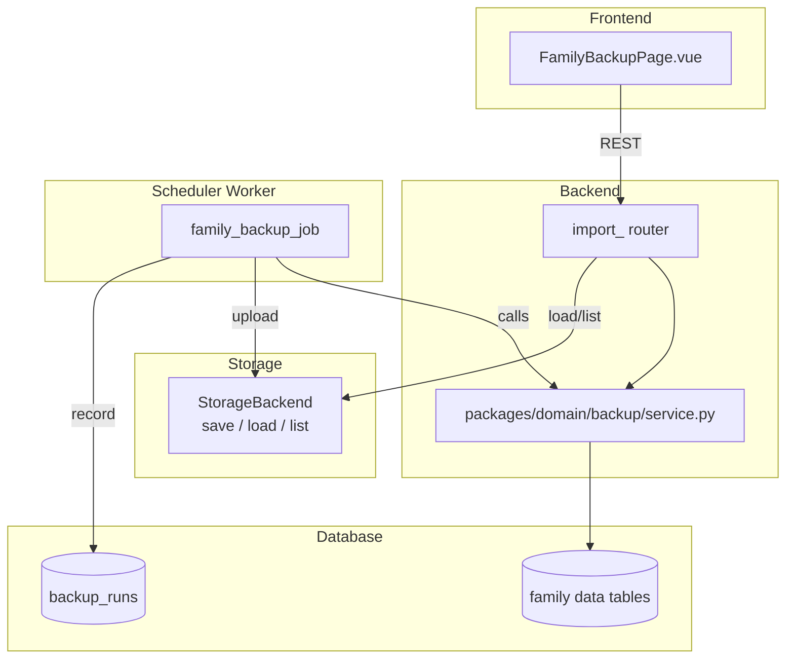
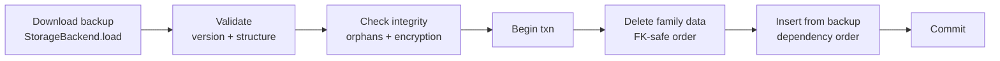
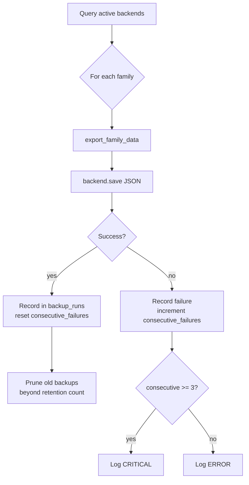

## Goal Capsule

- **Objective:** Families can automatically back up all their data to a remote storage backend and restore it end-to-end, so that volume loss or disaster recovery becomes a non-event.
- **Means:** Extend export/import to cover all family-scoped tables, add a scheduled backup job that uploads JSON to remote storage, add `StorageBackend.load()` for remote download, build a transactional restore flow, and expose a frontend entry point. Shared export/import logic lives in `packages/domain/backup/service.py` so both backend routers and the scheduler worker can call it (KTD1).
- **Product authority:** Family data portability and disaster recovery for the self-hosted Numina deployment.
- **Execution:** code — backend (export/import expansion, scheduler job, storage abstraction), frontend (restore UI). Ships as **two PRs**: PR 1 (U1–U5, backend + scheduler), PR 2 (U6, frontend).

---

## Product Contract

### Summary

End-to-end family data backup and restore: expand export/import from 4 tables to all family-scoped data, add a scheduled backup job that uploads a full JSON snapshot to the family's remote storage backend, extend the storage abstraction with `load()` so files can be pulled back, implement a transactional restore pipeline, and surface a restore entry point in the frontend settings page.

### Problem Frame

Issue #158 Phase 1 fixed the silent-failure symptoms (1MB limit, decryption warnings, retry exhaustion, rate limits). The underlying capability gap remains: the system's "backup" is file sync to GitHub — it covers uploaded images only, never DB data, has no download path, and the JSON export covers 4 of 40+ tables. A family that loses its Docker volume loses everything with no recovery path. The export/import that does exist has no transaction protection, no format versioning, and no frontend UI.

### Requirements

**A. Expand export/import coverage**

- R1. Export covers all family-scoped tables: users/children profiles, assets, liabilities, categories, tags, wishes, chores, coin transactions, milestones, rental contracts, asset snapshots, trips, itinerary items, expense entries, expense categories, cached file metadata, file remote locations, storage backend configs (redacted tokens), learning family config, learning progress/stats/sessions, notification channels, notification configs, reminders, reminder notifications, and AI provider configs (encrypted payload preserved as-is).
- R1a. A backup that exceeds the storage backend's upload size limit fails visibly rather than silently: the job checks the serialized payload size before upload, records the failure in `backup_runs` (R28) with an explicit "backup too large" message naming the measured size and the backend's limit, and logs at ERROR. The GitHub backend rejects payloads above 750 KB (`_MAX_CONTENT_BYTES` in `server/packages/storage/github.py`), which a large family's full export can reach.
- R2. Import handles every section the export produces, with the same table set.
- R3. Import runs inside a single database transaction — partial failure rolls back completely, leaving the existing data untouched.
- R4. Export format version bumps to `"2.0"`. Import accepts both `"1.0"` and `"2.0"`. The version is checked before any write; an unknown major version is rejected with a clear error.
- R5. Category matching during import uses a composite key: `(name, asset_type)` for custom categories. If the composite key matches, the existing category is reused. If only `name` matches with a different `asset_type`, a new category is created. Falls back to `category_id` from the export payload only when the composite key yields no match.
- R6. Sensitive fields in the export (storage backend tokens, AI provider API keys) are exported as their encrypted blob — never decrypted. On import, the encrypted blob is restored as-is, requiring the same `STORAGE_ENCRYPTION_KEY` / `SECRET_KEY` to decrypt at runtime.
- R7. Tables not belonging to the family (system categories, currency master, exchange rates) are excluded from export and ignored on import if encountered.

**B. Automated backup job**

- R8. A new scheduler job `family_backup_job` runs per active family (families with at least one active storage backend). It produces a full JSON export (per R1) and uploads it to the family's primary remote storage backend at path `backups/{YYYYMMDD}/{HHMMSS}/numina_backup_{family_id}.json` (timestamp component allows multiple backups per day, supporting manual backup triggers).
- R9. Backup schedule is controlled by `BACKUP_INTERVAL_HOURS` (default 24). The job is idempotent — if a backup with the same `{YYYYMMDD}` date already exists and was created by the scheduler (not manual), and `overwrite_existing` is false, it skips. Manual backups (R27) always create a new file.
- R10. After upload, the job prunes backups older than `BACKUP_RETENTION_COUNT` (default 7) from the remote. Pruning deletes the oldest dated directories first.
- R11. Backup failure is logged at ERROR level with `family_id` and the backend error. It does not retry within the same run (the next scheduled run will pick it up). A family with 3 consecutive backup failures logs a CRITICAL with a human-readable summary.
- R12. The backup job never touches the agent DB (AI chat threads/messages). Agent DB backup is out of scope (see Scope Boundaries).
- R12a. All backup and restore endpoints (`POST /api/v1/import/restore`, `POST /api/v1/import/restore-files`, `GET /api/v1/import/backups`, `POST /api/v1/import/backup`) use `Depends(require_owner)` — not `require_adult`. The restore endpoint verifies `user.role == UserRole.OWNER` server-side, independent of frontend confirmation. This matches the sensitivity level of existing owner-only operations (update_member_role, remove_member).

**C. File download (StorageBackend.load)**

- R13. `StorageBackend` gains `async def load(remote_path: str) -> bytes` as an abstract method. All three backends (local, github, webdav) implement it.
- R14. `GitHubStorageBackend.load()` uses the raw content download URL (`/repos/{owner}/{repo}/contents/{path}?ref={branch}`) with `Accept: application/vnd.github.raw+octet-stream`. It handles 404 as `FileNotFoundError` and 413/422 as `StorageFileSizeError` (though downloads should not hit the upload limit).
- R15. `LocalStorageBackend.load()` reads from the local path. Missing file raises `FileNotFoundError`.
- R16. `WebDAVStorageBackend.load()` issues a GET against the WebDAV URL. 404 raises `FileNotFoundError`.
- R17. The new method follows the same error hierarchy: network failures raise `StorageConnectionError`, auth failures raise `StorageAuthError`, rate limits raise `StorageRateLimitError`.
- R17a. `StorageBackend` gains `async def list(prefix: str) -> list[dict]` as an abstract method. All three backends implement it: GitHub uses `GET /repos/{owner}/{repo}/contents/{path}?ref={branch}` to list directory contents, Local uses `os.listdir()` with path filtering, WebDAV uses `PROPFIND`. Returns list of dicts with keys: `path`, `size`, `last_modified`. R23 and R18 both consume it — it is what makes a backup discoverable from remote storage alone, after the database that held `backup_runs` is gone.

**D. Restore flow**

- R18. A new endpoint `POST /api/v1/import/restore` accepts a JSON backup payload, a `backup_run_id`, or a `backup_date`. A client-supplied `backup_date` must match `^\d{8}$` before use; any other value is rejected with a validation error, so no client input can contribute a path component. The backend resolves the remote path server-side: with a `backup_run_id` it uses the recorded `file_path` from `backup_runs` (R28); with a `backup_date` it lists `backups/{backup_date}/` via `StorageBackend.list()` (R17a) and selects the newest `numina_backup_{family_id}.json`, which supplies the `{HHMMSS}` segment the client never sends. The authenticated user's `family_id` is always used, never a client-supplied one. The endpoint validates payload structure, version, and referential integrity before any write.
- R19. Validation checks: (a) `export_version` is a known version, (b) required top-level keys are present, (c) no orphan references — a reference is valid only when its target appears in the export payload or is a system row outside family scope (`family_id IS NULL`, e.g. seeded categories); a reference satisfied only by an existing family-scoped row is invalid, because R20 deletes those before inserting, (d) snowflake IDs are consistent across related records, (e) encrypted blobs can be decrypted with the current `STORAGE_ENCRYPTION_KEY` / `SECRET_KEY` — if decryption fails, the restore is rejected with error "备份中的加密数据无法使用当前密钥解密，请确认 STORAGE_ENCRYPTION_KEY 未更改".
- R20. Restore operates in full-replacement mode: it deletes all family-scoped data for the target family, then inserts from the backup. Restored records preserve their original snowflake IDs from the backup — since cross-family restore is out of scope and all existing records are deleted first, ID conflicts cannot occur. References with a resolution rule are remapped to the rows actually inserted: `category_id` is resolved through R5's composite key against the export's own category entries, and asset tag links through the export's tag entries by name. References with no resolution rule (e.g. `linked_asset_id`) are used as-is from the payload. This is wrapped in a single transaction (covers R3).
- R21. Before executing the destructive delete, the endpoint returns a preview response (when called with `?dry_run=true`): counts of records that would be deleted and inserted per table, plus the backup's `export_date` and `export_version`.
- R22. A separate endpoint `POST /api/v1/import/restore-files` triggers file re-download: it lists all `file_remote_location` rows with `sync_status="synced"`, calls `StorageBackend.load()` for each, writes the content to the local `UPLOAD_DIR`, and rebuilds `cached_files` rows. This is a background job that reports progress via a task ID. Progress is queryable via `GET /api/v1/import/restore-files/{task_id}` returning `{status: "running"|"completed"|"failed"|"partial_success", files_completed: int, files_total: int, files_failed: int}`. Partial failures (some files succeed, others fail) return `partial_success` with the failed file list.
- R23. `GET /api/v1/import/backups` lists available backups: remote storage is the authoritative source, because `backup_runs` is lost along with the database in the very disaster this feature exists for. It uses `StorageBackend.list("backups/")` (R17a) to scan the `backups/` prefix and returns dates, file sizes, and whether the backup can be restored (version check), joined with `backup_runs` metadata (status, trigger type) where a matching `file_path` exists. Results are paginated (most recent 30 first, with `limit` and `offset` query parameters).
- R27. `POST /api/v1/import/backup` triggers an immediate manual backup. It generates the full JSON export (per R1), uploads to `backups/{YYYYMMDD}/{HHMMSS}/numina_backup_{family_id}.json`, and returns the backup metadata (date, size, path) synchronously. This endpoint always creates a new backup file regardless of whether a scheduled backup already exists for today. Guarded by `require_owner` (R12a).
- R28. The backup job records its result after each run: `family_id`, `backup_date`, `file_path`, `file_size`, `status` (success/failed), `error_message` (if failed), `consecutive_failures` count. This is stored in a `backup_runs` table (or equivalent queryable location) so the backend can serve R24(a) ("last backup date and status") without remote API calls. The consecutive failure counter persists across scheduler restarts and resets to 0 on success.

**E. Frontend restore UI**

- R24. A new "备份与恢复" tab in the family settings page (adult-only). It shows: (a) last backup date and status, (b) list of available remote backups (from R23), (c) a "手动备份" button that triggers an immediate backup, (d) a "恢复" button per backup that shows the dry-run preview (R21) before confirming.
- R25. Restore confirmation displays: number of records per table that will be replaced, the backup date, and a warning that this action is irreversible. The user must type the family name to confirm (same pattern as family deletion).
- R26. After restore is triggered, a progress indicator shows the restore status. On completion, the user is prompted to also restore files (R22) if any `cached_files` are missing locally.

### Key Decisions

- **JSON over pg_dump for backup format** (session-settled: user-approved — chosen over pg_dump: works across SQLite and PostgreSQL, reuses existing export serialization code, human-readable and diffable, does not require filesystem access to the DB container). Governs R1, R8, R18.
- **Full-replacement restore for v1** (session-settled: user-approved — chosen over selective restore: simpler semantics, matches user expectation of "restore everything", avoids complex merge logic between existing and restored data). Governs R20, R21, R25.
- **Backup job in scheduler_worker** (session-settled: user-approved — chosen over backend cron: reuses existing scheduler infrastructure, shares the storage backend factory, follows the established job pattern from file_sync_job). Governs R8, R9, R10, R11.
- **Encrypted blobs for sensitive fields** (session-settled: user-approved — chosen over decrypt-then-reencrypt: avoids exposing API keys in backup JSON, preserves the existing encryption boundary, restore requires the same key — which is the correct security property). Governs R6, R19.
- **Owner-only access for backup/restore endpoints** — all new endpoints use `require_owner` (not `require_adult`), matching the sensitivity of destructive operations. Governs R12a, R18, R22, R23, R27.
- **Snowflake ID preservation during restore** — restored records keep their original IDs from the backup; safe because cross-family restore is out of scope and all existing records are deleted first. Governs R20.
- **Timestamped backup paths** — backup path includes `{HHMMSS}` component to allow multiple backups per day (manual + scheduled). Governs R8, R9, R27.

<!-- ce-section: work-relationships -->
### How This Work Fits Together

This plan covers the full backup-restore pipeline as one coherent unit. The five requirement groups are not independently shippable — A without B has no automation, B without C/D has no restore path, D without E has no user-facing entry point.

- **A (expand export/import)** — foundation; every other group depends on the expanded data coverage.
- **B (automated backup)** — depends on A for the export payload shape.
- **C (file download)** — independent of A/B/D in code (storage abstraction), but needed by E for the "restore files" prompt.
- **D (restore flow)** — depends on A (import logic) + B (backup location convention) + C (file re-download).
- **E (frontend UI)** — depends on D (restore endpoints) + B (backup listing).

### Actors

- A1. **Family owner (adult)** — the only role authorized to trigger backup and restore. Sees the backup list, initiates restore, confirms with family name.
- A2. **scheduler_worker** — runs the backup job on schedule, produces the JSON payload, uploads to remote storage, prunes old backups.
- A3. **StorageBackend** — the remote storage abstraction (local / github / webdav). Receives backup uploads (R8), serves backup downloads (R23), serves file re-downloads (R22).

### Key Flows

- F1. **Scheduled backup**
  - **Trigger:** scheduler fires `family_backup_job` every `BACKUP_INTERVAL_HOURS`.
  - **Actors:** A2, A3
  - **Steps:** For each family with an active storage backend: (1) generate full JSON export per R1, (2) upload to `backups/{YYYYMMDD}/{HHMMSS}/numina_backup_{family_id}.json`, (3) record result in `backup_runs` table (R28), (4) prune oldest backups beyond `BACKUP_RETENTION_COUNT`, (5) log success or failure.
  - **Outcome:** Remote storage contains up to N dated backup directories per family.

- F2. **Manual backup trigger**
  - **Trigger:** Family owner clicks "手动备份" in settings.
  - **Actors:** A1, A2, A3
  - **Steps:** (1) Frontend calls `POST /api/v1/import/backup` (R27), (2) backend generates and uploads immediately, (3) response returns the backup metadata (date, size, path).
  - **Outcome:** A new backup appears in the list within seconds.

- F3. **Restore from remote backup**
  - **Trigger:** Family owner selects a backup and clicks "恢复".
  - **Actors:** A1, A3
  - **Steps:** (1) Frontend calls `POST /api/v1/import/restore?dry_run=true` with the selected `backup_run_id` to get the preview, (2) shows record counts per table + warning, (3) user types family name to confirm, (4) frontend calls `POST /api/v1/import/restore` with the same `backup_run_id` (without dry_run), (5) backend resolves the remote path server-side per R18 — from the recorded `file_path`, or by listing the date prefix and taking the newest — and downloads via `StorageBackend.load()`, (6) validates structure and integrity (R19), (7) begins transaction, deletes all family-scoped data, inserts from backup, commits, (8) prompts user to also restore files if cached_files are missing locally.
  - **Outcome:** Family data is fully restored. User can optionally trigger file re-download.

- F4. **File re-download**
  - **Trigger:** After a data restore, user accepts the prompt to restore files; or user manually triggers from settings.
  - **Actors:** A1, A2, A3
  - **Steps:** (1) Frontend calls `POST /api/v1/import/restore-files`, (2) backend enqueues a background task, (3) for each synced file_remote_location, calls `StorageBackend.load(remote_path)`, writes to `UPLOAD_DIR`, rebuilds `cached_files`, (4) progress is tracked via task ID.
  - **Outcome:** All previously synced files are present locally again.

### Acceptance Examples

- AE1. **Export version migration**
  - **Covers R4.**
  - **Given:** A backup exported with `export_version: "1.0"` (the old 4-table format).
  - **When:** The user imports it.
  - **Then:** Import succeeds, populating assets/liabilities/categories/tags. Fields introduced in 2.0 (wishes, chores, etc.) are simply absent — no error.

- AE2. **Unknown major version rejected**
  - **Covers R4.**
  - **Given:** A backup with `export_version: "3.0"` (a future version).
  - **When:** The user attempts to import it.
  - **Then:** Import is rejected with error `"不支持的备份版本: 3.0，当前支持: 1.0, 2.0"`. No data is written.

- AE3. **Restore dry-run preview**
  - **Covers R21.**
  - **Given:** A family with 42 assets, 7 liabilities, 3 wishes, and a remote backup from 2026-10-28 containing 38 assets, 5 liabilities, 1 wish.
  - **When:** The user requests `?dry_run=true` for that backup.
  - **Then:** Response shows: `{"delete": {"assets": 42, "liabilities": 7, "wishes": 3, ...}, "insert": {"assets": 38, "liabilities": 5, "wishes": 1, ...}, "backup_date": "2026-10-28", "export_version": "2.0"}`.

- AE4. **Backup failure does not cascade**
  - **Covers R11.**
  - **Given:** A family whose storage backend token has been revoked (401).
  - **When:** The backup job runs.
  - **Then:** That family's backup is logged at ERROR with `family_id` and `"GitHub 认证失败: 401"`. Other families' backups proceed normally. After 3 consecutive failures for the same family, a CRITICAL log entry is emitted.

- AE5. **Transaction rollback on partial import failure**
  - **Covers R3.**
  - **Given:** A backup with a valid assets section but a liabilities section referencing a nonexistent currency code.
  - **When:** Import is executed.
  - **Then:** Validation (R19) catches the orphan reference before any write. Import is rejected. Existing data is untouched.

### Scope Boundaries

**Deferred for later:**
- AI chat threads/messages backup — stored in agent DB (separate Supabase instance); requires separate backup strategy targeting the agent database.
- Skill SKILL.md file backup — these live in `DATA_ROOT` filesystem, not in DB; they are deployment-level artifacts, not family data.
- Selective restore (restore only specific tables) — v1 is full-replacement only; selective restore can be added later as an extension of the existing preview mechanism.
- Point-in-time restore (choose a specific timestamp) — v1 supports choosing a backup by date; sub-daily granularity is deferred.
- Cross-family restore (restore family A's backup into family B) — out of scope; restore always targets the authenticated family.

**Outside this product's identity:**
- Full database-level disaster recovery (pg_dump / WAL archiving / replica) — this is infrastructure, not application-level backup. The JSON backup complements but does not replace infra-level DR.
- End-to-end encryption of backup payloads at rest — backups inherit the remote storage's security model (e.g., GitHub repo privacy). Adding a separate encryption layer is a future enhancement.

### Dependencies / Assumptions

- **Assumes** the family has at least one active, correctly configured storage backend for automated backups to work (R8). Without one, the backup job skips the family silently (logged at DEBUG).
- **Assumes** `STORAGE_ENCRYPTION_KEY` / `SECRET_KEY` is stable across restores — if the key changes, encrypted blobs in the backup (AI provider configs, storage backend tokens) cannot be decrypted after restore.
- **Depends on** the existing `StorageBackend.save()` working correctly (Phase 1 fixes in issue #158 are a prerequisite for R8).
- **Depends on** the scheduler_worker having network access to both the backend DB and the remote storage endpoint.

---

## Planning Contract

### Key Technical Decisions

KTD1. **Shared export/import logic in `packages/domain/backup/`** — Both backend routers and the scheduler worker need the same export serialization. Putting it in `packages/domain/backup/service.py` follows the established cross-app sharing pattern (scheduler already imports from `packages/domain/` for audit, notification, snapshot services). The functions are pure Python operating on a DB session — no FastAPI dependency.

KTD2. **Export format v2.0 is a superset of v1.0** — All v1.0 keys (`assets`, `liabilities`, `categories`, `tags`) retain their exact shape. New keys are additive. Import checks `export_version` and processes only the keys that exist, so v1.0 imports continue to work unchanged.

KTD3. **Snowflake IDs as strings in export JSON** — The export converts all `int` ID fields (`id`, `family_id`, `user_id`, `category_id`, `linked_asset_id`, etc.) to strings, matching the existing `SnowflakeBase` serialization pattern. On import, they're converted back to `int` before ORM insertion. This prevents precision loss if the JSON is ever loaded by JS tooling.

KTD4. **Restore deletes in FK-safe order, inserts in dependency order** — Full-replacement restore deletes child tables first (assets, liabilities, wishes, etc.), then parent tables (categories, tags, users). Insertion reverses: parents first, then children. All within a single transaction with `SAVEPOINT` for rollback safety.

KTD5. **File re-download as backend background task** — Uses `asyncio.create_task()` with an in-memory progress dict keyed by task ID. Follows the existing pattern from other background operations. Not a scheduler job because it's user-triggered and needs per-task progress tracking.

### High-Level Technical Design

**Restore pipeline:**

**Backup scheduler flow (per family):**

---

## Implementation Units

### PR 1: Backend + Scheduler (U1–U5)

`Waits on:` nothing — this is the first PR.

### U1. Backup runs model + Alembic migration

- **Goal:** Add the `backup_runs` table to track backup history and consecutive failure counts.
- **Requirements:** R28
- **Dependencies:** none
- **Files:**
  - `server/packages/db/models/backup_run.py` (create)
  - `server/apps/backend/alembic/versions/xxxx_add_backup_runs.py` (create)
  - `server/packages/db/models/__init__.py` (modify — register model)
  - `server/tests/packages/db/test_backup_run_model.py` (create)
- **Approach:**
  1. Create `BackupRun` model with fields: `id` (BigInteger PK, snowflake), `family_id` (BigInteger FK → families), `backup_date` (String YYYYMMDD), `file_path` (String), `file_size` (BigInteger nullable), `status` (String: success/failed), `error_message` (Text nullable), `consecutive_failures` (Integer default 0), `trigger_type` (String: scheduled/manual), `created_at` (UTCDateTime).
  2. Follow `StorageBackend` model pattern at `server/packages/db/models/storage_backend.py` for Base import, snowflake ID, UTCDateTime mixin.
  3. Generate Alembic migration with `alembic revision --autogenerate -m "add backup_runs table"`.
  4. Register model in `packages/db/models/__init__.py` so it's picked up by `Base.metadata`.
- **Patterns to follow:** `server/packages/db/models/storage_backend.py` (model shape), `server/packages/db/models/asset_snapshot.py` (family-scoped model with date).
- **Test scenarios:**
  - Model instantiation with all fields; defaults for nullable fields are correct.
  - `consecutive_failures` defaults to 0.
  - `family_id` FK constraint prevents orphan records.
- **Verification:** Alembic migration applies cleanly to a fresh DB. Model is importable and queryable.

---

### U2. StorageBackend load() and list() methods

- **Goal:** Add download and directory listing capabilities to the storage abstraction, enabling backup retrieval and listing.
- **Requirements:** R13, R14, R15, R16, R17, R17a
- **Dependencies:** none
- **Files:**
  - `server/packages/storage/base.py` (modify — add abstract `load`, `list`)
  - `server/packages/storage/github.py` (modify — implement `load`, `list`)
  - `server/packages/storage/local.py` (modify — implement `load`, `list`)
  - `server/packages/storage/webdav.py` (modify — implement `load`, `list`)
  - `server/tests/packages/storage/test_base.py` (modify — test abstract contract)
  - `server/tests/packages/storage/test_github_load.py` (create)
  - `server/tests/packages/storage/test_local_load.py` (create)
- **Approach:**
  1. Add `async def load(remote_path: str) -> bytes` to `StorageBackend` ABC.
  2. Add `async def list(prefix: str) -> list[dict]` to `StorageBackend` ABC. Return dicts with keys: `path`, `size`, `last_modified`.
  3. **GitHub `load()`:** `GET /repos/{owner}/{repo}/contents/{path}?ref={branch}` with `Accept: application/vnd.github.raw+octet-stream`. Map 404 → `FileNotFoundError`, 401/403 → `StorageAuthError`, transport errors → `StorageConnectionError`.
  4. **GitHub `list()`:** Same endpoint as GET (without raw accept), returns array of file metadata. Parse `size`, `path`, `last_modified` from response.
  5. **Local `load()`:** `Path(remote_path).read_bytes()` if `UPLOAD_DIR` is the base. Guard path traversal (resolve within base dir). Missing → `FileNotFoundError`.
  6. **Local `list()`:** `os.listdir()` + filter by prefix. Return `path`, `size` (via `stat()`), `last_modified` (via `mtime`).
  7. **WebDAV `load()`:** HTTP GET against the WebDAV URL. Map 404 → `FileNotFoundError`, 401 → `StorageAuthError`.
  8. **WebDAV `list()`:** `PROPFIND` with `Depth: 1`. Parse XML response for `href`, `getcontentlength`, `getlastmodified`.
- **Patterns to follow:** Existing `save()` / `delete()` error mapping in `github.py:42-109`. Path traversal guard from `file_sync_job` at `server/apps/scheduler_worker/jobs/__init__.py:189-201`.
- **Test scenarios:**
  - GitHub `load()`: 200 returns content bytes; 404 raises `FileNotFoundError`; 401 raises `StorageAuthError`; transport error raises `StorageConnectionError`.
  - GitHub `list()`: returns parsed list of `{path, size, last_modified}`; empty directory returns `[]`.
  - Local `load()`: existing file returns bytes; missing file raises `FileNotFoundError`; path traversal attempt raises `FileNotFoundError`.
  - Local `list()`: returns files matching prefix with correct metadata.
  - WebDAV `load()`: 200 returns bytes; 404 raises `FileNotFoundError`.
- **Verification:** All three backend tests pass. Abstract method contract enforced (instantiating `StorageBackend` directly fails).

---

### U3. Expanded export service

- **Goal:** Create a reusable export function covering all family-scoped tables, producing the v2.0 JSON format.
- **Requirements:** R1, R4, R6, R7
- **Dependencies:** none
- **Files:**
  - `server/packages/domain/backup/__init__.py` (create)
  - `server/packages/domain/backup/service.py` (create — `export_family_data`)
  - `server/apps/backend/app/routers/export.py` (modify — delegate to domain service, bump version)
  - `server/tests/packages/domain/test_backup_export.py` (create)
- **Approach:**
  1. Create `packages/domain/backup/` package.
  2. Implement `export_family_data(db: Session, family_id: int) -> dict` that queries all family-scoped models and returns a JSON-serializable dict.
  3. Set `export_version` to `"2.0"`, `export_date` to today's ISO date, `family_id` to the string form.
  4. Serialize all ID fields as strings (snowflake safety). Serialize dates as ISO strings. Preserve encrypted blobs as-is (never decrypt).
  5. Export sections: `users`, `children`, `assets` (with `tag_names`, matching the existing v1.0 shape), `liabilities`, `categories` (custom only, per R7), `tags`, `wishes`, `chores`, `coin_transactions`, `milestones`, `rental_contracts`, `asset_snapshots`, `trips`, `itinerary_items`, `expense_entries`, `expense_categories`, `cached_files`, `file_remote_locations`, `storage_backends` (config as encrypted blob), `learning_family_config`, `learning_progress`, `learning_stats`, `learning_sessions`, `notification_channels`, `notification_configs`, `reminders`, `reminder_notifications`, `ai_provider_configs` (encrypted api_key preserved).
  6. Update `export.py` router to call `export_family_data()` instead of inline serialization. Bump `export_version` from `"1.0"` to `"2.0"`.
  7. Expose the serialized payload size so callers can enforce R1a before upload.
- **Patterns to follow:** Existing serialization in `export.py:160-226`. Snowflake ID string conversion in `schemas/base.py` (`SnowflakeBase._convert_snowflake_ids`).
- **Test scenarios:**
  - Export produces all 28+ sections for a family with data in every table.
  - Export with no data returns empty lists for all sections, `export_version: "2.0"`.
  - All ID fields are serialized as strings.
  - Encrypted fields (storage backend config, AI provider api_key_encrypted) are preserved as-is — not decrypted.
  - System categories (family_id IS NULL) are excluded per R7.
  - Dates are ISO-formatted strings.
  - Asset tag links serialize as `tag_names`, preserving the v1.0 shape that import matches on.
  - A large family's payload reports its serialized size, so R1a's limit check can run before upload.
- **Verification:** Calling `export_family_data(db, family_id)` returns a valid dict. Round-trip: export → json.dumps → json.loads produces identical dict.

---

### U4. Expanded import service with transactional restore

- **Goal:** Create a reusable import function with version checking, composite category matching, full-replacement restore in a single transaction, and dry-run preview.
- **Requirements:** R2, R3, R4, R5, R19, R20, R21
- **Dependencies:** U3
- **Files:**
  - `server/packages/domain/backup/service.py` (modify — add `import_family_data`, `validate_backup_data`, `preview_restore`)
  - `server/apps/backend/app/routers/import_.py` (modify — delegate to domain service)
  - `server/tests/packages/domain/test_backup_import.py` (create)
- **Approach:**
  1. Implement `validate_backup_data(data: dict) -> list[str]` — checks `export_version` is known (`"1.0"` or `"2.0"`), required top-level keys present, returns list of error strings (empty = valid).
  2. Implement `import_family_data(db: Session, family_id: int, user_id: int, data: dict) -> dict` — the full import:
     - Validate version (R4). Reject unknown major versions with Chinese error.
     - Wrap everything in a single transaction (R3). Use `db.flush()` between insert phases rather than intermediate commits, so the whole restore stays atomic.
     - Delete existing family data in FK-safe order: child tables first (assets, liabilities, wishes, chores, coin_transactions, milestones, rental_contracts, asset_snapshots, itinerary_items, expense_entries, cached_files, file_remote_locations, learning_progress, learning_stats, learning_sessions, reminder_notifications, reminders, notification_configs, notification_channels, ai_provider_configs), then parent tables (tags, categories, users/children). Rows outside family scope (`family_id IS NULL`) are untouched.
     - Insert categories first (R5: composite key matching `(name, asset_type)` for custom categories; fall back to `category_id` only when no match).
     - Insert tags.
     - Insert remaining tables, remapping category references (R5) and tag links (by name) to the inserted rows per R20. Snowflake IDs are preserved; references with no resolution rule are used as-is.
     - For v1.0 imports: only process sections present in the data; missing sections are skipped.
     - Return stats dict (counts per table).
  3. Implement `preview_restore(db: Session, family_id: int, data: dict) -> dict` — without writing, compute delete/insert counts per table, return `{delete: {...}, insert: {...}, backup_date, export_version}`.
  4. Update `import_.py` router to call `import_family_data()` instead of inline logic. Add validation and error handling.
- **Patterns to follow:** Existing import logic in `import_.py:23-139` (category/tag matching, asset/liability creation). Transaction pattern from SQLAlchemy docs (session.commit/rollback).
- **Execution note:** Implement test-first — write a failing test for transaction rollback on invalid data (R3, AE5), then make it pass. The delete-order and insert-order logic is the highest-risk part.
- **Test scenarios:**
  - Covers AE1: v1.0 import succeeds, populates only the 4 original tables.
  - Covers AE2: v3.0 import rejected with `"不支持的备份版本: 3.0，当前支持: 1.0, 2.0"`.
  - Covers AE5: invalid data (orphan reference) triggers rollback — existing data untouched.
  - Covers R5: category composite key `(name, asset_type)` matches correctly; name-only match with different `asset_type` creates new category.
  - Full round-trip: export → import produces identical data (all snowflake IDs preserved).
  - Category and tag references resolve to the rows inserted by this restore, not to pre-existing rows that the delete removed.
  - `preview_restore` returns correct counts without modifying DB.
  - R6: encrypted blobs pass through import unchanged.
- **Verification:** Round-trip test passes (export → import → verify all tables match). Transaction rollback test passes (partial failure leaves existing data intact).

---

### U5. Backup/restore API endpoints + scheduler job

- **Goal:** Add the backup, restore, listing, and file-re-download endpoints; register the automated backup scheduler job.
- **Requirements:** R8, R9, R10, R11, R12a, R18, R22, R23, R27, R28
- **Dependencies:** U1, U2, U3, U4
- **Files:**
  - `server/apps/backend/app/routers/import_.py` (modify — add restore, backup, backups list, restore-files endpoints)
  - `server/apps/scheduler_worker/jobs/__init__.py` (modify — add `family_backup_job`)
  - `server/apps/scheduler_worker/scheduler.py` (modify — register job)
  - `server/packages/core/settings.py` (modify — add `BACKUP_INTERVAL_HOURS`, `BACKUP_RETENTION_COUNT`)
  - `server/tests/backend/test_backup_restore_api.py` (create)
  - `server/tests/scheduler_worker/test_family_backup_job.py` (create)
- **Approach:**
  1. **`POST /api/v1/import/backup`** (R27): requires `require_owner`. Calls `export_family_data()`, gets storage backend for family via factory, checks payload size against the backend limit (R1a), uploads to `backups/{YYYYMMDD}/{HHMMSS}/numina_backup_{family_id}.json`. Records in `backup_runs` (trigger_type="manual"). Returns `{backup_date, file_size, file_path}`.
  2. **`GET /api/v1/import/backups`** (R23): requires `require_owner`. Calls `StorageBackend.list("backups/")` for the authoritative remote inventory, joins `backup_runs` metadata by `file_path` where present, returns paginated list (most recent 30 first). Each entry: `{backup_date, backup_run_id, file_path, file_size, status, trigger_type, created_at}`.
  3. **`POST /api/v1/import/restore`** (R18, R20, R21): requires `require_owner`. Accepts `{backup_run_id}` or `{backup_date}` — validating `backup_date` against `^\d{8}$` before it reaches any path. If `?dry_run=true`, calls `preview_restore()` and returns counts without writing. Otherwise resolves the remote path per R18, calls `StorageBackend.load()`, validates (R19), calls `import_family_data()`.
  4. **`POST /api/v1/import/restore-files`** (R22): requires `require_owner`. Creates background task, iterates `file_remote_location` rows with `sync_status="synced"`, calls `StorageBackend.load()` for each, writes to `UPLOAD_DIR`. Progress tracked in memory dict by task_id.
  5. **`GET /api/v1/import/restore-files/{task_id}`** (R22): returns progress dict.
  6. **`family_backup_job`** in scheduler: follows `file_sync_job` pattern — iterates active backends, decrypts config, calls `export_family_data()`, enforces R1a's size check, uploads via `backend.save()`, records in `backup_runs`. Idempotent: skips if today's scheduled backup exists (R9). Prunes old backups beyond `BACKUP_RETENTION_COUNT` (R10). Tracks `consecutive_failures` per family (R11). Logs CRITICAL at 3 consecutive failures.
  7. **Settings:** Add `BACKUP_INTERVAL_HOURS: int = 24` and `BACKUP_RETENTION_COUNT: int = 7` to `packages/core/settings.py`.
  8. **Scheduler registration:** Add job in `scheduler.py:setup_all_jobs()` with `trigger="interval"`, `hours=settings.BACKUP_INTERVAL_HOURS`, `max_instances=1`, `coalesce=True`, `replace_existing=True`.
- **Patterns to follow:** `file_sync_job` at `server/apps/scheduler_worker/jobs/__init__.py:90-293` (family iteration, backend factory, error handling, encryption). Scheduler registration at `scheduler.py:48-59`. Auth deps at `server/apps/backend/app/auth/deps.py:619`.
- **Test scenarios:**
  - `POST /import/backup`: owner succeeds; non-owner gets 403. Returns backup metadata. Records in `backup_runs`.
  - `GET /import/backups`: returns paginated list, most recent first. Empty list for family with no backups.
  - `POST /import/restore?dry_run=true`: returns preview counts without modifying DB (AE3).
  - `POST /import/restore`: full replace — deletes existing data, inserts from backup, preserves snowflake IDs.
  - `POST /import/restore` with a malformed `backup_date` (e.g. `../../etc`) is rejected before any path is built.
  - `POST /import/restore` with a date that has several backups restores the newest one for that date.
  - `POST /import/restore` with changed encryption key: rejected with Chinese error message (R19e).
  - `POST /import/restore-files`: returns task_id; progress endpoint returns running/completed/partial_success.
  - `family_backup_job`: iterates families with active backends, skips families without. Records success/failure in `backup_runs`.
  - A payload exceeding the backend's size limit records a failed run with a "backup too large" message rather than uploading a truncated file (R1a).
  - Idempotency: second run on same day skips if scheduled backup exists.
  - Pruning: backups beyond retention count are deleted from remote.
  - Covers AE4: family with revoked token → ERROR logged, other families unaffected. 3 consecutive failures → CRITICAL logged.
- **Verification:** All API endpoints respond correctly (owner-only enforced). Scheduler job runs without error. Backup → restore round-trip via API succeeds.

---

### PR 2: Frontend UI

`Waits on:` PR 1 (merge order only — backend API must be available for frontend integration testing)

### U6. Frontend backup & restore UI

- **Goal:** Add a "备份与恢复" settings page where the family owner can view backups, trigger manual backups, and restore from a backup with confirmation.
- **Requirements:** R24, R25, R26
- **Dependencies:** U5
- **Files:**
  - `frontend/apps/main/src/pages/FamilyBackupPage.vue` (create)
  - `frontend/apps/main/src/api/backup.ts` (create — API client functions)
  - `frontend/apps/main/src/router/index.ts` (modify — add route `/settings/family/backup`)
  - `frontend/apps/main/src/pages/FamilyBackupPage.test.ts` (create)
- **Approach:**
  1. Create `FamilyBackupPage.vue` at the family settings level, following the pattern of `FamilyStorageBackendPage.vue`.
  2. Page sections: (a) last backup status banner (from `GET /import/backups` most recent), (b) "手动备份" button calling `POST /import/backup`, (c) backup list with per-row "恢复" button.
  3. Restore flow: clicking "恢复" → call `POST /import/restore?dry_run=true` → show preview (record counts per table) in a dialog → user types family name to confirm → call `POST /import/restore` without dry_run → show progress.
  4. After restore completes, check if cached_files are missing locally and prompt for file re-download (`POST /import/restore-files`).
  5. Add route `/settings/family/backup` in router, guarded by adult role check.
  6. API client: `backup.ts` with `triggerBackup()`, `listBackups()`, `previewRestore(backupRunId)`, `executeRestore(backupRunId)`, `restoreFiles()`, `getRestoreProgress(taskId)`.
  7. State handling: an empty backup list renders Vant's empty state with a prompt to create the first backup; list fetch, manual backup, and restore each show a loading state; failures surface the backend's error message with a retry path rather than a generic alert.
- **Patterns to follow:** `FamilyStorageBackendPage.vue` (settings page layout, Vant components). Existing API client patterns in `frontend/apps/main/src/api/`.
- **Test scenarios:**
  - Page renders backup list from API response.
  - Empty backup list renders the empty state with the manual-backup prompt, not a blank region.
  - A failed list fetch shows an error with a retry path; a failed backup shows the backend error and re-enables the button.
  - "手动备份" button triggers API call and refreshes list on success.
  - "恢复" button shows dry-run preview dialog with record counts.
  - Confirm requires typing family name; button disabled until name matches.
  - After restore, file re-download prompt appears if cached_files are missing.
  - Route accessible from family settings navigation.
  - Non-owner users cannot access the page (redirect or hidden).
- **Verification:** Page renders correctly in browser. Full backup → restore flow works end-to-end.

---

## Verification Contract

| Area | Command | Scope |
|------|---------|-------|
| Backend tests | `cd server && uv run pytest tests/backend/ tests/packages/domain/ -v` | U3, U4, U5 API tests |
| Storage tests | `cd server && uv run pytest tests/packages/storage/ -v` | U2 |
| Scheduler tests | `cd server && uv run pytest tests/scheduler_worker/ -v` | U5 scheduler job |
| Backend lint | `cd server && uv run ruff check apps/backend/ packages/domain/backup/` | U3, U4, U5 |
| Storage lint | `cd server && uv run ruff check packages/storage/` | U2 |
| Scheduler lint | `cd server && uv run ruff check apps/scheduler_worker/` | U5 |
| Type check | `cd server && uv run mypy packages/domain/backup/ --explicit-package-bases` | U3, U4 |
| Type check | `cd server && uv run mypy packages/storage/ --explicit-package-bases` | U2 |
| Type check | `cd server && uv run mypy apps/scheduler_worker/ --explicit-package-bases` | U5 |
| Frontend test | `cd frontend && pnpm --filter @numina/main test` | U6 |
| Frontend lint | `cd frontend && pnpm --filter @numina/main lint` | U6 |
| Alembic check | `cd server/apps/backend && uv run alembic upgrade head` | U1 |
| Round-trip | Manual: export → restore → verify data matches | U4, U5 |

---

## Definition of Done

**Global:**
- All verification commands above pass with zero failures.
- Backup → restore round-trip produces identical data (all family-scoped tables match after restore).
- Encrypted fields survive round-trip without decryption (blobs pass through unchanged).
- Non-owner users receive 403 on all new endpoints.
- Scheduler job runs without error for families with and without active backends.
- Frontend page renders and functions correctly for the owner role.
- No dead-end or experimental code from abandoned approaches remains in the diff.

**Per-unit:**

| Unit | Done when |
|------|-----------|
| U1 | Migration applies cleanly; model importable and queryable |
| U2 | All three backends pass load/list tests; abstract contract enforced |
| U3 | Export covers all 28+ table sections; round-trip serialization is lossless |
| U4 | Import accepts v1.0 and v2.0; transaction rollback works; composite category matching correct |
| U5 | All 5 endpoints respond correctly; scheduler job runs; idempotency and pruning verified |
| U6 | Page renders; backup/restore flow works end-to-end in browser; non-owner blocked |

---

## Deferred / Open Questions

Entries here are review items left for the author. They do not block implementation.

### From 2026-10-30 review

- **Backup integrity has no tamper detection** — Scope Boundaries (P1, security-lens, confidence 75)

  A compromised remote storage backend can modify a backup file undetectably, and restore will happily load the altered content; the plan's only integrity checks are structural. A SHA-256 checksum written to `backup_runs` before upload and verified after download would detect it, since the checksum lives outside the storage backend that would need to be compromised. Left open because the brainstorm placed end-to-end protection of backup payloads outside the product's identity, so adding it now changes agreed scope.

  Change: Add a `checksum` column to `backup_runs`, compute it after export, and verify it after download before restoring.

- **Restore runs inline with no timeout or progress** — R18 (P2, adversarial, confidence 75)

  A large family's full-replacement restore may run long inside a single request with no progress signal and no guard against a hung transaction, so a user cannot distinguish slow from stuck and the worker can hold a connection indefinitely. R22 got task-based progress but the data restore did not.

  Change: Decide whether restore gains task-based progress like file re-download, or stays synchronous with a documented expected duration and a transaction timeout.

- **`backup_runs` rows are never pruned** — R28 (P2, adversarial, confidence 50)

  Remote backups are pruned to `BACKUP_RETENTION_COUNT` but the database rows recording them are not, so the table grows without bound and slows the listing join. Low urgency at one row per day per family.

  Change: Prune `backup_runs` rows beyond the retention window alongside the remote prune in R10.
