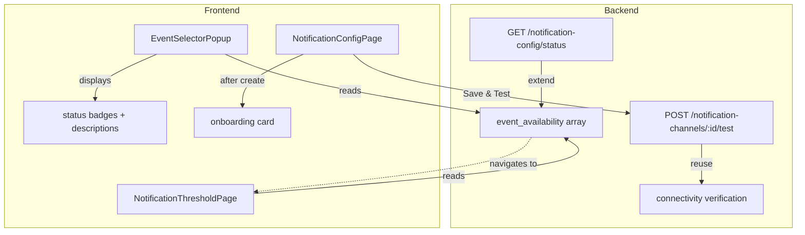

## Goal Capsule

- **Objective:** Users can see which notification events are actually triggerable given their data and configuration, get guided through next steps after creating a channel, and verify connectivity at save time — so no subscription silently never fires and no misconfigured channel goes undetected.
- **Means:** Extend the event selector with per-event status badges and trigger-condition descriptions; add a post-creation onboarding card; wire a "Save & Test" flow that reuses the existing `POST /{id}/test` endpoint.
- **Execution profile:** Single PR. All four items ship together as one cohesive UX improvement batch.
- **Stop conditions:** All R-IDs verified via tests; no regression on existing notification CRUD or dispatch flows.

---

## Product Contract

### Summary

Three coordinated UX enhancements to the notification system: (1) the event selector shows per-event trigger conditions and data-availability status so users only subscribe to events that can fire; (2) channel creation is followed by a guided onboarding card; (3) saving a channel offers an optional connectivity test with visible results.

### Problem Frame

Issue #157 identified that notification configuration is disconnected from actual data and behavior. The current branch (commit `04b2d93a`) fixed 11 of the issue's items (A1, B1–B4, C1, C2, C4, D1–D3). Four items remain:

- **A2:** Event selector shows all events identically regardless of whether the user's data can ever trigger them. A user who subscribes to `expiring_soon` but has no assets with `warranty_expiry_date` gets no feedback that the subscription is inert.
- **C5:** The event selector shows event names but not what conditions each event requires (e.g., "needs assets with expiry dates" or "requires threshold configuration"). Users cannot make informed subscription choices.
- **C3:** After creating a channel, the user gets only a success toast. No guidance to subscribe events, configure thresholds, or test — leading to channels that exist but never dispatch anything.
- **D4:** Saving a channel performs only format validation (non-empty strings, numeric chat_id). Credentials are never verified against the real service. The user discovers failures only when a real event fails to deliver.

### Requirements

**Event selector enrichment (A2 + C5)**

- R1. Each event in `EventSelectorPopup` displays a short trigger-condition description below the event label (e.g., "Triggers when assets approach warranty expiry").
- R2. Each event displays a data-availability status badge: ✅ (data/config present), ⚠️ (partially configured — needs user action), or ❌ (no data — event cannot fire).
- R3. When an event's status is ⚠️ "needs threshold", tapping the badge navigates to `/settings/notifications/threshold`.
- R4. A new backend endpoint returns per-event availability status based on the family's current data and configuration.

**Post-creation guidance (C3)**

- R5. After a new channel is created successfully, a guidance card is displayed with three steps: Subscribe events → Configure threshold (conditional) → Send test.
- R6. Each step shows its completion state (done / pending). The "Configure threshold" step appears only when the user subscribes to `large_purchase`.
- R7. Each pending step has an action button that opens the relevant dialog or navigates to the relevant page.

**Connectivity pre-check (D4)**

- R8. When saving a channel (new or existing), the user can trigger a connectivity test immediately after save. Test results (success/failure + error message) are displayed as inline feedback.
- R9. The test reuses the existing `POST /notification-channels/{id}/test` endpoint. No new backend endpoint is needed.

### Scope Boundaries

**Deferred to Follow-Up Work:**
- Event selector "Select All" filtering (only selecting triggerable events) — mentioned in #157 C5 but not required
- Draft test (testing before saving) — requires a separate `POST /test-draft` endpoint, deferred per #161 scope
- Per-channel connectivity status field (auto-populated from scheduled verification) — D4 mentions this as optional, deferred

**Out of scope:**
- Items already covered by the current branch (A1, B1–B4, C1, C2, C4, D1–D3)
- Event registry backend metadata for trigger conditions — these are static UI strings, kept in frontend i18n

---

## Planning Contract

### Key Technical Decisions

- KTD1. **Event trigger conditions in frontend i18n, not backend registry.** The trigger conditions are static descriptive text (e.g., "Requires assets with warranty expiry date"). Putting them in the backend registry couples backend code to UI-facing strings for no dynamic benefit. The backend owns data-availability queries; the frontend owns static descriptions.

- KTD2. **Extend `/notification-config/status` for event availability rather than a new endpoint.** The endpoint already returns `large_purchase` status. Extending it with an `event_availability` array avoids creating a second endpoint for related data. The frontend already calls this endpoint from `NotificationThresholdPage` and `NotificationConfigPage`.

- KTD3. **Data availability checked at family scope, not per-channel.** Whether `expiring_soon` can fire depends on whether any asset has `warranty_expiry_date` — a family-wide data question, not per-channel. The API returns family-level availability; the frontend combines it with the channel's own subscriptions to render per-event badges.

- KTD4. **Reuse `POST /{id}/test` for D4 connectivity check.** The current branch already implemented the test endpoint with full per-channel-type support. D4 needs the same behavior (verify credentials work). Adding a separate lightweight "validate only" endpoint would duplicate logic for marginal benefit. The test sends a real message, which is acceptable since the user explicitly triggers it.

- KTD5. **Post-creation guidance as inline card, not modal/popup.** A modal interrupts the user's flow; an inline card below the channel list is non-blocking and dismissible. The card reads from `featureStatus` (already fetched on mount) to determine step completion states.

### High-Level Technical Design



---

## Implementation Units

### U1. Backend: Event availability in `/notification-config/status`

**Goal:** Return per-event data-availability status so the frontend can render status badges in the event selector.

**Files:**
- `server/apps/backend/app/routers/notification_config.py` — extend `get_feature_status()`
- `server/apps/backend/app/schemas/notification_config.py` — add `EventAvailability` schema
- `server/tests/backend/test_notification_channels.py` — extend feature-status tests

**Approach:**
Add a new field `event_availability: list[EventAvailability]` to the `NotificationFeatureStatus` response. For each event type that has data prerequisites, query the family's data to determine availability:

| Event type | Condition for ✅ ready | Condition for ⚠️ needs_config | Condition for ❌ no_data |
|---|---|---|---|
| `expiring_soon` | Any non-archived asset has `warranty_expiry_date` | — | No asset has `warranty_expiry_date` |
| `maturity` | Any non-archived asset has `maturity_date` | — | No asset has `maturity_date` |
| `large_purchase` | Threshold configured | Threshold not configured | — (always available if data exists) |

All other event types return `status: "ready"` (no prerequisites).

Implementation in `get_feature_status()`:
1. Query `Asset` table for family — check existence of assets with `warranty_expiry_date IS NOT NULL` and `maturity_date IS NOT NULL` (use `EXISTS` subquery for efficiency, not full scan).
2. Reuse the existing `threshold_configured` check for `large_purchase`.
3. Build the `event_availability` list.

**Test scenarios:**
- Family with no expiry dates → `expiring_soon` status is `no_data`
- Family with expiry-dated assets → `expiring_soon` status is `ready`
- Family with maturity-dated assets → `maturity` status is `ready`
- Family with threshold configured → `large_purchase` status is `ready`
- Family without threshold → `large_purchase` status is `needs_config`
- Events without prerequisites (e.g., `ai_report_complete`) → status is `ready`

**Verification:**
```bash
cd server && uv run pytest tests/backend/test_notification_channels.py -k "feature_status or event_availability" -v
```

---

### U2. Frontend: EventSelectorPopup trigger conditions and status badges

**Goal:** Each event in the selector shows a trigger-condition description and a data-availability badge, so users can make informed subscription choices.

**Files:**
- `frontend/apps/main/src/components/notification/EventSelectorPopup.vue` — add descriptions and badges
- `frontend/apps/main/src/api/notificationChannels.ts` — add `EventAvailability` type
- `frontend/apps/main/src/i18n/locales/zh-CN.ts` — trigger condition descriptions + status labels
- `frontend/apps/main/src/i18n/locales/en-US.ts` — same

**Approach:**
1. Add new props to `EventSelectorPopup`: `eventAvailability?: EventAvailability[]` (received from parent).
2. In the event list, render each event row with the label on the first line and the trigger-condition description below it in secondary text (font-size 12px, `var(--van-text-color-2)`). The status badge is positioned to the right of the label (inline, not below). Minimum row height 56px to accommodate two-line content plus touch targets.
3. Trigger-condition description from i18n keyed by event type: `reminders.eventConditions.{eventType}`.
4. Render a status badge to the right of each event label:
   - ✅ green dot + "可触发" for `ready`
   - ⚠️ orange dot + "需配置" for `needs_config` — tappable, emits `navigate-to-threshold` event
   - ❌ gray dot + "无数据" for `no_data`
   - When `eventAvailability` is undefined (still loading), show no badges (neutral state). The parent already fetches on mount before the popup typically opens, so a loading spinner is unnecessary.
5. Parent (`NotificationConfigPage`) fetches `featureStatus` on mount and again on `onActivated` (when the page regains focus after navigating away, e.g., from the threshold page). This ensures badges reflect the latest state after the user configures a threshold and returns.
6. i18n keys for trigger conditions (static per event type):
   - `expiring_soon`: "资产接近保修到期日时触发"
   - `maturity`: "资产接近到期日时触发"
   - `large_purchase`: "消费超过配置阈值时触发"
   - AI events: "AI 任务完成后触发"
   - etc. (one key per event type in the registry)

**Test scenarios:**
- Open event selector with no data → all data-dependent events show ❌
- Open event selector with expiry-dated assets → `expiring_soon` shows ✅
- Subscribe to `large_purchase` without threshold → ⚠️ badge visible, tappable navigates to threshold page
- Event descriptions visible for all events

**Verification:** Manual UI testing on dev server.

---

### U3. Frontend: Post-creation onboarding card

**Goal:** After creating a new channel, display a guidance card that walks the user through the remaining setup steps.

**Files:**
- `frontend/apps/main/src/pages/NotificationConfigPage.vue` — add onboarding card UI
- `frontend/apps/main/src/i18n/locales/zh-CN.ts` — onboarding step labels
- `frontend/apps/main/src/i18n/locales/en-US.ts` — same

**Approach:**
1. After `saveChannel()` succeeds for a **new** channel (not edit), set `showOnboarding = true` and store the newly created channel reference.
2. Render a `van-notice-bar` or custom card below the channel list with three steps:
   - Step 1: "订阅事件" — pending if `channel.subscriptions.length === 0`, done otherwise. Action: opens edit dialog.
   - Step 2: "配置阈值" — shown only when `large_purchase` is in subscriptions AND threshold is not configured. Action: navigates to `/settings/notifications/threshold`.
   - Step 3: "发送测试" — pending if no test has been sent. Action: calls `sendTest()` (existing function from current branch).
3. Card has a close/dismiss button. Dismissing sets `showOnboarding = false`.
4. Steps update reactively as the user completes them. `featureStatus` is refetched on `onActivated` (when the page regains focus), so step-2 completion is reflected when the user returns from the threshold page — not just on initial mount.

**Test scenarios:**
- Create channel with no subscriptions → card shows all 3 steps pending
- Create channel with `large_purchase` subscribed but no threshold → step 2 visible
- Create channel with threshold already configured and events subscribed → step 2 hidden, card minimal
- Dismiss card → card disappears
- Complete step 1 (subscribe events via edit) → step 1 becomes ✅
- Navigate to threshold page via step 2, configure threshold, return → step 2 becomes ✅ (refetched on onActivated)

**Verification:** Manual UI testing on dev server.

---

### U4. Frontend: Save & Test connectivity flow

**Goal:** When saving a channel, offer a "Save & Test" option that saves and immediately verifies connectivity, with results shown inline.

**Files:**
- `frontend/apps/main/src/pages/NotificationConfigPage.vue` — add "Save & Test" button and inline result display
- `frontend/apps/main/src/i18n/locales/zh-CN.ts` — button labels + result messages
- `frontend/apps/main/src/i18n/locales/en-US.ts` — same

**Approach:**
1. In the channel edit popup footer, add a "保存并测试" button alongside the existing "保存" button.
2. On click: run the existing `saveChannel()` flow, then immediately call `sendTest()` (already implemented in current branch).
3. Display the test result as inline feedback in the popup (not just a toast):
   - Success: green banner "✅ 测试消息已发送"
   - Failure: red banner with error reason "❌ 测试失败：{reason}"
4. After the popup closes, the channel list already shows `last_delivery_status` from the current branch's status dots (C1 implementation). If the test was the first delivery, the dot updates reactively after the list refresh.
5. The existing "保存" button continues to work as before (save without test).

**Test scenarios:**
- Save & Test with valid Telegram credentials → green success banner, status dot turns green
- Save & Test with invalid bot_token → red failure banner with "chat not found" reason
- Save & Test with new webpush channel but no push subscriptions → red banner with "no subscriptions" reason
- Plain Save (without test) → no test triggered, existing behavior preserved

**Verification:** Manual UI testing on dev server.

---

## Verification Contract

| Check | Command | Applies to |
|---|---|---|
| Backend unit tests | `cd server && uv run pytest tests/backend/test_notification_channels.py -v` | U1 |
| Backend type check | `cd server && uv run mypy apps/backend/app/routers/notification_config.py` | U1 |
| Frontend build | `cd frontend && pnpm --filter main build` | U2, U3, U4 |
| Frontend type check | `cd frontend && pnpm --filter main type-check` | U2, U3, U4 |
| Digest window tests (regression) | `cd server && uv run pytest tests/scheduler_worker/test_digest_window.py -v` | All (no regression) |
| Full backend suite | `cd server && uv run pytest tests/backend/ -v` | All (no regression) |

---

## Definition of Done

- All R-IDs have corresponding test scenarios (backend tests for U1; manual UI verification for U2–U4).
- Backend tests pass: `pytest tests/backend/test_notification_channels.py` green.
- Frontend builds without TypeScript errors.
- No regression: existing notification CRUD, dispatch, digest, and test-endpoint tests all pass.
- i18n complete: all new keys present in both `zh-CN.ts` and `en-US.ts`.
- Cleanup: no dead-end experimental code, no unused imports, no commented-out blocks.
