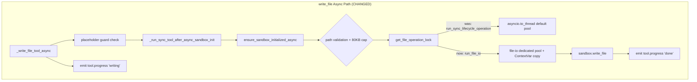

## Goal Capsule

- **Objective:** `write_file` operations run on an isolated thread pool to prevent event loop contention, and write progress events provide tool-level status updates during file writes.
- **Means:** Switch `write_file` execution from `run_sync_lifecycle_operation` (general `asyncio.to_thread`) to DeerFlow's dedicated `run_file_io` thread pool, preserving all existing validation (path validation, 80KB cap, file lock, placeholder guard). Emit `tool.progress` events via `bridge.publish` during write execution. (KTD1, KTD2)
- **Product authority:** This plan covers T16 (write_file async isolation) from issue #175. T14 (file tool parameter streaming) is deferred to a future plan after DeerFlow adds native support for `tool_call_chunks` forwarding. Other pending tasks (T18/T20/T21/T22/T23/T26) are independently scoped.
- **Execution profile:** Single PR. Ships to `main` via standard merge.
- **Product Contract preservation:** Significant change from origin brainstorm — T14 (streaming) dropped from scope after feasibility review found adapter cannot intercept `tool_call_chunks` (they are dropped inside DeerFlow before the adapter sees them). R1-R4, KD1, KTD1, U1, U2 removed. R5-R10 renumbered to R1-R6.

---

## Product Contract

### Summary

`write_file` execution switches from `run_sync_lifecycle_operation` (general `asyncio.to_thread` pool) to DeerFlow's dedicated `run_file_io` thread pool, isolating large file writes from SSE heartbeat and other async operations. All existing validation (path validation, 80KB cap, file lock, placeholder guard) is preserved. Write progress events are emitted via `bridge.publish` as `tool.progress` custom events during tool execution, providing tool-level status updates (writing → done) to the frontend.

### Problem Frame

Agent-generated reports (asset-report, finance analysis, deep-research) produce large markdown files — hundreds to thousands of lines — via `write_file`. `write_file` runs via `run_sync_lifecycle_operation` which uses `asyncio.to_thread` on the default executor pool. A large file write (up to 80KB per the existing limit) consumes a thread for the duration, potentially delaying heartbeat delivery and starving concurrent operations.

T14 (progressive rendering of file content as the LLM generates it) was investigated but found infeasible with the current architecture — DeerFlow deliberately drops `tool_call_chunks` inside `_stream_turn` (client.py:1190) before the adapter sees them, and modifying the harness to preserve them was rejected. T14 is deferred to a future plan.

### Requirements

**Async Write**

- R1. `write_file` execution uses DeerFlow's dedicated `run_file_io` thread pool instead of `run_sync_lifecycle_operation` (general `asyncio.to_thread`).
- R2. The `run_file_io` pool preserves all ContextVars (`sandbox_family_id`, `caller_user_id`, `extensions_config_path`, `numina_active_skill_name`, DeerFlow `_current_user`) — file operations resolve to the correct family sandbox.
- R3. `read_file` and `str_replace` remain on the existing `run_sync_lifecycle_operation` path. No change to their execution model.
- R4. All existing write_file validation is preserved: path validation (`validate_local_tool_path`), 80KB content cap, file operation lock (`get_file_operation_lock`), and elision placeholder rejection.

**Write Progress**

- R5. When a `write_file` tool call begins execution, a `tool.progress` custom event is emitted with the tool call's `tool_id`, status `writing`, and the target file path.
- R6. When the write completes, a `tool.progress` custom event is emitted with status `done` and the file size in bytes.

### Key Decisions

- **KD1. write_file only, not read_file or str_replace.** The user identified write_file as the sole pain point for async isolation. read_file returns small results (50KB max, typically much less) and str_replace is read-modify-write (already bounded by file size). Expanding to all file tools adds complexity without proportional benefit. (session-settled: user-directed — chosen over "all file tools async": only write_file has demonstrated pain.) Governs R1-R4.

- **KD2. Tool-level progress, not byte-level progress.** The file write is atomic (temp file + rename), so byte-level progress is not feasible. Tool-level status (writing → done) is the finest granularity achievable without modifying DeerFlow's write implementation. (session-settled: user-approved — user accepted tool-level progress after learning about atomic write constraint.) Governs R5-R6.

- **KD3. T14 deferred, not abandoned.** T14 (progressive file content rendering) requires DeerFlow to forward `tool_call_chunks` to the adapter. The current harness drops these chunks. Two paths forward: (a) submit a PR to DeerFlow upstream to add a config option for forwarding chunks, or (b) wait for DeerFlow to add this natively. T14 is deferred until one of these paths succeeds.

### How This Work Fits Together

<!-- ce-section: work-relationships -->

This plan covers the **write_file async isolation** area (T16) from issue #175. The broader breakdown is the current understanding, not a committed roadmap.

- **Write file async isolation (this plan):** T16 (write_file async pool + progress events). Can proceed independently of other areas.
- **File tool parameter streaming (deferred):** T14. Requires DeerFlow harness change. Blocked on upstream support.
- **Sandbox security upgrade:** T18 (sandbox gating) + T22 (container sandbox). Can proceed independently of this plan.
- **Chat persistence + architecture evaluation:** T21 (sync→async evaluation) → T20 (sessionStorage). T21's conclusion may affect T20's implementation. Can proceed independently of this plan.
- **Scheduled Tasks:** T23 (cron AI reports). Completely independent, no dependencies.
- **Thread Branching:** T26 (conversation forking). Already implemented; no remaining work.

### Scope Boundaries

**Deferred for later:**
- T14 (File tool parameter streaming) — requires DeerFlow harness change to forward `tool_call_chunks`; deferred per KD3
- T18 (Sandbox security gating) — separate brainstorm
- T20 (Chat sessionStorage persistence) — separate brainstorm
- T21 (Sync→Async evaluation) — separate brainstorm
- T22 (Container-level sandbox) — separate brainstorm, long-term
- T23 (Scheduled Tasks) — separate brainstorm
- read_file and str_replace async isolation — no demonstrated pain
- Byte-level write progress — infeasible with atomic write pattern

**Outside this product's identity:**
- DeerFlow harness modifications to forward `tool_call_chunks` natively — belongs in a future T14 plan with upstream PR
- aiofiles replacement for thread pool — rejected (plan uses `run_file_io` which provides dedicated pool + ContextVar propagation without requiring new dependencies)

### Dependencies / Assumptions

**Dependencies:**
- DeerFlow v2.2.0 (b3f23326) — already pinned in `HARNESS_VERSION`
- `run_file_io` utility in `deerflow/utils/file_io.py` — exists, provides dedicated thread pool with explicit `contextvars.copy_context()` propagation
- Frontend `aiEventNormalizer.ts` already handles `tool.progress` events — no frontend type changes needed for write progress

**Assumptions:**
- DeerFlow's `run_file_io` pool is sized appropriately (default `min(32, cpu_count+4)`) for concurrent file writes
- The 80KB write_file limit (enforced by DeerFlow) remains in place
- `run_file_io`'s lack of cancellation shielding is acceptable for file writes — the write is idempotent (either it completed or it didn't)

### Sources / Research

- DeerFlow `run_file_io` utility: `server/.venv/lib/python3.12/site-packages/deerflow/utils/file_io.py` — dedicated `file-io` ThreadPoolExecutor, explicit `contextvars.copy_context()`, re-entrant safety
- DeerFlow file tool: `server/.venv/lib/python3.12/site-packages/deerflow/sandbox/tools.py:3368-3478` (write_file_tool), `3465-3478` (_write_file_tool_async), `2320-2333` (_run_sync_tool_after_async_sandbox_init)
- `run_sync_lifecycle_operation`: `server/.venv/lib/python3.12/site-packages/deerflow/sandbox/lease.py:60-81` — `asyncio.to_thread` + `asyncio.shield`, no explicit ContextVar copy
- Numina sandbox provider: `server/apps/agent/services/runtime/sandbox_provider.py:175-263`
- Numina ToolProgressMiddleware: `server/apps/agent/services/runtime/tool_progress_middleware.py` — wall-clock timing, events logged but NOT forwarded to SSE
- Frontend `aiEventNormalizer.ts:196-211` — handles `tool.progress` event type
- Issue #175 (T14, T16): https://github.com/vincentruan/numina/issues/175
- Issue #168 (original task list): https://github.com/vincentruan/numina/issues/168

---

## Planning Contract

### Key Technical Decisions

KTD1. **Replace `run_sync_lifecycle_operation` with `run_file_io` inside `_write_file_tool_async`, preserving all validation.** The existing `_write_file_tool_async` (tools.py:3465) calls `_run_sync_tool_after_async_sandbox_init` → `run_sync_lifecycle_operation(func, runtime, *args)`. The fix replaces only the `run_sync_lifecycle_operation` call with `run_file_io(func, *args)`, keeping the sandbox init, path validation, 80KB cap, file lock, and placeholder guard intact. This is a surgical replacement of the thread pool, not a rewrite of the entire write path. `run_file_io` provides: dedicated `file-io` pool (isolation from default executor), explicit `contextvars.copy_context()` (sandbox_family_id preserved), re-entrant safety. The trade-off is loss of `asyncio.shield` cancellation protection — acceptable because file writes are idempotent. Governs R1-R4.

KTD2. **Write progress via ContextVar-based bridge reference, not middleware extension.** The current `ToolProgressMiddleware` (Numina) only logs events — it does not forward to SSE. Extending it to publish via bridge would require threading a bridge reference through the middleware chain. Simpler: set a ContextVar `write_progress_emitter` per-run that holds a callable publishing via `bridge.publish`. The `_write_file_tool_async` wrapper calls this emitter before and after the write. The frontend already handles `tool.progress` in `aiEventNormalizer.ts`. Governs R5-R6.

### High-Level Technical Design

---

## Implementation Units

### U1. `write_file` async path switch to `run_file_io`

- **Goal:** Switch `write_file` execution from `run_sync_lifecycle_operation` (default executor) to `run_file_io` (dedicated file-io pool with ContextVar propagation), preserving all existing validation.
- **Requirements:** R1, R2, R3, R4
- **Dependencies:** None
- **Files:**
  - `server/apps/agent/services/deerflow_adapter/sync_tool_patch.py` — add write_file-specific async override that replaces `run_sync_lifecycle_operation` with `run_file_io`
  - `tests/agent/unit/test_write_file_async.py` — NEW: verify run_file_io usage + ContextVar propagation + validation preservation
- **Approach:**
  1. In `sync_tool_patch.py`, add a new patch function `_apply_write_file_async_patch()` called from `apply_sync_tool_patches()`
  2. The patch replaces `_write_file_tool_async` with a new async function that:
     - Runs the placeholder guard check (unchanged)
     - Wraps the remaining steps in `async with sandbox_authorization_scope_async(runtime)` (unchanged — authorization gate from `_run_sync_tool_after_async_sandbox_init`, tools.py:2327)
     - Initializes the sandbox via `ensure_sandbox_initialized_async` (unchanged)
     - Performs path validation, 80KB cap check, and acquires file lock (unchanged — these happen inside `write_file_tool.func`)
     - Calls `await run_file_io(write_file_tool.func, runtime, path, content, description, append)` instead of `await run_sync_lifecycle_operation(write_file_tool.func, runtime, path, content, description, append)`
  3. The key insight: `write_file_tool.func` already contains all validation (path check, 80KB cap, file lock). We only change HOW it's executed (which thread pool), not WHAT it validates.
  4. Replicate the error wrapping from `_run_sync_tool_after_async_sandbox_init` (tools.py:2334-2337): catch `SandboxError` → `f"Error: {e}"`, catch generic `Exception` → `f"Error: Unexpected error initializing sandbox: {_sanitize_error(e, runtime)}"`. This preserves the `Error:` prefix contract the LLM relies on for tool error recovery.
  5. Verify ContextVar propagation: write a test that sets `sandbox_family_id`, calls write_file, and asserts the file lands in the correct family sandbox directory
  6. `read_file` and `str_replace` are NOT modified — they continue using `run_sync_lifecycle_operation`
- **Patterns to follow:** `run_file_io` usage in `deerflow/projects/documents.py:91` and `deerflow/agents/task_continuity/archive.py:180`
- **Test scenarios:**
  - write_file with `sandbox_family_id` set → file lands in correct family directory (ContextVar propagation)
  - write_file with invalid path → path validation error (validation preserved)
  - write_file with content > 80KB → rejection (80KB cap preserved)
  - write_file with elision placeholder → rejection (placeholder guard preserved)
  - Concurrent write_file calls use dedicated file-io pool (verify thread name prefix in logs)
  - read_file still uses `run_sync_lifecycle_operation` (unchanged)
  - str_replace still uses `run_sync_lifecycle_operation` (unchanged)
- **Verification:** Unit tests pass; `pytest tests/agent/unit/test_write_file_async.py -v`

### U2. Write progress event emission

- **Goal:** Emit `tool.progress` custom SSE events when write_file starts and completes.
- **Requirements:** R5, R6
- **Dependencies:** U1
- **Files:**
  - `server/apps/agent/services/deerflow_adapter/sync_tool_patch.py` — add progress event emission around write_file call
  - `server/apps/agent/services/deerflow_adapter/write_progress_context.py` — NEW: ContextVar for progress emitter
  - `server/apps/agent/services/runtime/run_pipeline.py` — set the ContextVar per-run to publish via `bridge.publish`
  - `tests/agent/unit/test_write_progress_events.py` — NEW: verify event emission
- **Approach:**
  1. Create `write_progress_context.py` with a ContextVar `write_progress_emitter: ContextVar[Callable | None]` and get/set helpers
  2. In `run_pipeline.py`, set the ContextVar at the start of each run to a callable that publishes via `bridge.publish(run_id, "custom", {"type": "tool.progress", ...})`
  3. In the write_file async override (from U1), import the ContextVar and call the emitter before and after the write:
     - Before: `emitter("writing", path, None, tool_id)` — `tool_id` is the LangGraph tool call ID from the active tool call metadata
     - After: `emitter("done", path, file_size, tool_id)`
     - Wrap in try/finally so `done` is emitted even on failure
  4. The emitter publishes `{"type": "tool.progress", "tool_id": tool_id, "progress_message": "Writing {path}...", "status": "writing"}` (and `"done"` with size). The `tool_id` field is required — the frontend `aiEventNormalizer.ts:197` guards on `event.tool_id && event.progress_message`, silently dropping events without it.
  5. The frontend already handles `tool.progress` events — no frontend changes needed
- **Patterns to follow:** Existing `bridge.publish` pattern in `run_pipeline.py:953`; existing `tool.progress` event schema in `aiEventNormalizer.ts:196-211`; ContextVar pattern from `active_skill_context.py`
- **Test scenarios:**
  - write_file emits `tool.progress` with status `writing` before the write
  - write_file emits `tool.progress` with status `done` and file size after the write
  - write_file failure still emits `done` event (in finally block)
  - Events are published via bridge (verifiable in test by mocking bridge)
  - No events emitted for read_file or str_replace
  - When ContextVar is not set (e.g., non-pipeline path), no error — emitter is None, skipped gracefully
- **Verification:** Unit tests pass; manual test shows progress events in SSE stream during asset-report generation

---

## Verification Contract

| Check | Command | Applies to | Pass criteria |
|-------|---------|-----------|---------------|
| Unit tests | `cd server && uv run pytest tests/agent/unit/test_write_file_async.py tests/agent/unit/test_write_progress_events.py -v` | U1, U2 | All tests pass |
| Full agent suite | `cd server && uv run pytest tests/agent/ -v` | All | 902+ tests pass (no regressions) |
| Type check | `cd server && uv run mypy apps/agent/services/deerflow_adapter/ --exclude vendor` | U1, U2 | No new errors |
| Lint | `cd server && uv run ruff check apps/agent/services/deerflow_adapter/` | U1, U2 | No errors |
| Integration smoke | `cd server && uv run pytest tests/agent/integration/ -v -k "middleware or run_event"` | All | Integration tests pass |

---

## Definition of Done

- All implementation units (U1-U2) pass their verification checks
- Full agent test suite passes with no regressions (902+ tests)
- Type check and lint pass with no new errors
- Manual smoke test: trigger asset-report generation, observe `tool.progress` events showing writing/done status in SSE stream
- `write_file` execution verified on dedicated `file-io` thread pool (thread name check in logs)
- ContextVar propagation verified: multi-family concurrent writes land in correct sandbox directories
- All existing write_file validation confirmed working: path validation, 80KB cap, file lock, placeholder guard
- No DeerFlow harness code modified — all changes in adapter layer or Numina-specific code
- Clean diff: no experimental or abandoned code left in the PR
