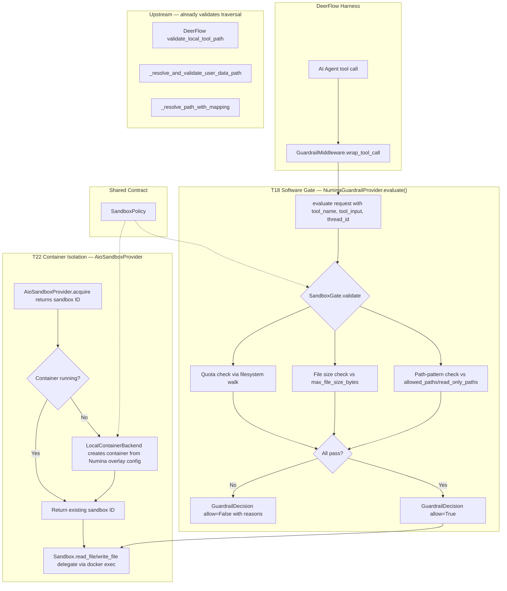

## Goal Capsule

- **Objective:** Establish two-tier sandbox security for Numina's multi-tenant AI agent — T18 implements software-level per-family policy enforcement (resource limits, path-pattern policies) with hard-block semantics on top of DeerFlow's existing traversal guard; T22 upgrades to Docker container per family (reusing DeerFlow's existing `AioSandboxProvider`) for OS-level isolation reusing T18's policy definitions as container configuration.
- **Product authority:** Agent module sandbox layer (`server/apps/agent/services/runtime/sandbox_provider.py` and `services/deerflow_adapter/`).
- **Execution profile:** Code — Python backend changes to the agent service. Two PRs: T18 (pure Python) merges first; T22 (container integration) waits on T18 merge.

---

## Product Contract

### Summary

Two-tier sandbox security progression, grounded in the actual DeerFlow harness protocol. T18 extends `NuminaGuardrailProvider` to satisfy `GuardrailProvider.evaluate(request) -> GuardrailDecision` (the real harness interface) — it enforces per-family resource limits (file size, cumulative disk quota via filesystem-derived measurement) and per-family path-pattern policies (`allowed_paths`, `read_only_paths`) on top of DeerFlow's existing upstream traversal guard. T22 reuses the existing `deerflow.community.aio_sandbox.AioSandboxProvider` + `LocalContainerBackend` with a Numina-specific configuration overlay that sets per-family mounts and derives resource limits from `SandboxPolicy`. T18 is the immediate deliverable; T22 is the follow-up hardening layer.

### Problem Frame

Numina's AI agent sandbox currently relies on three isolation mechanisms: ContextVar-based family_id path scoping (`sandbox_family_id` routes operations to `{DEER_FLOW_HOME}/users/{family_id}/...`), `NuminaGuardrailProvider` tool-level allow/deny lists, and `PolicyGuard` pre-dispatch capability checks. DeerFlow's harness already validates path traversal upstream via `validate_local_tool_path` and `LocalSandbox._resolve_path_with_mapping` (commonpath check → `PermissionError('Access denied: path escapes mounted directory')`), so raw `../../etc/passwd` traversal is caught before the sandbox gate is reached. What is **not** validated is **per-family policy**: there are no per-family resource limits (file size, total disk quota), no per-family read-only path patterns, and no per-family operation-level permission model beyond tool-level allow/deny. The existing guardrail system operates at tool granularity (tool name matching), not at operation granularity (file path patterns, resource counting, per-tenant policy). T18's additive value is therefore per-family policy enforcement on top of DeerFlow's traversal guard, not raw traversal prevention.

### Requirements

**Policy Definition**

- R1. Define a `SandboxPolicy` data structure that captures resource limits (max file size, total disk quota) and path-pattern policies (`allowed_paths`, `read_only_paths`). Container-oriented fields (`max_memory_mb`, `max_cpu_count`) are included so the schema can drive both T18 software enforcement and T22 container configuration.
- R2. `SandboxPolicy` must be per-family configurable — each family can have different limits based on their subscription tier or admin settings.
- R3. `SandboxPolicy` definitions must be reusable as T22 container configuration — the same policy schema drives both software enforcement (T18) and Docker container setup (T22 security options, cgroups limits, mount namespaces).

**Software Enforcement (T18)**

- R4. Implement a `SandboxGate` that validates file sandbox operations (`write_file`, `read_file`, `str_replace`) against the family's `SandboxPolicy` before execution.
- R5. Path-pattern violations must hard-block the operation and return a clear error to the AI agent — the agent sees the failure and can adapt its approach.
- R6. Resource limit violations (file too large, cumulative disk quota exceeded) must hard-block with a descriptive error indicating which limit was hit. Cumulative quota is computed at check time from the family's sandbox root, not from an in-memory counter.
- R7. Operation permission violations (write to read-only path) must hard-block with a clear error. (The `execute` axis is excluded from T18 because DeerFlow's `allow_host_bash: false` means no tool triggers it — `deny_execute_paths` is reserved for future enablement.)
- R8. `SandboxGate` must integrate with DeerFlow's file tool execution path via the `GuardrailProvider.evaluate(request: GuardrailRequest) -> GuardrailDecision` protocol (the actual harness interface, per `deerflow/guardrails/provider.py`). The gate runs pre-execution and receives `tool_name`, `tool_input`, and `thread_id` in the request.
- R9. Path validation must join the virtual path from `tool_input["path"]` onto the family's host sandbox root (`get_paths().host_sandbox_work_dir(thread_id, user_id=family_id)`) and check the result against `allowed_paths` patterns. Upstream DeerFlow still validates traversal (`LocalSandbox._resolve_path_with_mapping`); T18's additive value is per-family policy patterns, not raw traversal prevention.

**Container Enforcement (T22)**

- R10. Configure `AioSandboxProvider` (the existing DeerFlow container provider) with a Numina overlay that creates per-family containers with family sandbox dir mounted and policy-derived resource limits.
- R11. Each family gets a Docker container with filesystem mounted from the family's sandbox directory — cross-family access is impossible at the OS level (mount namespace isolation).
- R12. Container resource limits (CPU, memory) are derived from `SandboxPolicy` in the long term. T22's first pass uses agent-wide defaults (via `DEER_FLOW_SANDBOX_MEMORY`/`DEER_FLOW_SANDBOX_CPUS` env vars — same limits for all families); per-family limits require a follow-up that subclasses `LocalContainerBackend._start_container` to look up `policy.max_memory_mb`/`max_cpu_count`.
- R13. The Numina overlay must integrate with `AioSandboxProvider` without modifying DeerFlow's harness code.

**Integration**

- R14. T18's `SandboxGate` runs in the agent process (not inside the container) and validates operations before they reach the container — dual enforcement (software + OS) provides defense-in-depth.
- R15. Security violations must be logged with family_id, tool_name, operation_type (read/write), path, and violation reason — audit trail for security review.

### Key Decisions

- **Policy-first architecture (session-settled: user-approved — chosen over gate-first monolithic function and extend-GuardrailMiddleware approaches):** T18 defines a `SandboxPolicy` data structure and a `SandboxGate` that enforces it; T22 reuses the policy as container config. This provides clean separation between policy definition and enforcement mechanism. Governs R1, R3, R8, R12.
- **Hard-block violation semantics (session-settled: user-directed — chosen over silent-redirect and alert-only):** Policy violations hard-block the operation and return a clear error to the AI agent. Strongest security signal, may interrupt workflows but prevents silent data leakage. Governs R5, R6, R7.
- **Docker container per family via `AioSandboxProvider` reuse (session-settled: user-directed — chosen over Docker-per-run, lightweight namespace isolation, deferred T22, and building a new container provider from scratch):** Each family gets a Docker container shared across all their threads. The existing `deerflow.community.aio_sandbox.AioSandboxProvider` + `LocalContainerBackend` already handles Docker lifecycle (mount computation, idle timeout, warm pool, ownership leases, network policy). Numina's contribution is a configuration overlay that sets per-family mounts and derives resource limits from `SandboxPolicy`. Building a parallel provider was rejected because it would re-implement 211+ lines of non-trivial lifecycle code. Governs R10, R11, R12, R13.
- **Comprehensive T18 scope, narrowed to enforceable axes (session-settled: user-directed — chosen over path-boundary-only, path+resource, and path+RBAC subsets):** T18 originally scoped path boundaries + resource limits + operation RBAC + execution-time limits. After feasibility review, two axes were found unenforceable: `max_execution_time_seconds` (no post-hook exists in the guardrail protocol to time calls) and `deny_execute_paths` (DeerFlow's `allow_host_bash: false` means no tool triggers the `execute` operation). The enforceable scope is: **per-family resource limits** (file size, total disk quota via filesystem-derived measurement) + **per-family path-pattern policies** (`allowed_paths`, `read_only_paths`). Raw path traversal remains upstream's job via DeerFlow's existing `validate_local_tool_path`. Governs R1, R4, R6, R7.
- **T18 hook via actual `GuardrailProvider` protocol (corrected from prior KTD1):** The previous plan extended `NuminaGuardrailProvider.check_tool_call()`, but feasibility review (anchor 100, verified against `deerflow/guardrails/provider.py`) confirmed that the harness invokes `evaluate(request: GuardrailRequest) -> GuardrailDecision` and `aevaluate`. `check_tool_call` is never called. The re-plan replaces the provider method with the correct protocol. Governs R4, R8.
- **Unconditional gate activation (corrected from prior U6 coupling):** The previous plan coupled the sandbox gate to `ai_config["guardrails"]["enabled"]`, but the backend's `AIConfig` schema has no `guardrails` field and `_inject_guardrail()` returns early when the key is absent — the gate would have been silently inert for every family. The re-plan injects `config["guardrails"]` unconditionally so the gate activates for every family run with the default policy. Governs R4, R8.
- **Filesystem-derived quota measurement (corrected from prior KTD3 in-memory counter):** The previous plan used in-memory per-family counters keyed by `family_id`, but feasibility + security review confirmed: (a) the guardrail protocol has no post-execution hook to call `record_write`, so the counter could never increment; (b) counters reset on restart; (c) `check_write`/`record_write` are not atomic. The re-plan computes cumulative quota at check time by walking the family sandbox root (`sum(f.stat().st_size for f in root.rglob('*') if f.is_file())`), which is what the protocol can actually enforce. Governs R6.

### Key Flows

- F1. Sandbox operation validation (T18)
  - **Trigger:** AI agent calls `write_file`, `read_file`, or `str_replace` tool. DeerFlow's `GuardrailMiddleware` calls `NuminaGuardrailProvider.evaluate(request)`.
  - **Steps:** `evaluate()` extracts `tool_name` + `tool_input` + `thread_id` from the request. For file tools: (1) check `family_id` ContextVar — fail-closed via `assert_run_context_complete('SandboxGate')` if missing; (2) compute sandbox root via `get_paths().host_sandbox_work_dir(request.thread_id, user_id=get_family_sandbox_context())` — this returns the actual host filesystem path for the family's sandbox workspace; (3) join the virtual path from `tool_input["path"]` onto that root to get the host target path; (4) check `tool_input["content"]` length against `max_file_size_bytes`; (5) compute cumulative disk usage of family sandbox root, check against `max_total_quota_bytes` (best-effort — see KTD3 for TOCTOU caveat); (6) check resolved path against `read_only_paths` patterns. If any check fails → `GuardrailDecision(allow=False, reasons=[...])`. Otherwise → `GuardrailDecision(allow=True)`. The entire `evaluate()` body is wrapped in try/except mirroring the existing `check_tool_call` pattern: any exception from `assert_run_context_complete` or the validation logic is caught, logged at WARNING, and converted to `GuardrailDecision(allow=False, reasons=[...])` when `self._fail_closed` is True.
  - **Covers R4, R5, R6, R7, R8, R9.**

- F2. Container sandbox acquisition (T22)
  - **Trigger:** DeerFlow harness calls `AioSandboxProvider.acquire(thread_id, user_id)` per the standard `SandboxProvider` protocol.
  - **Steps:** `AioSandboxProvider` reads the Numina overlay config (which includes per-family mounts, image, resource limits derived from `SandboxPolicy`) → checks if family's Docker container is running (warm pool / idle timeout handled by `AioSandboxProvider`) → if not, creates container via `LocalContainerBackend` with policy-derived resource limits and mount namespace → returns sandbox ID (per `SandboxProvider.acquire()` contract) → `AioSandboxProvider.get(id)` returns a `Sandbox` whose `read_file`/`write_file` delegate via `docker exec`. Subsequent operations execute inside the container with OS-level isolation.
  - **Covers R10, R11, R12, R13.**

- F3. Policy reuse across tiers
  - **Trigger:** T22 Numina overlay configures `AioSandboxProvider` for a family.
  - **Steps:** Overlay helper reads the same `SandboxPolicy` that T18's `SandboxGate` uses → translates policy into `sandbox.environment` env-var overrides (memory/CPU limits) and `sandbox.mounts` (family sandbox root → `/sandbox`) → `AioSandboxProvider` uses the config to create/manage the container via `LocalContainerBackend` → container starts with OS-level enforcement of the policy → T18's `SandboxGate` continues to run in the agent process (not inside the container) as defense-in-depth.
  - **Covers R1, R3, R12, R14.**

<!-- ce-section: work-relationships -->
### How This Work Fits Together

This plan covers the T18→T22 sandbox security progression as one coherent work unit — T18 is the immediate software enforcement deliverable, T22 is the follow-up container isolation upgrade. They share the `SandboxPolicy` definition as the contract between tiers.

- **T18 (this plan, immediate):** Software-level `SandboxPolicy` + `SandboxGate` enforcement via the actual `GuardrailProvider` protocol. Independently deliverable and valuable — provides resource limits and per-family path-pattern policies even without T22.
- **T22 (this plan, follow-up):** Docker container per family via `AioSandboxProvider` reuse. Depends on T18's `SandboxPolicy` definitions — reuses them as container configuration. Can proceed independently after T18 is merged.
- **Related work outside this plan:** T14-T17, T20-T21, T23-T27 from issues #175/#176 are separate workstreams — they address file I/O streaming, middleware, persistence, and other agent enhancements, not sandbox security.

### Acceptance Examples

- AE1. Per-family path pattern violation
  - **Covers R5, R9.**
  - **Given:** Family A's thread t1 host sandbox workspace is `/app/.numina/data/users/family-A/threads/t1/user-data/workspace`. The LLM calls `write_file(path="workspace/report.txt", ...)`, so `tool_input["path"]` is the virtual path `"workspace/report.txt"`.
  - **When:** `evaluate()` runs. U2 joins the virtual path onto the sandbox root → host target `/app/.numina/data/users/family-A/threads/t1/user-data/workspace/report.txt`.
  - **Then:** If the family's `allowed_paths` includes that prefix → check passes → file written. If `allowed_paths` were restricted to `.../workspace/public/`, the same write → path not under allowed prefix → hard-blocked with "Path outside allowed directories".

- AE2. Resource limit enforced (file size within DeerFlow's 80KB write cap)
  - **Covers R6.**
  - **Given:** Family A's `SandboxPolicy` sets `max_file_size_bytes` to 50KB (within DeerFlow's per-call 80KB cap), total quota to 1GB.
  - **When:** AI agent calls `write_file(path="report.txt", content=<60KB data>)`.
  - **Then:** Gate extracts `tool_input["content"]` length (60KB) → exceeds 50KB policy limit → operation is hard-blocked → agent receives error "File size 60KB exceeds policy limit 50KB".

- AE3. Read-only path violation
  - **Covers R7.**
  - **Given:** Family A's `SandboxPolicy.read_only_paths` includes `/data/users/family-A/threads/t1/user-data/config/`.
  - **When:** AI agent calls `write_file(path="config/settings.json", content="new config")`.
  - **Then:** Gate checks resolved path against `read_only_paths` → write to read-only path → operation is hard-blocked → agent receives error "Write operation not permitted on read-only path".

- AE4. Container isolation (T22)
  - **Covers R11, R14.**
  - **Given:** Family A and Family B each have Docker containers (via `AioSandboxProvider`) with their sandbox dirs mounted.
  - **When:** AI agent in Family A's container attempts to read `/data/users/family-B/private.json`.
  - **Then:** OS-level mount namespace isolation prevents access → file does not exist in Family A's container filesystem → operation fails at OS level. T18's `SandboxGate` (running in the agent process) also blocks the path as outside Family A's allowed directories.

### Scope Boundaries

**Deferred to T22 follow-up or later:**

- Per-family container resource limits (memory/CPU per family) — T22's first pass uses agent-wide defaults via `DEER_FLOW_SANDBOX_MEMORY`/`DEER_FLOW_SANDBOX_CPUS` env vars (same limits for all families). Per-family limits require subclassing `LocalContainerBackend._start_container` to look up `SandboxPolicy.max_memory_mb`/`max_cpu_count` from a registry.
- Container image update/patching cadence — U8 names the pinned base image; the update policy is a separate decision.
- Container orchestration (multiple families on one host, resource scheduling) — out of scope for initial T22.
- Per-operation audit logging with structured events — R15 covers basic logging; detailed audit trail with event streaming is a separate enhancement.
- Integration with external secret management (Vault, AWS Secrets Manager) for family API keys — currently Fernet-encrypted in backend DB, not in scope for sandbox security.
- `deny_execute_paths` and `max_execution_time_seconds` — reserved for future bash enablement / post-hook availability.
- Tamper-evident audit trail (T27's `RunEventStore` hash chain) — R15 uses Python logger; routing through `RunEventStore` is a future enhancement.

**Outside this work:**

- Frontend UI for sandbox policy configuration — policies are backend-only for T18/T22; admin UI is a separate product decision.
- Cross-family file sharing or collaboration — T18/T22 enforce isolation, not sharing.
- Sandbox backup/restore — file operations happen inside the sandbox; backup is a storage-layer concern.
- Who is authorized to write `ai_config["sandbox_policy"]` — the plan assumes system-admin write access; family-facing admin endpoint authorization is a separate product decision.

### Dependencies / Assumptions

**Dependencies:**

- Docker Engine >= 20.10 must be installed and running on the host for T22. T18 has no external dependencies beyond the existing Python environment.
- `docker>=7.0.0` must be added to `[project.optional-dependencies].agent` in `server/pyproject.toml` (currently only in dev group; the agent Dockerfile excludes dev dependencies).
- DeerFlow's `AioSandboxProvider` + `LocalContainerBackend` + `GuardrailProvider` protocol must remain stable across the pinned harness version. If either changes, T18's hook or T22's overlay needs adaptation.
- Per-family `SandboxPolicy` reaches the agent via a `sandbox_policy` dict in `ai_config`. The backend's `AIConfig` schema must be extended to expose this field (or the config must be free-form dict — this is a deferred question the plan surfaces as an Open Question).

**Assumptions:**

- T18's `SandboxPolicy` schema can be designed to cover both software enforcement and container configuration without major revision.
- `AioSandboxProvider` supports the configuration overlay pattern (Numina sets per-family config via the existing DeerFlow config mechanism). If the overlay pattern is not supported, T22 needs a different integration approach.
- Docker Engine API version >= 1.41 (Docker 20.10+) for `docker-py` compatibility.
- Per-family container memory limit (default 512MB) is sufficient for typical AI agent file operations.
- The per-thread sandbox root (`get_paths().sandbox_user_data_dir(thread_id, user_id=family_id)`) is the correct boundary for per-family policy — cross-thread file access within a family is permitted.

### Sources / Research

- Issue #175 (P2 增强体验批量): T18 sandbox security gate definition.
- Issue #176 (P3 未来增强): T22 container-level sandbox evaluation.
- Current sandbox implementation: `server/apps/agent/services/runtime/sandbox_provider.py` — `NuminaLocalSandboxProvider` with ContextVar-based family_id isolation.
- Current guardrail provider: `server/apps/agent/services/deerflow_adapter/numina_guardrail_provider.py` — existing `NuminaGuardrailProvider` with `check_tool_call` method (to be replaced with `evaluate`/`aevaluate` per the actual harness protocol).
- DeerFlow guardrail protocol (anchor 100 evidence): `deerflow/guardrails/provider.py` defines `@runtime_checkable class GuardrailProvider(Protocol): def evaluate(self, request: GuardrailRequest) -> GuardrailDecision` and `async def aevaluate(...)`.
- DeerFlow container provider (anchor 100 evidence): `deerflow/community/aio_sandbox/aio_sandbox_provider.py` + `LocalContainerBackend` — 211+ lines of Docker lifecycle code including mount computation, idle timeout, warm pool, ownership leases.
- DeerFlow virtual path handling (anchor 100 evidence): `deerflow/sandbox/tools.py` (lines 1108-1116) + `deerflow/sandbox/local/local_sandbox.py` `_resolve_path_with_mapping` — translates `/mnt/user-data/...` virtual paths to host paths; `validate_local_tool_path` prevents traversal upstream.
- DeerFlow integration: `server/apps/agent/services/deerflow_adapter/family_adapter_cache.py` — `_inject_sandbox()`, `_inject_guardrail()` config injection patterns.
- DeerFlow harness constraints: `.claude/skills/deerflow-agent-dev/SKILL.md` — DeerFlow-only execution path, ContextVar propagation requirements.
- Security best practices: `docs/solutions/best-practices/security-protection.md`.

Product Contract unchanged — enriched with implementation planning below.

---

## Planning Contract

### Key Technical Decisions

KTD1. **SandboxGate satisfies the actual `GuardrailProvider` protocol.** `NuminaGuardrailProvider` is rewritten to implement `evaluate(request: GuardrailRequest) -> GuardrailDecision` and `aevaluate`, returning DeerFlow's `GuardrailDecision(allow=..., reasons=[GuardrailReason(...)])`. The provider declares the required `name`/`policy_id` attributes. The previous `check_tool_call` method is dropped — it was never invoked by the harness. Governs R4, R8.

KTD2. **`SandboxPolicy` is a Pydantic v2 model with YAML-safe defaults.** The policy uses Pydantic for validation. Default policy allows all operations within the family sandbox root with 50KB max file size (within DeerFlow's 80KB write cap), 1GB total quota, 512MB container memory, 1 CPU. The policy is serialized as a YAML-safe dict under `config["guardrails"]["provider"]["config"]["sandbox_policy"]` — not at the guardrails top level where Pydantic would silently drop it. The provider's `__init__` accepts `sandbox_policy: dict | None = None` and reconstructs `SandboxPolicy.from_config(...)` inside the provider. Governs R1, R2.

KTD3. **Cumulative quota computed at check time from filesystem (best-effort, not hard-atomic).** Instead of in-memory counters, the gate computes `sum(f.stat().st_size for f in sandbox_root.rglob("*") if f.is_file())` at each `evaluate()` call. This survives restarts and reflects deletions/overwrites — unlike counters. It is **not** atomic under concurrency: the gap between the walk and the tool write permits bounded overshoot of up to one `max_file_size_bytes` per concurrent request. This is an accepted T18 limitation; hard enforcement comes from T22's OS-level container quota. Do not cache the quota walk — caching widens the check-to-write gap. Governs R6.

KTD4. **T22 reuses `AioSandboxProvider` + `LocalContainerBackend`.** Instead of building a new provider from scratch, Numina provides a configuration overlay via `numina_container_sandbox_config(policy, family_id, sandbox_root) -> dict` that returns the container config keys `AioSandboxProvider` understands (mounts, image, memory limit, CPU, security options). The overlay is injected into `config["sandbox"]` when T22 is enabled. Governs R10, R13.

KTD5. **Two-PR delivery: T18 merges first, T22 waits on T18 merge.** T18 (software gate) and T22 (container integration) have different risk profiles. Separate PRs keep review focused. The `SandboxPolicy` schema is defined in T18's PR and reused by T22. Governs R3, R12.

### High-Level Technical Design

### Assumptions

- `GuardrailRequest` provides `tool_name`, `tool_input`, and `thread_id` — verified against `deerflow/guardrails/provider.py`. `tool_input["path"]` is the **raw virtual path** from the LLM (e.g. `"workspace/report.txt"`), because `GuardrailMiddleware` runs before the tool handler does path resolution. If the request shape changes, the gate needs adaptation.
- `get_paths().host_sandbox_work_dir(thread_id, user_id=family_id)` returns the family's host-side sandbox workspace path — verified against `worker.py:192` which uses exactly this call. This is the authoritative root for policy checks, NOT `provider.acquire()` (which returns a sandbox ID string, not a path).
- `AioSandboxProvider` accepts configuration via `SandboxConfig` fields (`image`, `mounts`, `environment`, `idle_timeout`). Per-family container resource limits are NOT config fields — they are env-var-driven inside `LocalContainerBackend`. Whether those env vars can be overridden per-family is an open blocker on U8.
- Per-family `SandboxPolicy` dict can reach the agent — either via backend `AIConfig` schema extension or via a free-form dict. This is an Open Question; T18's U6 uses the default policy until the backend path is settled.
- Agent container's bind-mount source path translation is handled by `AioSandboxProvider`'s existing `LocalContainerBackend` (which understands Docker bind mounts from the host perspective). If not, the Numina overlay must specify host-side paths — this is an Open Question.

### Sequencing

1. **T18 PR** (U1→U7): SandboxPolicy model → validators → guardrail integration via `evaluate()` → unconditional config injection → tests. Self-contained, no Docker dependency.
2. **T22 PR** (U8→U9): After T18 merge. Numina overlay for `AioSandboxProvider` → integration tests. Requires Docker Engine on host.

---

## Implementation Units

### PR A: T18 Software Gate

### U1. SandboxPolicy data model

- **Goal:** Define the `SandboxPolicy` Pydantic model that captures resource limits and path-pattern policies, with container-oriented fields for T22 reuse.
- **Requirements:** R1, R2, R3
- **Dependencies:** None
- **Files:**
  - Create `server/apps/agent/services/runtime/sandbox_policy.py`
  - Create `server/tests/agent/unit/test_sandbox_policy.py`
- **Approach:**
  1. Define `SandboxPolicy` as a Pydantic v2 `BaseModel` with fields: `allowed_paths` (list[str], optional — empty means "family sandbox root"), `read_only_paths` (list[str], default []), `max_file_size_bytes` (int, default 50KB), `max_total_quota_bytes` (int, default 1GB), `max_memory_mb` (int, default 512), `max_cpu_count` (int, default 1). Deliberately excludes `max_execution_time_seconds` and `deny_execute_paths` — not enforceable in either tier.
  2. `default_policy()` classmethod returns sensible defaults.
  3. `from_config(config: dict)` classmethod for deserialization from YAML-safe dict.
  4. `to_container_config()` method returns dict suitable for `AioSandboxProvider` overlay.
  5. Validation: all paths must be absolute; numeric limits must be positive.
- **Patterns to follow:** Pydantic v2 conventions in `server/AGENTS.md`.
- **Test scenarios:**
  - Default policy has expected values (50KB file size, 1GB quota, 512MB memory, 1 CPU).
  - `from_config()` correctly deserializes a config dict with custom values.
  - Validation rejects relative paths.
  - `to_container_config()` returns correct memory/CPU keys.
- **Verification:** `pytest server/tests/agent/unit/test_sandbox_policy.py -v` passes.

### U2. Path policy validator

- **Goal:** Implement per-family path-pattern validation: join the virtual path onto the family's host sandbox root, then check against `allowed_paths` / `read_only_paths`. NOT traversal prevention (upstream handles that).
- **Requirements:** R5, R9
- **Dependencies:** U1
- **Files:**
  - Create `server/apps/agent/services/runtime/sandbox_path_validator.py`
  - Create `server/tests/agent/unit/test_sandbox_path_validator.py`
- **Approach:**
  1. Define `validate_path_against_policy(virtual_path: str, sandbox_root: Path, policy: SandboxPolicy) -> PathPolicyResult`. The `virtual_path` is the raw path from `tool_input["path"]` (e.g. `"workspace/report.txt"`). The `sandbox_root` is the already-computed host path from U5 step 5c (`get_paths().host_sandbox_work_dir(thread_id, user_id=family_id)`).
  2. Join `virtual_path` onto `sandbox_root` to get the host target path. The virtual path is relative to the thread's workspace, so `sandbox_root / virtual_path` gives the host path.
  3. Normalize via `pathlib.Path(host_target).resolve()` to handle symlinks within the sandbox root.
  4. Check that resolved path is still relative to `sandbox_root` (defense-in-depth with upstream traversal validation).
  5. If `policy.allowed_paths` is non-empty, check the resolved path starts with at least one allowed prefix (each `allowed_paths` entry is a host-absolute prefix).
  6. If path is under any `policy.read_only_paths` prefix, mark as read-only (caller decides whether operation is write).
  7. Return `PathPolicyResult(allowed: bool, is_read_only: bool, reason: str)`.
- **Test scenarios:**
  - Path under allowed prefix → allowed.
  - Path outside allowed prefixes → blocked with "Path outside allowed directories".
  - Path under read-only prefix → marked read-only (caller decides).
  - Empty `allowed_paths` → deferred to sandbox-root check.
- **Verification:** `pytest server/tests/agent/unit/test_sandbox_path_validator.py -v` passes.

### U3. Resource limit check

- **Goal:** File size check (from `tool_input["content"]`) and cumulative disk quota check (filesystem-derived).
- **Requirements:** R6
- **Dependencies:** U1
- **Files:**
  - Create `server/apps/agent/services/runtime/sandbox_resource_check.py`
  - Create `server/tests/agent/unit/test_sandbox_resource_check.py`
- **Approach:**
  1. Define `check_file_size(content: str | bytes, policy: SandboxPolicy) -> ResourceCheckResult`.
  2. Define `check_cumulative_quota(sandbox_root: Path, policy: SandboxPolicy) -> ResourceCheckResult`. This walks the sandbox root: `sum(f.stat().st_size for f in sandbox_root.rglob("*") if f.is_file())`. Do not cache — see KTD3 for the TOCTOU caveat.
  3. Both functions return `ResourceCheckResult(allowed: bool, reason: str)`.
- **Test scenarios:**
  - Covers AE2. File size exceeding `max_file_size_bytes` → blocked with "File size X exceeds policy limit Y".
  - Cumulative quota exceeded → blocked with "Disk quota exceeded".
  - File size within limits, quota within limits → allowed.
  - Empty sandbox root → zero usage, check passes.
- **Verification:** `pytest server/tests/agent/unit/test_sandbox_resource_check.py -v` passes.

### U4. Operation permission checker

- **Goal:** Check write-vs-read-only permission per path pattern.
- **Requirements:** R7
- **Dependencies:** U1, U2
- **Files:**
  - Create `server/apps/agent/services/runtime/sandbox_permission_check.py`
  - Create `server/tests/agent/unit/test_sandbox_permission_check.py`
- **Approach:**
  1. Define `check_write_permission(host_target_path: Path, policy: SandboxPolicy) -> PermissionCheckResult`.
  2. If path is under any `policy.read_only_paths` prefix, deny.
  3. Return `PermissionCheckResult(allowed: bool, reason: str)`.
  4. Read operations are always permitted (no permission check needed).
- **Test scenarios:**
  - Covers AE3. Write to read-only path → blocked with "Write operation not permitted on read-only path".
  - Write to writable path → allowed.
  - Read from read-only path → allowed.
- **Verification:** `pytest server/tests/agent/unit/test_sandbox_permission_check.py -v` passes.

### U5. SandboxGate integration via evaluate() protocol

- **Goal:** Rewrite `NuminaGuardrailProvider` to satisfy the actual `GuardrailProvider` protocol; wire path/resource/permission checks.
- **Requirements:** R4, R5, R6, R7, R8, R9, R15
- **Dependencies:** U1, U2, U3, U4
- **Files:**
  - Modify `server/apps/agent/services/deerflow_adapter/numina_guardrail_provider.py`
  - Modify `server/tests/agent/unit/test_numina_guardrail_provider.py`
- **Approach:**
  1. Replace `check_tool_call` with `evaluate(self, request: GuardrailRequest) -> GuardrailDecision` and `async def aevaluate`. Import DeerFlow's `GuardrailDecision`, `GuardrailReason`, `GuardrailRequest` from `deerflow.guardrails.provider`.
  2. Declare required `name = "numina-sandbox-gate"` and `policy_id` attributes.
  3. `__init__(self, sandbox_policy: dict | None = None, fail_closed: bool = True)` — reconstruct `SandboxPolicy.from_config(sandbox_policy)` if dict provided, else use `SandboxPolicy.default_policy()`.
  4. In `evaluate()`: (a) check `family_id` via `get_family_sandbox_context()` — fail-closed with `assert_run_context_complete('SandboxGate')` if missing; (b) if `tool_name` not in `{write_file, read_file, str_replace}`, return `GuardrailDecision(allow=True)`; (c) compute sandbox root via `get_paths().host_sandbox_work_dir(request.thread_id, user_id=get_family_sandbox_context())` — this returns the actual host filesystem path (NOT `provider.acquire()` which returns a sandbox ID); (d) extract `path` and `content` from `request.tool_input`; (e) run path validation (U2 — which joins virtual path onto the sandbox root), file size check (U3), quota check (U3), permission check (U4); (f) on first failure return `GuardrailDecision(allow=False, reasons=[GuardrailReason(...)]);` (g) on violation log with `family_id`, `tool_name`, `operation_type`, `path`, `reason` (R15 audit trail).
  5. Wrap the entire `evaluate()` body in try/except mirroring the existing `check_tool_call` exception-handling pattern (lines 122-143 of the current provider): catch any exception from `assert_run_context_complete` or the validation logic, log at WARNING with family_id context, and return `GuardrailDecision(allow=False, reasons=[GuardrailReason(code='internal_error', message=str(e))])` when `self._fail_closed` is True. This ensures missing family_id or any unexpected exception results in deny, not a propagated RuntimeError.
- **Patterns to follow:** Existing `NuminaGuardrailProvider` structure. DeerFlow's `GuardrailDecision`/`GuardrailReason` classes. `get_logger` convention.
- **Test scenarios:**
  - `evaluate()` with file tool + valid path + within limits → `allow=True`.
  - `evaluate()` with path outside allowed prefixes → `allow=False` with reason.
  - `evaluate()` with file size exceeding limit → `allow=False`.
  - `evaluate()` with write to read-only path → `allow=False`.
  - `evaluate()` with non-file tool → `allow=True` (sandbox validation skipped).
  - `evaluate()` with missing `family_id` → `allow=False` (fail-closed).
  - `evaluate()` with malformed `sandbox_policy` dict in config → fail-closed (all operations denied until config fixed).
  - `aevaluate()` mirrors `evaluate()` behavior.
- **Verification:** `pytest server/tests/agent/unit/test_numina_guardrail_provider.py -v` passes.

### U6. Unconditional config injection

- **Goal:** Inject `config["guardrails"]` unconditionally with the sandbox gate + default policy, bypassing the missing `ai_config["guardrails"]` backend field.
- **Requirements:** R2, R8
- **Dependencies:** U1, U5
- **Files:**
  - Modify `server/apps/agent/services/deerflow_adapter/family_adapter_cache.py`
  - Modify `server/tests/agent/unit/test_family_adapter_cache.py`
- **Approach:**
  1. Add `_inject_sandbox_gate(config: dict, ai_config: dict) -> None` function.
  2. Read `ai_config.get("sandbox_policy")` as a dict. If absent or empty, use `SandboxPolicy.default_policy().model_dump()`.
  3. Set `config["guardrails"] = {"enabled": True, "provider": {"use": "apps.agent.services.deerflow_adapter.numina_guardrail_provider:NuminaGuardrailProvider", "config": {"sandbox_policy": <policy_dict>, "fail_closed": True}}}`.
  4. This is independent of the existing `_inject_guardrail()` — the sandbox gate is always on. Call `_inject_sandbox_gate()` from `EffectiveConfigBuilder.build()` after `_inject_sandbox()`.
  5. When `ai_config["sandbox_policy"]` is present but malformed, log at ERROR and fail closed (block all sandbox ops for that family) — do NOT silently fall back to default.
- **Test scenarios:**
  - `ai_config` with no `sandbox_policy` → default policy injected.
  - `ai_config` with valid `sandbox_policy` dict → custom policy injected.
  - `ai_config` with malformed `sandbox_policy` → ERROR logged, fail-closed (no fallback to default).
  - Injection happens regardless of existing `ai_config["guardrails"]` state.
- **Verification:** `pytest server/tests/agent/unit/test_family_adapter_cache.py -v` passes.

### U7. T18 integration tests

- **Goal:** End-to-end tests for the full T18 middleware chain.
- **Requirements:** R4, R5, R6, R7, R8, R9, R15
- **Dependencies:** U5, U6
- **Files:**
  - Create `server/tests/agent/integration/test_sandbox_gate_integration.py`
- **Approach:**
  1. Set up a test fixture that creates a `NuminaGuardrailProvider` with a `SandboxPolicy` and a real sandbox directory (`tmp_path`).
  2. Set `sandbox_family_id` ContextVar to a test family.
  3. Call `evaluate()` with various `GuardrailRequest` scenarios (pattern violation, resource limit, permission violation, valid operations).
  4. Verify the gate blocks/allows correctly and logs violations.
- **Execution note:** Integration test, uses real filesystem paths and ContextVar setup.
- **Test scenarios:**
  - Full chain: evaluate → path validation → file size check → quota check → permission check → allow/block.
  - Missing family_id → fail-closed (not skipped).
  - Audit log contains family_id, tool_name, operation_type, path, and violation reason.
  - Non-file tool bypasses sandbox validation.
- **Verification:** `pytest server/tests/agent/integration/test_sandbox_gate_integration.py -v` passes.

---

### PR B: T22 Container Isolation

*Waits on: PR A merge (merge order only — T22 can be built before PR A merges, but cannot merge until PR A is on the default branch).*

### U8. AioSandboxProvider Numina overlay

- **Goal:** Create a Numina configuration overlay for `AioSandboxProvider` that sets per-family container mounts, image, and resource limits from `SandboxPolicy`.
- **Requirements:** R10, R11, R12, R13
- **Dependencies:** U1 (for `SandboxPolicy` schema)
- **Files:**
  - Create `server/apps/agent/services/runtime/numina_container_overlay.py`
  - Modify `server/apps/agent/services/deerflow_adapter/family_adapter_cache.py`
  - Create `server/tests/agent/unit/test_numina_container_overlay.py`
- **Approach:**
  1. Define `numina_container_sandbox_config(policy: SandboxPolicy, family_id: str, sandbox_root: Path) -> dict[str, str]` that returns **`sandbox.environment` env-var overrides** for container-local env vars (e.g. `PYTHONDONTWRITEBYTECODE=1`) — NOT resource limits. Container resource limits are NOT settable per-family via `SandboxConfig` fields (no `mem_limit`/`cpu_count` fields exist). Resource limits are agent-global via process env vars (`DEER_FLOW_SANDBOX_MEMORY`, `DEER_FLOW_SANDBOX_CPUS`, `DEER_FLOW_SANDBOX_PIDS_LIMIT`) read at `local_backend.py:2020-2024` inside `_start_container`. For T22's first pass, the agent runs with a single default memory/CPU budget (`DEER_FLOW_SANDBOX_MEMORY=2g`, `DEER_FLOW_SANDBOX_CPUS=2` — the DeerFlow defaults); per-family limits from `SandboxPolicy.max_memory_mb`/`max_cpu_count` are deferred to a follow-up that subclasses `LocalContainerBackend._start_container`.
  2. Mount configuration: set `config["sandbox"]["mounts"]` (a real `SandboxConfig` field) to bind-mount the family's `sandbox_root` at `/sandbox`. Do NOT use `thread_data_mounts` as a mount spec — it is a `bool | None` flag controlling whether `/mnt/user-data` is already visible through shared mounts (`sandbox_config.py:324-327`).
  3. Container hardening baseline (non-negotiable): no `/var/run/docker.sock` mount, `cap_drop: ALL`, run as non-root user (UID != 0), read-only rootfs. Because `python:3.12-slim` writes bytecode, set `PYTHONDONTWRITEBYTECODE=1` and add tmpfs mounts for `/tmp` and the workspace — without these, Python operations crash with `OSError: Read-only file system` and an operator disables the hardening to restore service.
  4. Pinned base image: `python:3.12-slim`, non-root user `65532`. Image update/patching cadence stays deferred.
  5. Add `_override_sandbox_provider(config: dict, ai_config: dict) -> None` in `family_adapter_cache.py` that, when T22 is enabled (via `ai_config["sandbox"]["container_enabled"]`), sets `config["sandbox"]["use"] = "deerflow.community.aio_sandbox.aio_sandbox_provider:AioSandboxProvider"` and merges the overlay config.
  6. Source the T22 enable flag from `ai_config["sandbox"]` (not from `sandbox.container_enabled` at the top level, which `SandboxConfig` would drop as Pydantic `extra="ignore"`).
  7. Document the agent-container path translation: the overlay's `mounts` entry must use the HOST-side path (not the agent-container-internal path). This is an Open Question pending deployment topology clarification.
- **Test scenarios:**
  - `numina_container_sandbox_config()` returns env dict with memory/CPU limit vars and `PYTHONDONTWRITEBYTECODE=1`.
  - `mounts` entry uses the family sandbox root as source and `/sandbox` as target.
  - `_override_sandbox_provider()` sets `config["sandbox"]["use"]` to `AioSandboxProvider` when enabled.
  - `_override_sandbox_provider()` is a no-op when T22 is disabled.
- **Verification:** `pytest server/tests/agent/unit/test_numina_container_overlay.py -v` passes.

### U9. T22 integration tests

- **Goal:** End-to-end tests for container isolation.
- **Requirements:** R11, R14
- **Dependencies:** U8
- **Files:**
  - Create `server/tests/agent/integration/test_container_sandbox_integration.py`
- **Approach:**
  1. Test fixture: create two families with separate sandbox directories and Docker containers via `AioSandboxProvider`.
  2. Family A's container attempts to read Family B's sandbox directory → must fail (mount namespace isolation).
  3. Family A's `SandboxGate` (running in agent process) also blocks paths outside Family A's allowed directories (dual enforcement, R14).
  4. Verify container lifecycle: create, reuse across runs, idle timeout eviction.
- **Execution note:** Requires Docker Engine on test host. Mark tests with `@pytest.mark.docker` and skip when Docker is unavailable.
- **Test scenarios:**
  - Covers AE4. Cross-family container access → blocked at OS level.
  - Dual enforcement: path outside family boundary blocked by both container isolation and SandboxGate.
  - Container idle timeout → container evicted by `AioSandboxProvider`.
- **Verification:** `pytest server/tests/agent/integration/test_container_sandbox_integration.py -v` passes (requires Docker).

---

## Verification Contract

| Command | Scope | When |
|---|---|---|
| `cd server && uv run pytest tests/agent/unit/test_sandbox_policy.py -v` | U1 | After U1 |
| `cd server && uv run pytest tests/agent/unit/test_sandbox_path_validator.py -v` | U2 | After U2 |
| `cd server && uv run pytest tests/agent/unit/test_sandbox_resource_check.py -v` | U3 | After U3 |
| `cd server && uv run pytest tests/agent/unit/test_sandbox_permission_check.py -v` | U4 | After U4 |
| `cd server && uv run pytest tests/agent/unit/test_numina_guardrail_provider.py -v` | U5 | After U5 |
| `cd server && uv run pytest tests/agent/unit/test_family_adapter_cache.py -v` | U6 | After U6 |
| `cd server && uv run pytest tests/agent/integration/test_sandbox_gate_integration.py -v` | U7 | After U5+U6 |
| `cd server && uv run pytest tests/agent/unit/test_numina_container_overlay.py -v` | U8 | After U8 |
| `cd server && uv run pytest tests/agent/integration/test_container_sandbox_integration.py -v` | U9 | After U8 |
| `cd server && uv run ruff check apps/agent/services/runtime/ apps/agent/services/deerflow_adapter/numina_guardrail_provider.py apps/agent/services/deerflow_adapter/family_adapter_cache.py` | All | After each PR |
| `cd server && uv run mypy apps/agent/services/runtime/ apps/agent/services/deerflow_adapter/ --exclude vendor` | All | After each PR |
| `cd server && uv run pytest tests/agent/ -v` | Full agent suite | Before each PR merge |

---

## Definition of Done

- All implementation units pass their verification commands.
- Product Contract is preserved — all R-IDs, F-IDs, AE-IDs from the brainstorm are honored by the implementation units.
- `ruff check` and `mypy` pass on all changed files.
- Full agent test suite (`pytest tests/agent/ -v`) passes before each PR merge.
- PR A (T18) ships without Docker dependency — pure Python software gate via the actual `GuardrailProvider` protocol.
- PR B (T22) ships after PR A merge — requires Docker Engine on host.
- No dead-end or experimental code remains — abandoned approaches are removed.
- Security violations are logged with family_id, tool_name, operation_type, path, and reason (R15).
- `numina-sim-test` Area 11 adversarial tests should be updated separately to cover T18 path-pattern violations and T22 container escape scenarios (out of scope for this plan's verification).

## Open Questions

- **Backend plumbing for `sandbox_policy`:** The backend's `AIConfig` schema has no `sandbox_policy` field. Either extend the schema + add a backend unit to expose the field via `/internal/ai/config`, OR document that the config is free-form dict. Resolution required before U6 can fully wire per-family policies.
- **Per-thread vs per-family sandbox root:** The plan uses per-thread root (`get_paths().sandbox_user_data_dir(thread_id, user_id=family_id)`). Cross-thread file access within a family is permitted. If stricter per-family boundaries are required, the root helper and `allowed_paths` semantics change.
- **Agent-container path translation (U8):** Docker bind-mount source paths are resolved on the host, not inside the agent container. The overlay must use host-side paths. Resolution depends on deployment topology (is `NUMINA_DATA_DIR` propagated into the agent container, or is a named volume used?).
- **MCP tools + subagent routing:** Do MCP tools that touch the filesystem route through the same guardrail middleware? Do subagent (`task`) tool calls inherit the parent's middleware chain? If they bypass, they bypass SandboxGate too — must be in the tool allow-list or handled separately.
- **`sandbox.container_enabled` flag (T22):** Source from `ai_config["sandbox"]["container_enabled"]` or elsewhere? Default false (opt-in) or true (opt-out)? Default determines whether merging PR B changes any family's isolation.
