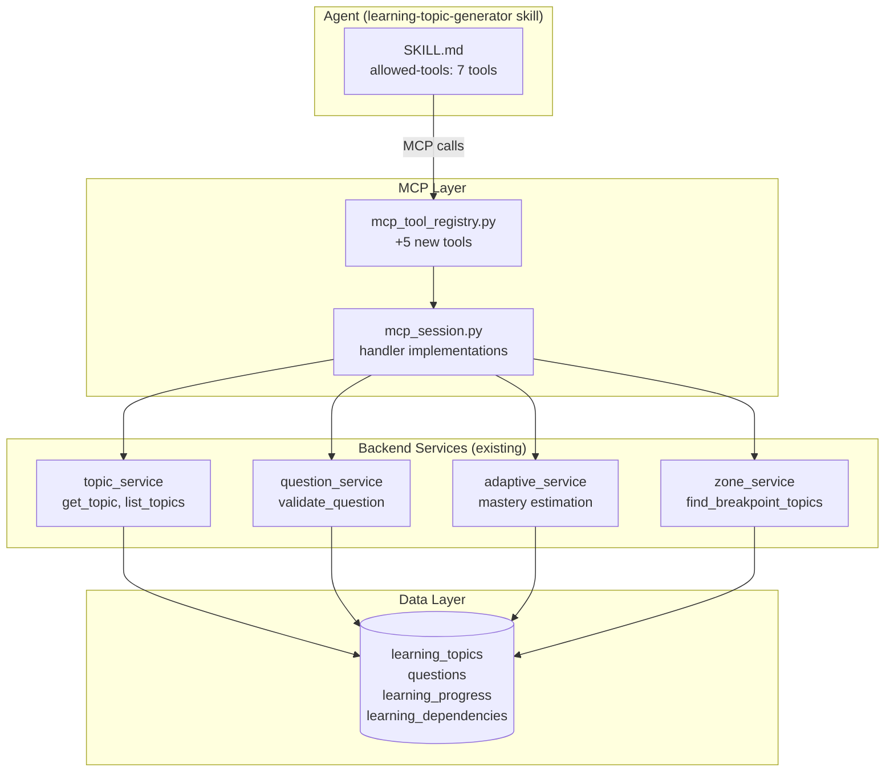

## Goal Capsule

- **Objective:** Enable the `learning-topic-generator` AI skill to interact with the system's knowledge taxonomy, question bank, and child learning data through MCP tools, so it can generate contextually grounded lesson plans that reference real topics, validate generated exercises against the question harness, and adapt to each child's weak points.
- **Means:** Register 5 new MCP tools in `mcp_tool_registry.py` that wrap existing backend services (question_service, topic_service, zone_service), reuse 2 existing tools (get_child_learning_profile, record_learning_result) for a total of 7 in `allowed-tools`, fix the SKILL.md frontmatter, and rely on skill-level `allowed-tools` filtering (no new MCP server registration needed). (KTD1, KTD2, KTD3)
- **Authority hierarchy:** R wins on product behavior; KTD wins on implementation mechanism.
- **Execution profile:** Single PR. All changes are additive (new MCP tools + SKILL.md fix). No data migration needed.
- **Who finishes and ships:** Implementing agent runs pytest + mypy + ruff, then ships.

---

## Product Contract

### Summary

The `learning-topic-generator` skill currently generates lesson plans in a vacuum — it has `allowed-tools: []` and cannot access the 1590-topic knowledge taxonomy, the question bank with format validation, or child learning profiles. This plan adds 5 new MCP tools and reuses 2 existing ones (7 total in `allowed-tools`) to expose backend services to the AI agent, fixes the SKILL.md, and adds language-aware output (R11).

### Problem Frame

The skill was shipped with empty `allowed-tools` (commit `63c2be77`). It can only use LLM parametric knowledge to generate lesson plans, which means:
- Generated exercises are not validated against the question format rules
- The skill cannot check if questions already exist in the bank for a topic
- It cannot adapt to a specific child's weak points or mastery level
- It cannot traverse the knowledge dependency graph to build prerequisite chains
- Its SKILL.md description violates SDO principles (describes workflow, not triggers)

### Requirements

**SKILL.md Frontmatter**

- R1. Fix `description` to state triggering conditions only, not workflow summary. Must start with "Use when..." and include keywords: 课题方案, 学习方案, topic plan, lesson plan.
- R2. Update `allowed-tools` to declare the 5 new + 2 reused = 7 total MCP tools the skill needs.
- R3. Add tool usage guidance in the SKILL.md body explaining when to call each tool during lesson plan generation.

**Taxonomy Query Tools**

- R4. `get_taxonomy_topic(topic_key: str)` — returns full topic details (name, description, evidence, assessment_prompt, age_group, subject, domain) from the `learning_topics` table. Read-only.
- R5. `get_taxonomy_dependencies(topic_key: str)` — returns prerequisite edges for a topic (prerequisite_key, strength, reason). Read-only.
- R6. `list_taxonomy_topics(subject: str, domain?: str, age_group?: str)` — returns lightweight topic index filtered by criteria. Read-only.

**Question Harness Tool**

- R7. `validate_question(question_json: object)` — runs L1 format/structure validation (stem non-empty, answer present, topic exists, type-specific field checks) and returns pass/fail with detailed errors. Read-only. Wraps `question_service.validate_question()`. L2 correctness and L3 AI cross-validation are out of scope (reserved for the question production pipeline).

**Child Learning Data Tools**

- R8. `get_child_weak_points(child_id: int, subject?: str)` — returns topics where the child has low mastery, sorted weakest first. Includes mastery_level and is_breakpoint flag. Read-only. Queries `LearningProgress` + `zone_service.find_breakpoint_topics()`. Merge algorithm: (1) query progress rows where mastery_level in (learning, available, review), (2) call find_breakpoint_topics(), (3) for each breakpoint topic not in progress results, add with mastery_level="available" and is_breakpoint=True, (4) sort by mastery_level priority (available < learning < review).
- R9. `get_child_learning_profile` — already exists for `learning-tutor` (registered at mcp_tool_registry.py:357). The `learning-topic-generator` reuses it. Tenant isolation (`child.family_id == session.family_id`) is already enforced by the existing handler.
- R10. `record_learning_result` — already exists for `learning-tutor` (registered at mcp_tool_registry.py:374). The `learning-topic-generator` reuses it for recording lesson plan outcomes.

**Worker Configuration**

- R11. The skill-level `allowed-tools` field in SKILL.md governs which MCP tools the skill can access. No separate `mcp_servers` configuration is needed in `_SimpleAppConfig` — the existing default MCP resolution (via `_resolve_numina_mcp_servers`) already exposes all registered tools, and DeerFlow's `filter_tools_by_skill_allowed_tools` restricts access per skill.

**Language-Aware Output**

- R12. Generated lesson plan output follows the user's current language: Chinese users receive Chinese content (zh fields), non-Chinese users receive English content (en fields). The skill receives `locale` as part of its input context and populates the corresponding fields. `validate_question` accepts a `locale` parameter to validate the correct language fields.

### Scope Boundaries

**In scope:**
- 5 new MCP tool registrations in `mcp_tool_registry.py`
- MCP handler implementations in `mcp_session.py`
- SKILL.md frontmatter fix + body tool guidance
- Skill-level `allowed-tools` filtering (no new MCP server config needed)
- Unit tests for new tools
- RESERVED_NAMES update (already done in commit `111b2235`)
- New `topic_service.get_topic_by_key()` method (simple wrapper over DB query)

**Deferred for later:**
- `create_question` MCP tool (write operation — needs separate security review per AGENTS.md §Security Rules #9)
- `update_question` / `delete_question` MCP tools
- Frontend UI for topic-generator trigger (separate branch)
- Batch question generation endpoint

**Outside this product's identity:**
- Changes to the question bank data model
- Changes to the os_taxonomy package
- Changes to the adaptive_service estimators
- L2 correctness validation or L3 AI cross-validation in `validate_question` (deferred)

---

## Planning Contract

### Key Technical Decisions

KTD1. **Wrap existing services, don't duplicate logic.** The 5 new MCP tools are thin wrappers over existing backend services (`topic_service`, `question_service`, `zone_service`). Where a needed query doesn't exist in the service layer (e.g., `get_topic_by_key`), a minimal service method is added — but no new business logic. Rationale: the services are well-tested and have clear interfaces; wrapping preserves the single-source-of-truth principle.

KTD2. **Read-only tools get `external_token` role; write tools stay `owner/member` only.** R4-R6, R7, R8 are read-only and can be called by external MCP clients. This follows the pattern established by `get_learning_topic` (line 354 of `mcp_tool_registry.py`). If a write tool is added later (deferred), it follows `record_learning_result`'s pattern (line 412).

KTD3. **Reuse `get_child_learning_profile` and `record_learning_result` from learning-tutor.** Both are already registered. The learning-topic-generator declares them in `allowed-tools` alongside the 5 new tools (7 total). No duplicate registration needed. Existing handlers already enforce tenant isolation (`child.family_id == session.family_id`).

KTD4. **`validate_question` runs L1 format validation only.** L1 checks: stem non-empty, answer present, topic exists, type-specific required fields (options for multiple_choice, answer key for calculation). L2 (correctness/recomputation) and L3 (AI cross-validation) are deferred — they belong to the question production pipeline, not the topic-generator's exercise-preview use case.

KTD5. **`get_child_weak_points` combines `LearningProgress` mastery_level with breakpoint detection from `zone_service`.** Merge algorithm: (1) query progress rows where mastery_level in (available, learning, review), (2) call find_breakpoint_topics() for knowledge breakpoints, (3) for each breakpoint not already in progress results, add with mastery_level="available" and is_breakpoint=True, (4) sort by mastery_level priority (available=0 < learning=1 < review=2). Return fields: topic_id, topic_key, name, mastery_level, is_breakpoint. No `suggested_difficulty` — the skill derives difficulty from mastery_level using the SKILL.md's Agent Derivation Rules.

### High-Level Technical Design



### Assumptions

- The `learning_topics` table is populated (1590 topics seeded). If empty, `get_taxonomy_topic` returns 404.
- Skill-level `allowed-tools` filtering (via DeerFlow's `filter_tools_by_skill_allowed_tools`) is sufficient to restrict tool access — no separate `mcp_servers` configuration needed in `_SimpleAppConfig`. The existing default MCP resolution exposes all registered tools, and the skill's allowed-tools list acts as the gate.
- No new database tables or migrations are needed — all tools read from existing tables.
- `learning_topics` is family-global (no `family_id` column) — taxonomy data is shared across all families. Verified against the ORM model.
- A new `topic_service.get_topic_by_key()` method needs to be added (thin DB query wrapper). This is in scope per KTD1.

---

## Implementation Units

### U1. Fix SKILL.md Frontmatter

**Goal:** Make the skill discoverable and properly scoped.

**Files:**
- `server/apps/agent/skills/builtin/public/learning-topic-generator/SKILL.md`

**Approach:**
1. Change `description` to trigger-condition format:
   ```yaml
   description: |
     Use when generating a structured learning plan (课题方案) for a taxonomy topic,
     or when parent/teacher requests a lesson plan for a specific knowledge point.
     Triggers: 课题方案, 学习方案, topic plan, lesson plan, teaching plan.
   ```
2. Update `allowed-tools` to list the 7 tools:
   ```yaml
   allowed-tools:
     - get_taxonomy_topic
     - get_taxonomy_dependencies
     - list_taxonomy_topics
     - validate_question
     - get_child_weak_points
     - get_child_learning_profile
     - record_learning_result
   ```
3. Add a `## Tool Usage` section in the SKILL.md body explaining when to call each tool:
   - Before generating objectives: call `get_taxonomy_topic` to verify topic exists and get evidence criteria
   - When building prerequisites: call `get_taxonomy_dependencies` to get the dependency chain
   - When generating exercises: call `validate_question` to check each generated exercise
   - If child_id is provided: call `get_child_weak_points` to adapt difficulty and topic focus

**Test Scenarios:**
- TS1.1: SKILL.md frontmatter parses as valid YAML
- TS1.2: `description` contains "Use when" and trigger keywords
- TS1.3: `allowed-tools` lists exactly 7 tool names
- TS1.4: SKILL.md body contains a `## Tool Usage` section

**Verification:**
```bash
cd server && uv run pytest tests/agent/unit/test_learning_topic_generator.py -v
```

---

### U2. Register Taxonomy Query MCP Tools

**Goal:** Enable AI to query the knowledge taxonomy.

**Files:**
- `server/apps/backend/app/services/mcp_tool_registry.py` — add 3 tool registrations
- `server/apps/backend/app/services/mcp_session.py` — add handler implementations
- `server/tests/backend/integration/test_learning_mcp_tools.py` — add tests

**Approach:**
1. In `mcp_tool_registry.py`, add after line 414 (after `record_learning_result`):
   - `get_taxonomy_topic`: input_schema `{topic_key: string}`, `allowed_roles={owner, member, external_token}`, `requires_write=False`
   - `get_taxonomy_dependencies`: input_schema `{topic_key: string}`, same roles
   - `list_taxonomy_topics`: input_schema `{subject: string, domain?: string, age_group?: string}`, same roles

2. In `mcp_session.py`, implement handlers:
   - `get_taxonomy_topic`: add `topic_service.get_topic_by_key(db, topic_key, source_taxonomy)` — a new thin wrapper that queries `LearningTopic.topic_key == topic_key`. If topic_key is not found, return error. The topic_key comes from the os_taxonomy ID field (e.g., "mt_AzTrT5ySCx").
   - `get_taxonomy_dependencies`: use existing `topic_service.get_topic_graph(db, topic_id, source_taxonomy)` which returns `{'topic', 'prerequisites', 'dependents'}`. Extract the prerequisites list. Requires first resolving topic_key → topic_id via get_topic_by_key.
   - `list_taxonomy_topics`: use existing `topic_service.list_topics(db, subject, domain, age_group, source_taxonomy)`. Add `source_taxonomy` parameter to the tool's input_schema, defaulting to the result of `topic_service.get_effective_source_taxonomy(db, language)`.
   - All taxonomy handlers: topics are family-global (no family_id filter needed). No tenant isolation required for read-only taxonomy data.

**Test Scenarios:**
- TS2.1: `get_taxonomy_topic` returns topic details for a valid topic_key
- TS2.2: `get_taxonomy_topic` returns error for non-existent topic_key
- TS2.3: `get_taxonomy_dependencies` returns prerequisite edges
- TS2.4: `list_taxonomy_topics` filters by subject correctly
- TS2.5: `list_taxonomy_topics` with age_group filter returns only matching topics
- TS2.6: All three tools reject cross-family access (tenant isolation)

**Verification:**
```bash
cd server && uv run pytest tests/backend/integration/test_learning_mcp_tools.py -v -k taxonomy
```

---

### U3. Register Question Harness MCP Tool

**Goal:** Enable AI to validate generated questions against format rules (L1).

**Files:**
- `server/apps/backend/app/services/mcp_tool_registry.py` — add 1 tool registration
- `server/apps/backend/app/services/mcp_session.py` — add handler implementation
- `server/tests/backend/integration/test_learning_mcp_tools.py` — add tests

**Approach:**
1. In `mcp_tool_registry.py`, register `validate_question`:
   ```python
   "validate_question": MCPToolMeta(
       name="validate_question",
       description="验证生成的题目是否符合格式要求（L1 格式验证）。返回验证结果和错误详情。",
       input_schema={
           "type": "object",
           "properties": {
               "topic_id": {"type": "integer"},
               "question_type": {"type": "string", "enum": ["calculation", "multiple_choice", "fill_blank", "true_false"]},
               "stem": {"type": "string"},
               "answer": {"type": "object"},
               "options": {"type": "array", "items": {"type": "object"}},
               "age_group": {"type": "string", "enum": ["low", "mid", "high"]},
           },
           "required": ["topic_id", "question_type", "stem", "answer", "age_group"],
       },
       allowed_roles=frozenset({"owner", "member", "external_token"}),
       requires_write=False,
   )
   ```

2. In `mcp_session.py`, implement handler that calls `question_service.validate_question(topic_id, question_type, stem, answer, age_group, db, options)` and returns structured result with `passed: bool` and `errors: list[str]`.

3. Per KTD4, this runs L1 format validation only (matching the existing service). L2 correctness and L3 AI cross-validation are out of scope.

**Test Scenarios:**
- TS3.1: Valid question passes validation
- TS3.2: Empty stem fails with "Stem must not be empty"
- TS3.3: Non-existent topic_id fails with "Topic does not exist"
- TS3.4: Multiple choice without options fails
- TS3.5: Calculation without answer fails

**Verification:**
```bash
cd server && uv run pytest tests/backend/integration/test_learning_mcp_tools.py -v -k validate_question
```

---

### U4. Register Child Weak Points MCP Tool

**Goal:** Enable AI to query a child's weak topics for targeted lesson planning.

**Files:**
- `server/apps/backend/app/services/mcp_tool_registry.py` — add 1 tool registration
- `server/apps/backend/app/services/mcp_session.py` — add handler implementation
- `server/tests/backend/integration/test_learning_mcp_tools.py` — add tests

**Approach:**
1. In `mcp_tool_registry.py`, register `get_child_weak_points`:
   ```python
   "get_child_weak_points": MCPToolMeta(
       name="get_child_weak_points",
       description="获取儿童薄弱知识点列表，按掌握度从低到高排序。包含知识断点（前置已掌握但当前未掌握的知识点）。",
       input_schema={
           "type": "object",
           "properties": {
               "child_id": {"type": "integer"},
               "subject": {"type": "string"},
               "limit": {"type": "integer", "default": 10},
           },
           "required": ["child_id"],
       },
       allowed_roles=frozenset({"owner", "member", "external_token"}),
       requires_write=False,
   )
   ```

2. In `mcp_session.py`, implement handler per KTD5 merge algorithm:
   - Queries `LearningProgress` for the child where `mastery_level` in (`available`, `learning`, `review`)
   - Optionally filters by subject (via join with `LearningTopic`)
   - Calls `zone_service.find_breakpoint_topics(db, child_id, subject)` to identify knowledge breakpoints
   - Merge: for each breakpoint topic not already in progress results, add with mastery_level="available" and is_breakpoint=True
   - Sort by mastery_level priority: available (0) < learning (1) < review (2)
   - Returns `[{topic_id, topic_key, name, mastery_level, is_breakpoint}]`

3. Enforce tenant isolation: verify `child.family_id == session.family_id`.

4. Add `"maximum": 100` to `limit` parameter to prevent excessive result sets.

**Test Scenarios:**
- TS4.1: Returns weak topics sorted by mastery_score ascending
- TS4.2: Subject filter works correctly
- TS4.3: Breakpoint topics are flagged with `is_breakpoint: true`
- TS4.4: Cross-family child_id returns permission_denied
- TS4.5: Child with no progress returns empty list (not error)

**Verification:**
```bash
cd server && uv run pytest tests/backend/integration/test_learning_mcp_tools.py -v -k weak_points
```

---

### U5. Language-Aware Output in SKILL.md

**Goal:** Ensure generated content follows the user's language.

**Files:**
- `server/apps/agent/skills/builtin/public/learning-topic-generator/SKILL.md`

**Approach:**
1. Add language-aware guidance in the SKILL.md body:
   - When `locale` starts with `zh`: populate all `_zh` fields with Chinese content, `_en` fields with English translations
   - When `locale` is non-Chinese: populate `_en` fields with English content, `_zh` fields may be empty
   - `recommended_exercises` descriptions follow the same locale rule
2. Add `locale` to the Input section of SKILL.md
3. Add to Quality Checklist: "locale matches user preference (zh fields in Chinese for zh locale, en fields in English otherwise)"

**Test Scenarios:**
- TS5.1: SKILL.md body mentions locale-aware output rules
- TS5.2: Quality checklist includes locale verification

**Verification:**
```bash
cd server && uv run pytest tests/agent/unit/test_learning_topic_generator.py -v -k locale
```

---

### U6. Update Existing Tests

**Goal:** Ensure existing test file covers the new allowed-tools and validates SKILL.md changes.

**Files:**
- `server/tests/agent/unit/test_learning_topic_generator.py`

**Approach:**
1. Update `test_frontmatter_has_allowed_tools` to verify the tool list includes the 7 expected tools (5 new + 2 reused).
2. Add `test_skill_md_has_tool_usage_section` to verify the body has tool guidance.
3. Add `test_allowed_tools_match_registered_mcp_tools` to verify skill's allowed-tools align with registry (defense against drift).

**Test Scenarios:**
- TS6.1: `allowed-tools` in SKILL.md matches the 7 tool names (5 new + get_child_learning_profile + record_learning_result)
- TS6.2: SKILL.md body mentions each tool name in the Tool Usage section

**Verification:**
```bash
cd server && uv run pytest tests/agent/unit/test_learning_topic_generator.py -v
```

---

## Verification Contract

| Command | Scope | Quality gate |
|---------|-------|--------------|
| `cd server && uv run pytest tests/agent/unit/test_learning_topic_generator.py -v` | SKILL.md structure + worker config | All tests pass |
| `cd server && uv run pytest tests/backend/integration/test_learning_mcp_tools.py -v` | MCP tool registration + handlers | All tests pass |
| `cd server && uv run ruff check apps/backend/app/services/mcp_tool_registry.py apps/backend/app/services/mcp_session.py` | Lint | No errors |
| `cd server && uv run mypy apps/backend/app/services/mcp_session.py --explicit-package-bases` | Type check | No errors |

---

## Definition of Done

**Global:**
- 5 new MCP tools registered and tested + 2 existing tools reused (7 total in allowed-tools)
- SKILL.md frontmatter fixed (description + allowed-tools)
- SKILL.md body has Tool Usage section + language-aware output guidance
- Skill-level allowed-tools filtering works (no new MCP server config needed)
- All existing tests still pass
- No new lint/type errors

**Per-unit:**
- U1: SKILL.md parses as valid YAML, description starts with "Use when"
- U2-U4: Each new tool has handler + tests + correct service method calls
- U5: SKILL.md has locale-aware output rules
- U6: Test file validates allowed-tools alignment (7 tools)

**Cleanup:**
- No experimental or abandoned code in the diff
- All `# TODO` comments resolved or removed
