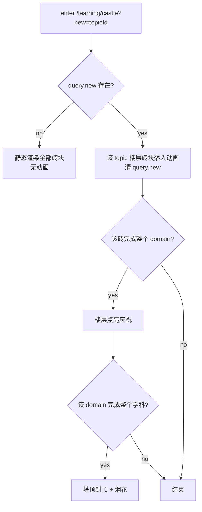

## Goal Capsule

- **Objective:** 孩子在自己的学习端拥有一座看得见、会生长的"知识城堡"——掌握的 topic 落成砖块、完成的 domain 点亮楼层、完成的学科立起塔楼——让知识积累从无感的数字（XP/Level）变成孩子会主动回来看的属于自己的东西。
- **Means:** 孩子端新增城堡视图（立面剖面城堡，DOM+CSS 确定性渲染），由现有学习进度数据驱动，不新增持久化表。
- **Authority:** 本契约是 GitHub issue #209 的产品需求边界。Issue 中的 8 项 Key Tasks 经对话收敛：家长端镜像、历史城堡、castle_progress 表、1590 元素全量渲染不在本轮范围（见 Scope Boundaries）。上级 Epic #204 的其余部分不是当前活跃范围。
- **Execution profile:** 以前端为主的全栈切片——child app 页面与组件为主，后端仅需要轻量数据口径调整（新增按年龄圈定 topic 范围的聚合端点）。分两个 PR 交付：PR1 为后端城堡数据端点（新 service + 端点 + schema），PR2 为前端城堡视图（主题扩展、视图、窗户导航、动画、入口、结果页 CTA）。PR2 在 PR1 之后合并（可在 PR1 合并前按契约先行开发）。
- **Open blockers:** 无。
- **Tail ownership:** 实现者负责测试质量、验证命令、PR；合并前需 code review。

---

## Product Contract

Product Contract unchanged — carried forward verbatim from ce-brainstorm (issue #209); planning adds Planning Contract, Implementation Units, Verification Contract, and Definition of Done.

### Summary

在孩子学习端新建一座"知识城堡"：每个当前年龄带 in-scope 学科一座塔并排的立面剖面城堡（通常 5-8 座），塔内楼层按 domain 分层、砖块按 topic 填充，全部由后端新端点按孩子生效 taxonomy 派生。城堡零基础时就有完整地基与 in-scope 学科塔的空楼层轮廓；掌握 topic 砖块落入（增长动画，仅对新掌握 topic 播放），完成 domain 楼层点亮，完成学科塔放烟花。装饰层（灯火/花园）表达坚持与复习活跃度，衰退表现为裂缝/褪色而非拆除；少量"该复习/可学"的未点亮窗户点击直达练习。新增 `/learning/castle` 全视图路由，学习进度页替换主视觉为通往城堡的入口卡片，XP 概念本身保留。

### Problem Frame

孩子对学习进度条无动于衷。"Level 3 · 150 XP"是抽象数字：孩子看不到自己拥有了什么，学过的东西在孩子的世界里没有被积累成任何可见之物。这是从真实使用中观察到的——孩子无视数字进度条，而非推演。

现状的反馈是断裂的：练习结果页只显示分数与正确率；庆祝动画放完即散，不留任何持久痕迹；徽章墙是离散的成就，拼不出"我的知识全貌"。孩子在任何一屏都看不到"我已经走了多远"。

家长同样受损：分数与 XP 无法转化为亲子对话素材（"我看到你新盖了一座塔"），只有数字报表。

与 #208 的知识大陆地图是互补分工，不是重复：大陆地图回答"我接下来去哪学"（导航/探索），城堡回答"我已经建成了什么"（积累/拥有）。孩子先在地图上探索，在城堡里看到探索的成果沉淀。

### Key Decisions

- KD1. 城堡与知识大陆地图分工共存——地图管导航（去哪学），城堡管拥有（建成了什么）。两者平级，各是独立入口。(session-settled: user-directed — chosen over 城堡取代地图成为主视觉 / 城堡作为大陆的一个视图: 两个隐喻职责不同，需各自存在)
- KD2. 建筑体量由掌握（mastery）驱动，装饰（灯火/花园）由坚持与复习活跃度驱动——两个维度分开表达，不混同。Governs R3, R5.
- KD3. 城堡覆盖当前年龄带 ∪ 孩子所有 `first_mastered_at` 非空 topic 的范围（按孩子年龄用 topic 的 ageRange 覆盖圈定当前年龄带；6-11 岁约 426-686 个 topic，5 岁仅 297、12 岁起显著缩小）；曾经掌握过的 topic 永远留在城堡中，生日变化只能加新楼层不能移除已有砖块。升学时旧城堡保留为可回顾的历史城堡。Governs R1, R3.
- KD4. 砖块聚合、窗户精确：塔/楼层/砖是按学科与 domain 掌握数确定性生成的聚合装饰，不存储坐标、不逐砖绑定 topic；只有少量"该复习/可学"窗户绑定真实 topic 并可点击。因此不需要 castle_progress 表——现有 LearningProgress（懒创建）+ taxonomy 全集在前端 join 即可。(session-settled: user-directed — chosen over Issue 原计划的 castle_progress 表存 topic_id+坐标: 只需"看得见积累"，逐砖存坐标成本过高)
- KD5. 建筑不倒退：掌握过的楼层/砖块永久保留，衰退以裂缝/褪色信号呈现；衰退谓词为 `mastery_level == 'mastered' AND next_review_at <= now`（与 `zone_service.find_review_due_topics` 及 TopicNode/ClusterMap 的派生状态一致），`mastery_level == 'review'` 等级保留给 MCP needs_review 路径。`first_mastered_at` 只写一次不重置，天然支撑"永久保留"语义。Governs R3, R7.
- KD6. 分层庆祝：单 topic 掌握 = 城堡增长动画（砖块落入）；完成一个 domain（点亮楼层）可在城堡内庆祝；完成一个学科（立塔）触发完整庆祝动画（烟花）。烟花不在单 topic 时触发。Governs R6.
- KD7. 立面剖面城堡（方案 A）：每个 in-scope 学科一座塔并排的正视图（数量由孩子生效 taxonomy 在该年龄带覆盖的学科数派生，通常 5-8 座；os-taxonomy 8 个学科，beijing 部署更多；12 岁+ 孩子仅 5 个学科有 in-scope topic），DOM+CSS 确定性布局，可横向滚动的条带（min tower width 约 120px，视口可见子集 + 边缘淡出暗示更多塔），靠插画层（塔顶形状/学科材质/城墙/地基庭院）制造"地方感"，不做等距/3D 几何引擎。与 KnowledgeContinent 同一实现方式，学科主题沿用 continentThemes 体系（见 D4 中需新增的 4 个学科主题）。(session-settled: user-directed — rejected: 等距庭院 SVG / 单一生长主体 / 硬编码 8 塔：硬编码 8 塔在三个现实中失败——375px 视口每塔仅 45px 不可交互、12 岁+ 孩子 in-scope 学科 < 8、beijing 默认部署学科数 ≠ 8)
- KD8. 视觉决策以文字描述方式进行（用户明确选择不上视觉草图），具体塔顶/材质美术样式留待实现阶段。
- KD9. 成功信号是"孩子会主动打开城堡"（非任务引导的打开），不是练习量或复习完成率。Governs R10.

### Requirements

**城堡视图与结构**

- R1. 孩子端提供城堡视图：每个当前年龄带 in-scope 学科一座塔并排的立面剖面城堡，每座塔内楼层对应 domain、砖块对应 topic；城堡范围覆盖（按孩子年龄由 topic 的 ageRange 覆盖圈定的当前年龄带 topic）∪（该孩子 `first_mastered_at` 非空的所有 topic），使已掌握 topic 的砖块在任何年龄带下都留在城堡中。
- R2. 零掌握的孩子看到完整的地基、城墙与当前年龄带内每个 in-scope 学科塔的空楼层轮廓——城堡从第一天起就是城堡，增长是往既有骨架上填砖点亮，不是从空地建起。当前年龄带内无 in-scope topic 的学科不渲染塔（也不计入 R6 的塔完成/烟花检查）。
- R3. 建筑只增不减：已建成的楼层与砖块永久保留；掌握衰退以裂缝/褪色的视觉信号呈现，衰退谓词为 `mastery_level == 'mastered' AND next_review_at <= now`（即 SM-2 到期，与 `zone_service.find_review_due_topics` 一致）；裂缝同时配非颜色标记（如虚线轮廓）以照顾色盲用户，修复裂缝的方式是完成复习。灯火/花园等装饰随坚持与复习活跃度实时变化（此句规则由 KD2 定义，此处不重复其定义）。
- R4. 每座学科塔有可辨识的主题视觉（如数学=齿轮檐口、科学=实验室塔顶），学科色与图标沿用知识大陆的学科主题体系，保证两套隐喻在学科认知上连续。注意：`CONTINENT_THEMES` 当前无 `computing / learning_to_learn / life_skills / personal_social` 条目（回退到共享 DEFAULT_THEME），本轮城堡切片需为这 4 个学科新增主题条目，使所有 in-scope 学科塔各自可辨识。

**反馈与具象化文案**

- R5. 掌握 topic 后的反馈文案具象到城堡元素（"你的城堡多了一层新砖"），不再出现 "+10 XP" 作为主反馈；XP 数字保留在后端与次要位置，不作为掌握时刻的主表达。
- R6. 分层庆祝（按 KD6）：单 topic 掌握播放砖块落入动画；完成学科塔时触发完整烟花庆祝；domain 楼层点亮在城堡内有视觉庆祝但不放烟花。

**未点亮窗户（revisit 动力）**

- R7. 城堡上显示少量"未点亮窗户"，只绑定当前值得学习的 topic——复习到期（`mastery_level == 'mastered' AND next_review_at <= now`）与下一步可学（available/learning 中被推荐）的 topic；其余未掌握区域呈现为不透明的墙体，不渲染窗户。每个窗户是一个按钮，`aria-label` 包含 topic 名 + 原因（"复习到期" / "推荐学习"），每种原因配独立 glyph，最小触控目标 44px。
- R8. 点击未点亮窗户直接导航到对应 topic 的练习/复习入口。每座塔暴露掌握/总数的文本摘要供辅助技术与文字读者使用。

**入口与替换**

- R9. 新增 `/learning/castle` 路由作为城堡全视图页面；学习进度页（现 XPProgressBar 所在位置）替换主视觉为通往 `/learning/castle` 的紧凑城堡入口卡片；XP/Level 数据继续在后端累积并保留可见途径，不删除 XP 系统本身。

**平台与性能**

- R10. 城堡是孩子愿意主动打开的地方——提供从学习主页直达 `/learning/castle` 的入口（不要求经过练习完成页）。
- R11. 城堡渲染不做 1590 元素全量渲染与虚拟化：聚合砖块 + 少量窗户使单屏可点元素保持在个位数到十几；年级范围内全部砖块可渲染（注意：age 7 的 in-range 集合约 611 个 topic 分布在 51 个 domain，不是 ClusterMap 单 domain 最大 75 节点的同量级，而是其 8 倍；但因砖块是聚合装饰、窗户只点少量，单屏实际可点元素仍然稀疏）。

### Actors

- A1. 孩子（child app 用户）：城堡的主人，探索大陆、完成练习、看城堡生长。
- A2. 家长：本轮不直接使用城堡（家长端镜像 deferred），但孩子可能把城堡展示给家长看。

### Key Flows

- F1. 掌握时刻的城堡生长
  - **Trigger:** 孩子完成一次练习/评估，某 topic 的 mastery_level 变为 mastered（首次）。
  - **Actors:** A1
  - **Steps:** 结果页出现具象文案（R5）→ 孩子从结果页的城堡 CTA 进入城堡路由，携带新掌握 topic id（URL 参数 `?new=<topicId>`）→ 城堡只为该 id 播放砖块落入动画，清参数 → 若此砖完成一个 domain，楼层点亮；若此砖完成一个学科全部楼层，塔顶封顶 + 烟花庆祝（R6）。自发打开（F3）不触发动画。
  - **Outcome:** 城堡与"我学会了什么"之间建立可见的因果；增长被孩子看见并期待。
  - **Covers R3, R5, R6.**
- F2. 从窗户回到复习
  - **Trigger:** 孩子打开城堡，存在复习到期或推荐的 topic。
  - **Actors:** A1
  - **Steps:** 城堡显示少量未点亮窗户（R7）→ 孩子点击某扇窗户 → 直接导航到该 topic 的练习/复习（R8）→ 复习通过后窗户点亮（若无裂缝则亮起，若有则修复裂缝）。
  - **Outcome:** 城堡成为复习入口；"未点亮"本身成为复习动力。
  - **Covers R7, R8.**
- F3. 日常打开城堡（成功信号）
  - **Trigger:** 孩子出于好奇主动打开城堡（无任务引导）。
  - **Actors:** A1
  - **Steps:** 从学习主页直达城堡（R10）→ 看到整座城堡当前状态（已建楼层、灯火、花园、裂缝）→ 可点击窗户去练习，也可只是看。
  - **Outcome:** 城堡本身成为孩子回访的目的地。
  - **Covers R3, R7, R10.**

### Acceptance Examples

- AE1. **零掌握的新孩子打开城堡**
  - **Covers R2, R4.**
  - **Given:** 一个没有任何 LearningProgress 行的孩子（刚完成 onboarding）首次打开城堡。
  - **When:** 城堡渲染时。
  - **Then:** 看到完整的地基、城墙与当前年龄带每个 in-scope 学科塔的空楼层轮廓（未点亮的楼层）；不出现空白土地；不因无进度数据报错。
- AE2. **首次掌握一个 topic**
  - **Covers R5, R6.**
  - **Given:** 孩子完成练习，某 topic mastery_level 首次变为 mastered。
  - **When:** 从结果页 CTA 进入城堡（URL 携带 `?new=<topicId>`）。
  - **Then:** 结果反馈的主文案是城堡元素具象文案（如"你的城堡多了一层新砖"）；"+X XP"不是主反馈；城堡只在该 topic 所属 domain 楼层出现砖块落入动画；其他砖块/楼层不动画。
- AE3. **掌握衰退与修复**
  - **Covers R3.**
  - **Given:** 孩子曾掌握 topic T（T 的砖块已在楼层中）。
  - **When:** T 的 `mastery_level == 'mastered'` 且 `next_review_at` 已过期（SM-2 到期；注意 mastery_level 仍为 mastered，不转为 review）。
  - **Then:** T 所在区域出现裂缝/褪色信号（配非颜色标记照顾色盲）；砖块不消失、楼层不降级；完成 T 的复习后裂缝消失（`next_review_at` 向前推）。
- AE4. **窗户口径**
  - **Covers R7, R8.**
  - **Given:** 孩子当前有 3 个复习到期 topic（`mastered + past next_review_at`）和 2 个推荐可学 topic，另有 180 个未掌握 topic。
  - **When:** 城堡渲染窗户时。
  - **Then:** 只出现约 5 扇未点亮窗户（对应那 3+2 个 topic），每扇窗户是带 `aria-label`（topic 名 + 原因）的按钮、44px 触控目标、按原因分 glyph；其余 180 个不渲染窗户、呈现为墙体；点任一窗户直达对应 topic 练习。
- AE5. **学科塔完成**
  - **Covers R6.**
  - **Given:** 孩子掌握当前年级范围内某学科的全部 topic。
  - **When:** 最后一砖落入。
  - **Then:** 塔顶封顶动画 + 烟花庆祝；此前单 topic 掌握时从未触发过烟花。
- AE6. **年级范围与年龄边界**
  - **Covers R1.**
  - **Given:** 一个 7 岁孩子（其年龄覆盖约 611 个 topic，分布在 8 学科）。
  - **When:** 城堡计算范围时。
  - **Then:** 用这约 611 个 topic ∪ 孩子所有 `first_mastered_at` 非空 topic 计算城堡分母与渲染；其他未掌握也未曾经掌握的 topic 不出现。边缘年龄（如 5 岁仅 297 个、12 岁仅 243 个且仅 5 个学科有 in-scope topic）不报错；按同样规则圈定，只渲染 in-scope 学科的塔（12 岁孩子为 5 座塔，而非 8 座）。
- AE7. **城堡路由**
  - **Covers R9.**
  - **Given:** 任何孩子使用学习进度页或学习主页。
  - **When:** 查看进度或从主页进入。
  - **Then:** 进度页主视觉是通往 `/learning/castle` 的入口卡片；主页有直达 `/learning/castle` 的入口；城堡全视图在 `/learning/castle` 路由；XP/Level 未被删除、仍有途径可见（如次要位置或详情）；后端 XP 累积逻辑不变。
- AE8. **装饰（灯火/花园）的实时性**
  - **Covers KD2.**
  - **Given:** 孩子当前学习连续天数（streak）为 5，但今天尚未学习。
  - **When:** 城堡渲染装饰时。
  - **Then:** 城堡的灯火/花园反映坚持活跃度——装饰数量或亮度与 streak 相关；streak 中断后装饰逐步变暗但不消失（装饰永不拆除，仅活跃度变化）。

### Success Criteria

- SC1. 城堡上线后，孩子存在非任务引导的主动打开行为（打开频次/停留可从埋点或日常观察判断）——这是 KD9 定下的、团队会盯的信号。
- SC2. 孩子能指着城堡说出"这是我的数学塔"级别的归属表达（可用性观察）。
- SC3. 从窗户进入练习的路径被真实使用（F2 成为真实行为，非摆设）。

### Scope Boundaries

**Deferred for later（本轮不做，后续轮次候选）**

- 家长端城堡镜像（平级新增只读入口，child app 之外的 main app 工作）
- 历史城堡回顾（年级毕业时旧城堡留存为可翻阅的档案；本轮城堡范围=当前年级，毕业切换的交互未设计）
- 等距/斜视角城堡（若立面剖面的"地方感"不足，KD7 的方案 A 可升级为方案 B）
- 城堡与大陆地图的联动（如从大陆地块跳到对应塔）
- **城堡塔/楼层展开交互**：点击塔查看学科详情、点击楼层查看 domain 内 topic 列表（OQ1 本轮决议为静态展示，交互面仅限于窗户点击；展开交互待后续轮次）

**Outside this product's identity（明确不做）**

- castle_progress 表与逐元素坐标存储（KD4 已否定；聚合渲染 + 精确窗户满足需求）
- 1590 元素全量渲染与虚拟化引擎（R11 已否定其必要性）
- 移除 XP/Level 系统（R9 只让位置，不删除）
- 单 topic 掌握触发烟花（KD6 分层庆祝已否定）

### Dependencies / Assumptions

- D1. **年级=年龄假设**：child User 模型只有 `birthday`，无 grade 字段；假设"当前年级"由生日推算年龄，用 topic 的 `ageRangeStart/End` 覆盖该年龄来圈定城堡范围。注意：`CreateChildRequest` 当前不含 birthday 字段，新建孩子默认 birthday=NULL，此假设在新建账号上未定义——**兜底规则**：若 `birthday == NULL`，按 `age_group='mid'`（与 `learning_child._child_age_group` 的 NULL 生日默认一致）派生城堡范围，并在孩子资料页引导补填生日。若产品后续引入显式年级概念，此口径需同步调整。
- D2. "曾经掌握"水位线由 `LearningProgress.first_mastered_at` 承载（只写一次、不重置）——已核实 `server/apps/backend/app/services/learning/progress_service.py:314,436` 的写法满足"建筑不倒退"语义，无需新表新字段。
- D3. 进度全集由后端按孩子生效 taxonomy（zh-CN 默认 beijing，其他 os-taxonomy）+ 年龄带圈定 topic 集合，并通过新端点 `GET /child/learning/castle/index` 返回给 child app——聚合 schema 见 U2（tower → floor → 聚合计数 + window 列表，per KTD2），作为城堡渲染的唯一权威来源；不做"前端 join `server/packages/os_taxonomy/topics.json`"（该文件在 child app bundle 不可达且 key 体系不匹配），也不扩展 `/child/learning/map/index`（KTD1 已定专用端点）。
- D4. 学科主题视觉沿用 #208 的 `continentThemes` 体系（frontend/apps/child/src/data/continentThemes.ts）与 CSS 变量色板。注意：`CONTINENT_THEMES` 当前仅覆盖 os-taxonomy 8 学科中的 4 个（mathematics / science / english / history），`computing / learning_to_learn / life_skills / personal_social` 缺失、回退到 `DEFAULT_THEME`（📚 灰色），本轮城堡切片必须为这 4 个学科新增主题条目（terrain 分类、color、icon、塔型），使所有 in-scope 学科塔各自可辨识。
- D5. 城堡渲染走 DOM+CSS 路线（与 KnowledgeContinent.vue 同方式）；cytoscape 仅 GraphMap 在用（动态导入），城堡不引入新渲染引擎。
- D6. 具体美术样式（塔顶形状、材质、砖块纹理、灯火/花园具体形态）留待实现阶段设计——本契约只约束结构与语义，KD8 记录了用户选择文字描述方式决策。

### Outstanding Questions

- OQ1. **Resolved during Planning:** 塔/楼层展开交互——本轮静态展示，交互面仅限于窗户点击；展开交互（点击塔查看学科详情、点击楼层查看 domain 内 topic 列表）归入 Scope Boundaries 的 Deferred。
- OQ2. **Resolved during Planning:** 窗户口径与上限——见 U1 / KTD4：去重按 topic_id（复习到期优先），总量 ≤ 10（复习到期 ≤ 6、推荐补位），推荐路径为空时回退到 in-scope available/learning topic 按 centrality 填充。
- OQ3. **Resolved during Planning:** 动画降级——见 U7 方案：砖块落入、楼层点亮、烟花庆祝三者都读 `useReducedMotion()`，reduced 模式下直接跳到终态（无 transition/animation class）；烟花 reduced 走 toast 降级路径。
- OQ4. **Resolved during Planning:** 生日兜底——见 U1 step 1 / KTD3：birthday NULL → `age_group == 'mid'`（与现有学习 hook 默认一致）；是否强制创建时填生日留作产品后续讨论，本轮不强制。

### Sources / Research

- Grounding dossier（含 file:line 引用）: `/tmp/compound-engineering-501/ce-brainstorm/knowledge-castle-209/grounding.md` — 大陆地图实现（DOM grid、continentThemes、fog tiers）、XP/mastery 存储与状态机、taxonomy 量级（8 学科×54 domain×1590 topic、单年龄覆盖约 500-700）、家长端现有接口、渲染依赖现状。机器本地路径，随 /tmp 清理失效。
- GitHub issue #209《知识城堡可视化成长 — 看得见的知识积累》(enhancement, ui)。
- `docs/plans/2026-10-26-001-feat-learning-playful-exploration-upgrade-plan.md` — 前置 Epic 语境（去奖励中心化、探索即奖励），城堡延续其"积累可见化"方向。
- Planning research dossiers（机器本地，随 /tmp 清理失效）:
  - `docs/solutions/best-practices/gamified-child-system-architecture-2026-04-17.md` — 聚合端点单一 GROUP BY、应用层去重、schema 归位、`{data}` 信封。
  - `docs/solutions/best-practices/main-app-ui-design-patterns-2026-08-03.md` — Skeleton → Empty → content 三态；零进度=空态（完整地基）非 error。
  - `docs/solutions/ui-bugs/dark-mode-inline-style-specificity-2026-05-30.md` — 内联 background 在暗色模式特异性陷阱；必须用 theme key + mastery 修饰类 + CSS 自定义属性。
  - `docs/solutions/best-practices/graph-library-evaluation-antv-g6-vs-cytoscape-2026-10-22.md` — 375px 下 DOM+CSS 已胜出，勿重议渲染引擎。
  - `docs/solutions/ui-bugs/vue3-transition-keepalive-blank-screen.md`、`action-sheet-clipped-in-transformed-container.md` — 横滚条用原生 overflow/scroll-snap 而非 transform；弹出层需 `teleport="body"`。

### Residual Risks（评审团 residual concerns 汇总，本轮不承诺修复）

- **beijing 部署每年龄学科分布未验证**：beijing taxonomy 有 2008 额外 topic（`mtc_` 前缀）与不同学科 slug 集合，所有本契约中的数字（5-8 塔、51 域、年龄带 topic 数）仅对 os-taxonomy 验证；beijing 部署的城堡规模需单独核算。
- **age_group bucket 与 ageRange 精确覆盖口径不一致**：/child/learning/map/index 已返回 `age_group`（low/mid/high），按该 bucket 圈定 age 7 得 715 topic（vs ageRange 精确覆盖 611）。本契约选择 ageRange 精确覆盖作为城堡范围；若产品后续要求与现有 hook/zone 推荐口径对齐，需重新评估。
- **child app 无任何分析埋点**：child app 当前无 posthog/gtag/sentry 等分析基础设施，SC1（孩子主动打开城堡）与 SC3（从窗户进入练习）只能靠人工观察判断——若需量化验证，需先接入埋点基础设施。
- **AE5 烟花触发在真实使用中可能永不发生**：年龄 7 的 Science 学科有 217 个 topic，Mathematics 有 136 个，让孩子"完全掌握一整个学科"作为烟花触发条件，在真实使用中几乎永不触发（即便在 AE 中能通过）。可考虑降级为"完成一整个 domain 的楼层"作为烟花触发条件。
- **城堡加载/失败状态未定义**：若城堡骨架先于进度数据渲染，或进度请求失败时画出不完整城堡，孩子可能误读为"进度丢了"——现有 ContinentFog/ClusterMap 已有 RoleShimmer skeleton 与 van-pull-refresh 处理，可参照但本轮未承诺。
- **城堡入口是否受 learning-onboarding 守卫**：从主页直接进 /learning/castle 会绕过 /learning 的 onboarding 流程；零进度孩子首次进入城堡会看到何种屏幕未定。规划阶段需确认是否应与 learning map 共用 onboarding 守卫。

---

## Planning Contract

### Key Technical Decisions

- KTD1. **专用端点而非扩展 map/index。** castle 需要逆向查询（全量 in-scope topic LEFT JOIN progress），而 `GET /child/learning/map/index` 枚举的是 progress 行。新增 `GET /child/learning/castle/index`，服务逻辑落在 `services/learning/`，router 保持 thin（对齐 `learning_child.py` 现状）。
- KTD2. **服务端聚合而非逐 topic 一行。** 响应为 tower → floor → 聚合砖块计数 + 一个 window 列表（`topic_id` + 名称 + 原因）。避免 age 9 最坏 ~686 行 topic 名外溢，并省去前端第二次 `getTopicsBatch` 调用（对齐 `gamified-child-system-architecture` 的单一聚合调用规则）。
- KTD3. **范围谓词。** scope = `LearningTopic` WHERE `source_taxonomy == effective_taxonomy` AND `deprecated == False` AND `age_range_start <= age <= age_range_end`，UNION `first_mastered_at IS NOT NULL` 的 progress 行。birthday NULL 时回退 `age_group == 'mid'`（bucket，与 `learning_child._child_age_group` 的 NULL 生日默认一致）——这是 D1 兜底规则的落地。
- KTD4. **window 来源复用现有服务。** 复习到期取 `zone_service.find_review_due_topics`（需加可选 `source_taxonomy` 参数过滤，现无）；可学取 `recommendation_service.generate_recommendation_path(limit=5)`，推荐路径为空时回退从 in-scope 的 available/learning topic 按 centrality 填充。**闭合 reason 集 = 两种**：`复习到期`（mode=review）与 `推荐学习`（mode=practice）；把现有 `知识断点/课标必会/需要复习` 三词在窗户层归并到这两种 reason，前端 glyph 两种，与 R7/AE4 的两-glyph 规格一致。window 裁剪到 castle 范围；去重按 `topic_id`（复习到期优先），总量 ≤ 10。
- KTD5. **主题策略：theme key + mastery 修饰类，禁内联 background。** 塔/楼层/砖颜色由 `class="tower tower--math tower--mastered"` 驱动，颜色经 `:style` 设置 CSS 自定义属性（复刻 `continentStyle()` 模式）、背景/边框/阴影写在 SFC `<style scoped>`——严禁逐实例内联 `background`（暗色模式特异性陷阱，`dark-mode-inline-style-specificity` 已记录其失败）。mastery 作为正交修饰符（`--mastered/--learning/--faded`）叠加在学科主题上，而非 5×8 手写色值。4 个新主题复用现有 `--color-brand-*` token。
- KTD6. **动画分层 + reduced-motion。** 塔完成烟花用城堡本地 confetti（读 `useReducedMotion()`，降级到 `useFlightChoreography` 的 toast 路径），不引入新依赖；砖块落入仅 `?new=<topicId>` 触发；衰退=裂缝/褪色（`--faded` 修饰类 + 虚线轮廓），永不拆除。复用 `motionTokens` 时长与缓动。
- KTD7. **review 模式透传。** (session-settled: user-approved — chosen over 落到普通 practice 会话: "复习到期"窗口必须真正进入复习，否则 F2 的复习闭环是空话) `PracticeSessionPage` 读取 mode 参数（默认 `practice`），复习窗口导航时传 `review`。
- KTD8. **入口直达、不加 onboarding 守卫。** `/learning/castle` 直接可达，新孩子看到空地基（AE1 设计的零进度态），不套用 name-scoped 到 `LearningMap` 的 onboarding 守卫。入口二处：主页学习区城堡卡片（R10）+ 进度页入口卡片替换 XP 主视觉（R9，XP/Level 保留次要可见）。两处既有色 token bug（`--color-brand-sage` 未定义）与 `ClusterTerritory` 的 `SUBJECT_META` 重复映射不在本轮改动（surgical-change 规则）。

### High-Level Technical Design

组件与数据流（城堡数据单向流动；动画层只消费 `?new` 参数）：

```mermaid
flowchart TB
  LT[LearningTopic<br/>source_taxonomy + ageRange] --> CS[castle_service<br/>scope ∪ first_mastered]
  LP[LearningProgress<br/>mastery_level / next_review_at / first_mastered_at] --> CS
  ZS[zone_service.find_review_due_topics<br/>+ source_taxonomy filter] --> CS
  RS[recommendation_service.generate_recommendation_path<br/>limit=5] --> CS
  CS --> EP[GET /child/learning/castle/index<br/>CastleIndexResponse]
  EP --> AC[api/learning.ts fetchCastle]
  AC --> VC[KnowledgeCastle.vue<br/>towers / floors / windows]
  VC --> W[window button → /learning/practice/:topicId?mode=review|practice]
  VC --> A[animation layer<br/>brick-drop / floor-light / fireworks<br/>useReducedMotion]
```

动画时序（F1 的 `?new` 触发，F3 不触发）：



### Sequencing

- PR1（backend）先行：U1（service）→ U2（endpoint + schema）。PR2 依赖 PR1 的响应契约。
- PR2（frontend）内部：U3（主题+i18n）与 U4（api client+types）并行 → U5（视图+路由，依赖 U3、U4）→ U6（窗户导航）、U7（动画）、U8（入口）、U9（结果页 CTA）并行（U6/U7 依赖 U5；U9 依赖 U3、U5）。
- PR2 `Waits on: PR1 — merge order`（前端可凭契约先行开发与单测；集成验证需 PR1 部署）。

---

## Implementation Units

### PR1: Castle data endpoint

Waits on: none.

### U1. Castle scope + aggregation service

- **Goal:** 新增 `castle_service.py`，按 KTD3 计算城堡范围并聚合成塔/楼层/砖块计数 + window 列表；为 `find_review_due_topics` 增加可选 `source_taxonomy` 过滤。
- **Requirements:** R1, R2, R3, R7；KTD2, KTD3, KTD4；D1 兜底规则落地。
- **Dependencies:** 无（仅依赖现有 `LearningTopic`/`LearningProgress` 模型与 `zone_service`/`recommendation_service`）。
- **Files:**
  - `server/apps/backend/app/services/learning/castle_service.py`（新建）
  - `server/apps/backend/app/services/learning/zone_service.py`（改 `find_review_due_topics` 加可选 `source_taxonomy` 参数）
  - `server/tests/backend/test_learning_castle_service.py`（新建）
- **Approach:**
  1. 年龄：复用 `progress_service._compute_age(child.birthday)` 已暴露的 helper（`session_service` 已这样用），新增一个只处理 "birthday NULL → age_group='mid'（与现有 hook 默认一致）" 的分支即可；不要新写第三份 age 计算。两处现有 `_age_to_group` 副本在 `progress_service.py` 与 `zone_service.py`，本轮保留不动。
  2. scope = in-range topic（age 已知走 ageRange，None 回退 `age_group=='mid'` bucket 与现有 hook 对齐）∪ first_mastered 非空 topic；按 `subject → domain → 聚合 mastered/learning/review_due 计数` 组织。
  3. window = `find_review_due_topics`（传 source_taxonomy）∩ scope ∪ `generate_recommendation_path(limit=5)` ∩ scope；每条带 `topic_id, topic_name, topic_name_zh, reason`。**闭合 reason 集**：`复习到期`（review 模式）与 `推荐学习`（practice 模式）两种 glyph，把推荐路径的 `知识断点/课标必会` 归并到 `推荐学习`，对齐 R7/AE4 的两-glyph 规格与 KTD4 的复用规则。
  4. window 去重按 `topic_id`（复习到期优先），**总量 cap ≤ 10**：复习到期 ≤ 6（most-overdue-first），推荐补到 10 为满。推荐路径为空（新孩子、无生日、无 mastery）时，回退从 in-scope 中取 `mastery_level in [available, learning]` 的 topic 按 centrality 降序填充。
  5. 每扇 window 携带其所属 `subject` 与 `domain`（前端渲染时定位到对应塔/楼层的砖位）。
- **Patterns to follow:** `zone_service.find_review_due_topics`、`progress_service` 的查询风格；`gamified-child-system-architecture` 的单一聚合 + 应用层去重规则。
- **Test scenarios:**
  - 7 岁孩子、3 个 in-range topic + 1 个 out-of-range 且 `first_mastered_at` 非空 → 4 个都进 scope；out-of-range 且未掌握的不进。
  - birthday NULL → 用 `age_group=='mid'` bucket 圈定（与现有 hook 默认一致），不报错。
  - 聚合结果无重复 tower/floor id，mastered 计数正确（一个 topic 多条 progress 不重复计）。
  - review-due window 仅含 `mastered AND next_review_at <= now` 且裁剪到 scope；可学 window 仅含 `generate_recommendation_path(limit=5)` ∩ scope；**两表重叠时单 topic 去重**（只出现一次、reason 取 `复习到期`）。
  - 推荐路径为空（新孩子 + 无生日 + 无 mastery）→ 由 in-scope available topics 按 centrality 填充至少 1 扇窗户。
  - **总量 cap ≤ 10**：review 占位在前、recommended 补位；一个 30 个 review-due 的孩子只得到 6 扇 review 窗 + 至多 4 扇 recommended。
  - 每扇 window 含 `subject` 与 `domain` 字段且在 in-scope 内。
  - `source_taxonomy` 过滤生效：other-taxonomy 的 topic 不进 window、不进 tower。
- **Verification:** `uv run pytest tests/backend/test_learning_castle_service.py -q` 全绿；`uv run ruff check` 与 `uv run mypy` 对 touched 文件通过。

### U2. Castle endpoint + response schema

- **Goal:** 新增 `GET /child/learning/castle/index`，返回 `CastleIndexResponse`；零进度孩子返回完整塔骨架（200 非 404）。
- **Requirements:** R1, R2, R7, R8；KTD1；D3。
- **Dependencies:** U1。
- **Files:**
  - `server/apps/backend/app/routers/learning_child.py`（注册新路由）
  - `server/apps/backend/app/schemas/learning.py`（新增 `CastleIndexResponse` / `CastleTower` / `CastleFloor` / `CastleWindow`，继承 `SnowflakeBase`）
  - `server/tests/backend/test_learning_castle_api.py`（新建）
- **Approach:**
  1. schema：tower 含 `subject, mastered_count, learning_count, review_due_count, total_count, floors[]`；floor 含 `domain, mastered_count, learning_count, review_due_count, total_count`；window 含 `topic_id (int, snowflake→str), subject, domain, topic_name, topic_name_zh, reason`。`review_due_count` / `learning_count` 供前端渲染 R3 裂缝/褪色与 in-progress 砖块；window 的 `subject/domain` 让前端把窗定位到对应塔楼层的砖位。
  2. router 薄：`get_effective_source_taxonomy(db, child.language)` + 调 castle_service，返回 schema。
  3. 额外在响应里携带 `streak_days`（来自 `stats_service.get_or_create_stats`，已有字段）供装饰层渲染（AE8）；不新增第二个请求，满足 KTD2 单调用规则。
  4. 空进度 → towers 全为空楼层轮廓（total_count 为 in-scope 分母），绝不 404。
- **Patterns to follow:** `learning_child.py:121-163` 的 map/index 端点、`test_learning_cluster_api.py::TestMapIndex` 的断言风格（`resp.json()["data"]`、`topic_id == str(...)`、other-taxonomy 过滤）。
- **Test scenarios:**
  - 零进度孩子 → 200，`data.towers` 含 in-scope 学科塔、空楼层，`total_count > 0`。
  - `resp.json()["data"]` 信封正确；`topic_id` 序列化为字符串。
  - other-taxonomy 行被排除；`source_taxonomy` 由 `child.language` 生效。
  - 无权限/非 child 身份 → 401/403（`get_current_child_user`）。
  - 一个 overdue mastered topic 的 floor → `review_due_count > 0`。
  - window 携带 `subject` 与 `domain`，与对应 tower/floor 的主键一致。
  - `streak_days` 在响应里且与 `stats_service` 一致。
- **Verification:** `uv run pytest tests/backend/test_learning_castle_api.py -q` 全绿；ruff/mypy 通过。

### PR2: Castle view

Waits on: PR1 — merge order（前端可凭契约先行开发与单测；集成验证需 PR1 部署）。

### U3. Subject theme expansion + i18n

- **Goal:** 为 `computing / learning_to_learn / life_skills / personal_social` 4 个 os-taxonomy 学科，及 `ethics_law / general_technology / pe_health / labor / comprehensive_practical` 5 个 beijing 学科新增主题条目（复用现有 `--color-brand-*` token），补城堡文案 i18n key（双 locale）。
- **Requirements:** R4；KTD5；D4。
- **Dependencies:** 无。
- **Files:**
  - `frontend/apps/child/src/data/continentThemes.ts`（新增 os-taxonomy 4 条 + beijing 5 条）
  - `frontend/apps/child/src/i18n/locales/zh-CN.ts`、`en-US.ts`（新增 `learning.castle.*` 与 os-taxonomy 4 学科的 `learning.subject.*`、beijing 5 学科的对应翻译；不添加 `learning.subject.default`）
  - `frontend/apps/child/src/data/__tests__/continentThemes.test.ts`（更新 expected 列表；新增断言：对 os-taxonomy 与 beijing 两套 taxonomy 的 subject slug 集合，`getContinentTheme` 均返回非 DEFAULT_THEME 条目）
- **Approach:** 每条主题 `color`/`accent` 用现有 token（如 computing→teal、life_skills→mint、learning_to_learn→lavender、personal_social→peach）；`terrain` 复用既有 5 值，不新增 union 值。同时补齐 zh-CN 默认部署（beijing taxonomy）的学科主题：按 `loaders/beijing.py:27-59 SUBJECT_MAP_ZH` 的 slugs（`ethics_law, general_technology, pe_health, labor, comprehensive_practical`）追加 5 条 beijing 学科条目，复用既有 `--color-brand-*` token；beijing 与 os-taxonomy 共享 token 即可满足 R4 的可辨识性。不顺手修 `--color-brand-sage` 旧 bug、不动 `ClusterTerritory.SUBJECT_META`。`learning.subject.default` 当前没有任何代码消费（`nameKey` 字段无人读取），本轮不添加此 key。
- **Patterns to follow:** `continentThemes.ts` 现有 14 条 + `continentStyle()` 用法；`clay.css` 的 `--color-brand-*` 双主题 token。
- **Test scenarios:**
  - `getContinentTheme('computing')` 等 4 个 os-taxonomy 新增主题返回各自主题、非 DEFAULT_THEME，color/accent 是真实 token（非 `--color-brand-sage`/`--color-text-secondary`）。
  - `getContinentTheme('ethics_law')` 等 5 个 beijing 主题也解析到非 DEFAULT_THEME 条目。
  - `getTerrainClass` 对所有 9 新主题返回合法 terrain 类。
  - `learning.castle.*` 与 9 个新学科的 `learning.subject.*` 在 zh-CN、en-US 都存在；`learning.subject.default` **不**存在（本轮刻意不加）。
- **Verification:** `pnpm --filter frontend-child test:run` 通过；`typecheck`/`lint` 通过。

### U4. Castle API client + types

- **Goal:** 在 `api/learning.ts` 新增 `fetchCastle`，类型对齐响应 schema（snowflake id 为 `string`）。
- **Requirements:** R1, R7；D3。
- **Dependencies:** 无（按 PR1 契约开发）。
- **Files:**
  - `frontend/apps/child/src/api/learning.ts`（新增 fetchCastle + 类型）
  - `frontend/apps/child/src/api/__tests__/learning.test.ts`（或既有 api 测试文件扩展）
- **Approach:** 类型 `CastleIndex/Tower/Floor/Window`，`topic_id: string`；`Tower/Floor` 含 `mastered_count / learning_count / review_due_count / total_count`，`Window` 含 `subject / domain`，`CastleIndex` 含 `streak_days`——严格对齐 U2 的 schema。错误走既有 axios 统一封装（非 2xx 由拦截器 toast，城堡端点保证 200 结构故无需 `_silentErrorCodes`）。
- **Patterns to follow:** `api/learning.ts` 现有 `getMyLearningMap` 等；`SnowflakeBase` 的 string id 约定。
- **Test scenarios:**
  - fetchCastle 成功返回 `data` 解包后的 `CastleIndex`；`topic_id` 为 string。
  - 非 2xx 走统一错误路径（mock 拦截器）。
- **Verification:** `pnpm --filter frontend-child test:run` 通过。

### U5. Castle view component + page + route

- **Goal:** 新增 `KnowledgeCastle.vue`（塔/楼层/砖/地基/裂缝 + 三态渲染）与 `LearningCastlePage.vue`，注册 `/learning/castle` 路由。
- **Requirements:** R1, R2, R3, R4, R11；KTD5, KTD6；AE1, AE3, AE6。
- **Dependencies:** U3, U4。
- **Files:**
  - `frontend/apps/child/src/components/learning/KnowledgeCastle.vue`（新建；塔/楼层/砖/地基/裂缝 + 四态渲染 + 装饰层）
  - `frontend/apps/child/src/pages/learning/LearningCastlePage.vue`（新建）
  - `frontend/apps/child/src/router/index.ts`（新增 `learning/castle` 路由，name `LearningCastle`）
  - `frontend/apps/child/src/components/learning/__tests__/KnowledgeCastle.test.ts`（新建）
  - `frontend/apps/child/src/pages/learning/__tests__/LearningCastlePage.test.ts`（新建）
- **Approach:**
  1. 四态：Skeleton（`RoleShimmer`）→ 错误态（区别于空态的文案/图标 + `van-pull-refresh` 重试，绝不渲染成空城堡）→ 空态（完整地基 + 空楼层轮廓，非 `EmptyState`）→ 内容；加载骨架与零进度态视觉必须可区分。
  2. 塔按 `class="tower tower--<subject> tower--<mastery>"`，颜色走 `:style` 设自定义属性、背景写 scoped CSS；mastery 正交修饰符表达 mastered/learning/decayed（裂缝=虚线轮廓非颜色）。**每塔掌握/总数以可见文本渲染**（如 `12 / 136`），非 sr-only，满足 R8 的文字读者诉求。
  3. 横滚条用原生 overflow + `scroll-snap`，不用 transform（避免弹出层被裁剪）；每塔掌握/总数文本摘要供 AT。
  4. 页面 `onMounted` 取数（learning 页不在 KeepAlive 缓存列表）。
  5. **装饰层（灯火/花园）**：读 `fetchCastle` 响应里的 `streak_days`（U2 已在响应里携带，无需第二个请求，符合 KTD2 单调用精神）；装饰数量/亮度随 streak 单调，streak 中断后渐暗但永不拆除（KD2 的坚持驱动）。
  6. **塔/楼层只展示，不展开**——点击塔/楼层无任何交互，本轮的交互面仅限于窗户点击（F2）。塔/楼层展开（学科详情、domain topic 列表）归入 Deferred（见 Scope Boundaries）。
- **Patterns to follow:** `KnowledgeContinent.vue` 的 DOM+CSS、`continentStyle()`、`LearningMapPage.vue` 的三态 + `van-pull-refresh`；`RoleShimmer`。
- **Test scenarios:**
  - 零进度 → 渲染地基 + 空楼层轮廓，无 `EmptyState`、无 error。
  - 加载中 → 显示 skeleton，且与零进度态视觉不同（断言不同 class）。
  - fetch 失败 → 错误态（含重试按钮），**非**空城堡态（断言 class/icon 区分）。
  - 数据就绪 → 塔数 = in-scope 学科数，每塔有可见的掌握/总数文本。
  - 衰退 topic → `--faded` 类 + 虚线轮廓（非纯颜色），砖不消失。
  - 12 岁（5 学科）→ 5 塔非 8 塔。
  - streak=5 → 装饰数量/亮度 ≥ 某阈值；streak=0 → 装饰仍渲染但更暗，**不消失**（AE8）。
  - 点击塔/楼层无任何导航或展开（本回合静态展示）。
- **Verification:** `pnpm --filter frontend-child test:run` 通过；`typecheck`/`lint` 通过。

### U6. Unlit windows + navigation + review-mode pass-through

- **Goal:** 渲染少量未点亮窗户（aria-label + 原因 glyph + 44px 触控），点击导航到 `/learning/practice/:topicId?mode=review|practice`；`PracticeSessionPage` 读 mode。
- **Requirements:** R7, R8, F2；KTD4, KTD7；AE4。
- **Dependencies:** U4, U5。
- **Files:**
  - `frontend/apps/child/src/components/learning/KnowledgeCastle.vue`（窗户渲染 + 点击）
  - `frontend/apps/child/src/pages/learning/PracticeSessionPage.vue`（读 mode 参数）
  - `frontend/apps/child/src/router/index.ts`（`learning/practice/:topicId` 支持 mode query）
  - `frontend/apps/child/src/components/learning/__tests__/KnowledgeCastle.test.ts`（窗户断言追加）
- **Approach:** 窗户只绑定后端返回的 window 列表；`aria-label` = topic 名 + 原因（`复习到期` / `推荐学习`，与 KTD4 闭合集一致），44px 目标；每扇窗户渲染在 **其所属塔 / 楼层的砖位上**（用 window 的 `subject` + `domain` 字段定位到对应 tower → floor → 砖位置）；点击用 `router.push('/learning/practice/' + topicId + '?mode=' + reason对应的模式)`。**按后端返回顺序渲染**（KTD4 已把复习到期排在前）；前端不再本地排序。`PracticeSessionPage` 读 `route.query.mode`，默认 `practice`。
- **Patterns to follow:** `ClusterMap.vue` 的 reason i18n 映射（`learning.recommendPath.*`）；`TopicNode.vue` 的 mastery 状态按钮。
- **Test scenarios:**
  - 3 复习到期 + 2 推荐 → 只渲染 5 扇窗户；其余 topic 区域是墙体无窗户。
  - 每扇窗户 `aria-label` 含 topic 名 + 原因，44px 尺寸，复习/推荐 glyph 不同。
  - 窗户渲染在其所属 tower/floor 的砖位（断言 DOM 位置）。
  - 点复习到期窗 → `router.push` 到 `mode=review`；点推荐窗 → `mode=practice`。
  - `PracticeSessionPage` 无 mode → 默认 practice；`mode=review` → session_mode 传 review。
  - 后端返回顺序与前端渲染顺序一致（前端不排序）。
  - F2 闭环：模拟 review 完成后，下一帧该窗户**不再渲染**；若该窗所在 topic 有裂缝，其 `--faded` 类被移除。
- **Verification:** `pnpm --filter frontend-child test:run` 通过。

### U7. Growth + celebration animation

- **Goal:** 砖块落入（仅 `?new`）、楼层点亮、塔完成烟花（本地 confetti + reduced-motion 降级）。
- **Requirements:** R3, R5, R6, F1；KTD6；AE2, AE3, AE5。
- **Dependencies:** U5。
- **Files:**
  - `frontend/apps/child/src/components/learning/CastleCelebration.vue`（新建，本地 confetti）
  - `frontend/apps/child/src/components/learning/KnowledgeCastle.vue`（动画钩子）
  - `frontend/apps/child/src/components/learning/__tests__/CastleCelebration.test.ts`（新建）
  - `frontend/apps/child/src/composables/useReducedMotion.ts`（复用，不改）
- **Approach:** 读取 `route.query.new` → 只对该 topic 楼层播砖块落入，播后清参数；domain 完成楼层点亮；学科完成触发 `CastleCelebration`（读 `useReducedMotion()`，reduced 时降级为 toast 路径，复刻 `useFlightChoreography.runReducedMotionPath`）；复用 `motionTokens`。**砖块落入与楼层点亮同样**读 `useReducedMotion()`：reduced 模式下直接跳到终态（砖已放置、楼层已点亮），无 transition/animation class；对应测试断言在 reduced-motion 下 `transition: none`、`animation: none`。
- **Patterns to follow:** `useFlightChoreography` 的 reduced-motion 降级、`useReducedMotion.ts`、`motionTokens.ts`；`LandingBurst`/`MilestoneCelebration` 的 confetti 形态（自建 motion-safe 版本）。
- **Test scenarios:**
  - `?new=<topicId>` → 该 topic 楼层有落入动画类，其他砖无动画；播后 `query.new` 被清。
  - 无 `?new` → 全部静态无动画。
  - reduced-motion 开启 → 砖块落入、楼层点亮、confetti/flight 都**不**播 transition/animation；砖块直接落定、楼层直接点亮、城堡庆祝走 toast 降级。
  - domain 完成 → 楼层点亮类；学科完成 → 烟花触发（且单 topic 不触发烟花）。
- **Verification:** `pnpm --filter frontend-child test:run` 通过。

### U8. Entry points

- **Goal:** 主页学习区新增城堡卡片（R10）+ 进度页入口卡片替换 XP 主视觉（R9），均直达 `/learning/castle`。
- **Requirements:** R9, R10, F3；KTD8；AE7。
- **Dependencies:** U5。
- **Files:**
  - `frontend/apps/child/src/pages/ChildHomePage.vue`（学习区新增城堡卡片）
  - `frontend/apps/child/src/pages/learning/LearningProgressPage.vue`（XP 主视觉替换为入口卡片，XP/Level 保留次要可见）
  - `frontend/apps/child/src/pages/__tests__/ChildHomePage.test.ts`（或既有测试扩展）
  - `frontend/apps/child/src/pages/learning/__tests__/LearningProgressPage.test.ts`（扩展）
- **Approach:** 主页学习区加城堡入口卡片（复用现有卡片容器样式）；进度页 `.xp-level-section` 内主视觉改为城堡入口卡片，`XPProgressBar`/`LevelBadge`/`LearningStreakBadge` 移到次要位置仍可见。两张卡片都**静态**（`learning.castle.entryTitle` + CTA 文案 via i18n，不拉取实时城堡状态——避免给 home 与 progress 页各加一个 fetch；`fetchCastle` 的加载/零进度态只在城堡全视图页处理）。二者 `router.push('/learning/castle')`。
- **Patterns to follow:** `ChildHomePage.vue:43-52` 学习区卡片、`LearningRecommendationCard`/`TodayLearningCard` 的卡片容器；`main-app-ui-design-patterns` 的 `:active { scale(0.97) }`。
- **Test scenarios:**
  - 主页渲染城堡卡片，点击 → `router.push('/learning/castle')`。
  - 进度页主视觉是城堡入口卡片；XP/Level/streak 仍渲染在次要位置。
  - 点击进度页入口卡片 → `/learning/castle`。
  - 直接访问 `/learning/castle` 不被 onboarding 守卫重定向。
- **Verification:** `pnpm --filter frontend-child test:run` 通过。

### U9. Result-page castle copy + CTA (the producer for F1)

- **Goal:** 在 `PracticeResultSummary` 上，首次 mastery 时把"城堡多了一块砖"作为主反馈文案，并渲染直达 `/learning/castle?new=<topicId>` 的城堡 CTA——这是 U7 的 `?new` 动画与 R5/AE2 的唯一来源。
- **Requirements:** R5, F1；KTD6；AE2。
- **Dependencies:** U5（castle 路由存在）、U3（i18n key `learning.castle.brickDropped` 可用）。
- **Files:**
  - `frontend/apps/child/src/components/learning/PracticeResultSummary.vue`（修改：主反馈文案替换为城堡文案；新增城堡 CTA 按钮）
  - `frontend/apps/child/src/pages/learning/PracticeSessionPage.vue`（修改：把 `mastery_changed` + `new_mastery_level` 透传到结果摘要）
  - `frontend/apps/child/src/components/learning/__tests__/PracticeResultSummary.test.ts`（新建或扩展）
- **Approach:** 结果页判断 `sessionResult.mastery_changed && sessionResult.new_mastery_level === 'mastered'`：
  1. 主奖励文案从 `+X XP` 切换为 `learning.castle.brickDropped`（"你的城堡多了一块砖" 类），`+X XP` 仅保留在次要奖励行。
  2. 新增城堡 CTA 按钮，`router.push('/learning/castle?new=' + sessionResult.topic_id)`；按钮文案 `learning.castle.viewYourCastle`。
  3. 非首次 mastery 时不渲染此 CTA（避免每练习一次都推）。
- **Patterns to follow:** `CelebrationAnimation` 的触发模式；`useCelebration` 的 trigger 条件；现有 PracticeResultSummary 的卡片样式。
- **Test scenarios:**
  - 首次 mastered → 主文案含 `learning.castle.brickDropped`；CTA 可见；点击 → `router.push('/learning/castle?new=' + topicId)`。
  - 非首次 mastered（mastery 提升但不是首次）→ 不渲染城堡 CTA；主文案为普通庆祝文案。
  - `+X XP` 仍出现在次要奖励行，主反馈位置不显示 XP。
  - CTA 的 href/query 含 mastered topic id（字符串 snowflake）。
- **Verification:** `pnpm --filter frontend-child test:run` 通过。

---

## Verification Contract

| Area | Command | Gate |
|------|---------|------|
| Backend tests | `cd server && uv run pytest tests/backend/test_learning_castle_service.py tests/backend/test_learning_castle_api.py -p no:warnings -q` | 全绿 |
| Backend lint/type | `cd server && uv run ruff check <touched paths>` · `uv run mypy <touched paths>` | 通过 |
| Frontend tests | `pnpm --filter frontend-child test:run` | 全绿 |
| Frontend typecheck | `pnpm --filter frontend-child typecheck` | 通过 |
| Frontend lint | `pnpm --filter frontend-child lint` | 通过 |

- 全新 worktree 首次跑 backend pytest 前需 `cd server && uv sync --extra backend --extra agent`（否则 `ModuleNotFoundError: jwt`）。
- E2E/visual：`tests/` 的 Playwright 未在本 worktree 安装，不作为本轮 gate；可选手工走查 `/child/learning/castle`。
- 参考后端断言模板：`server/tests/backend/test_learning_cluster_api.py::TestMapIndex`；参考前端模板：`KnowledgeContinent.test.ts`、`LearningMapPage.test.ts`、`continentThemes.test.ts`、`useFlightChoreography.test.ts`（reduced-motion 分支）。

---

## Implementation Status

Implemented and verified in this branch (`vincentruan/issue-209-knowledge-castle`).

| Unit | Status | Verification |
|------|--------|--------------|
| U1 castle service | Done | `server/tests/backend/test_learning_castle_service.py` (17 passed) |
| U2 endpoint + schema | Done | `server/tests/backend/test_learning_castle_api.py` (8 passed) |
| U3 themes + i18n | Done | `continentThemes.castle.spec.ts` (33 passed) |
| U4 API client | Done | covered via page specs |
| U5 castle view + page + route | Done | `KnowledgeCastle.spec.ts` (11), `LearningCastlePage.spec.ts` (9) |
| U6 windows + review mode | Done | page spec (window/navigation/F2-closure), `usePracticeRoute.test.ts` (13) |
| U7 animation + reduced motion | Done | `CastleCelebration.spec.ts` (3), page spec brick-drop cases |
| U8 entry points | Done | typecheck; no page-level tests exist for home/progress |
| U9 result-page copy + CTA | Done | `PracticeResultSummary.castle.spec.ts` (5 passed) |

**Implementation notes / deviations**

- **Decay is an overlay, not a bucket.** `mastered_count` counts a mastered topic even when
  `next_review_at` has passed; `review_due_count` is incremented *in addition*. Counting them as
  mutually exclusive made decayed floors render zero bricks, which contradicts R3 ("buildings never
  regress"). The plan's U2 test scenario ("an overdue mastered topic → review_due_count > 0") holds
  either way; this reading was chosen because it is the only one consistent with R3.
- **`?new` animates via a resolved anchor.** Castle bricks are aggregated, so the castle payload
  cannot say which tower/floor owns a topic. The page resolves `getTopicDetail(?new)` to obtain
  subject/domain and passes them down; a lookup failure only loses the animation, never the castle.
- **Entry points carry no live data.** Both the home card and the progress-page card are static
  (per U8), to avoid adding a castle fetch to two more pages.
- **Known pre-existing failures, unrelated to this work:** 11 tests in
  `frontend/apps/child/src/pages/learning/LearningTopicPage.test.ts` fail on this branch before and
  after these changes (verified by stashing).

---

## Definition of Done

- 全部 U1–U9 完成，Verification Contract 中每项命令通过并留存输出。
- 后端零进度孩子返回 200 完整塔骨架（非 404）；`topic_id` 以字符串序列化；`streak_days` 在响应里。
- 前端四态正确：加载骨架、错误（含重试）、零进度、内容——加载/错误/零进度三者视觉互不相同。
- 城堡范围按 KTD3 派生，建筑只增不减；装饰层（灯火/花园）亮度随 streak 单调，streak=0 时不拆除。
- 窗户口径符合 AE4 与 KTD4 闭合集：去重 + cap ≤ 10 + 两-glyph；窗户定位到对应塔/楼层砖位。
- 点击窗户真正进入 review（`mode=review`）/practice，而非落到默认 practice。
- 动画只在 `?new` 触发，reduced-motion 分支可用（砖块落入/楼层点亮/烟花三者均降级到无动画终态）；烟花只在学科完成时触发。
- 练习结果页首次 mastery 渲染 R5 城堡文案 + 城堡 CTA（`?new=<topicId>`）；F1 可完整触发。
- 无 castle_progress 表、无逐元素坐标、无新渲染引擎、无新 UI/动画依赖（Vant dedupe 不被破坏）。
- 未引入未使用的 import/变量；无 test.skip/test.only/stub；被放弃的实验代码已删除。
- 2 个 PR 依序合并：PR1（backend）先合，PR2（frontend）后合。
