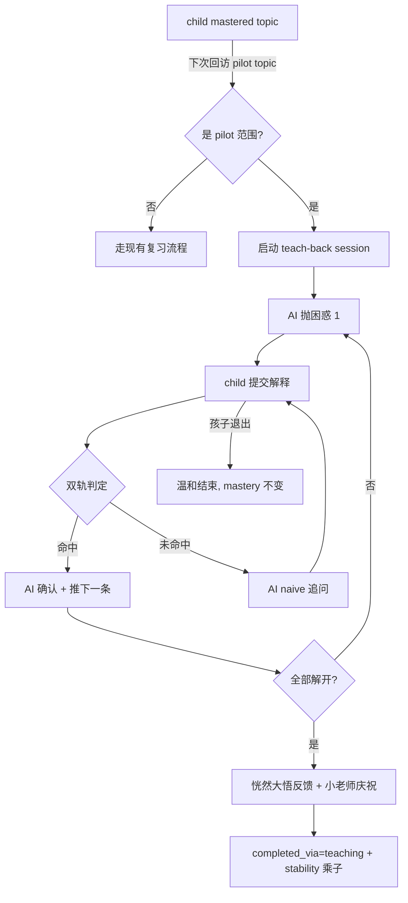
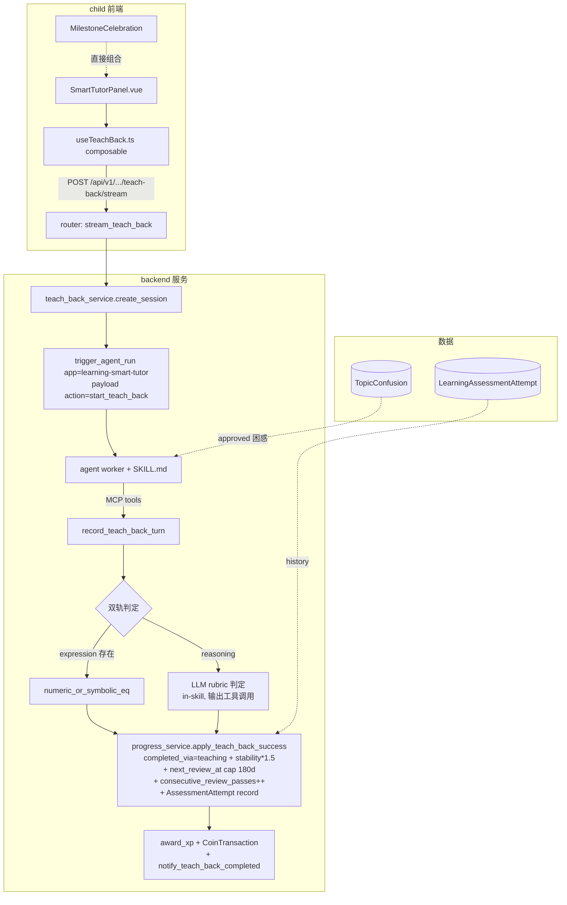

## Goal Capsule

- **Objective:** 在 Learning OS 中新增一个"教 AI"的教学会话，让已掌握某 topic 的孩子通过向 AI 学生解释，验证并加固自己的理解；成功后写入新的教学记录、拉长该 topic 的下次复习间隔，并触发一次"小老师"庆祝。
- **Authority:** 产品契约在本文件内；规划决策（实现机制、schema 细节、LLM prompt 全文）由 `ce-plan` 在 KTD 里决定。
- **Execution profile:** 全栈增量，**单 PR 交付**（pilot 范围小，单元间强耦合：模型/迁移/服务/SKILL/前端/seed 一起才能跑通一次教学 session）。后端：teach-back session 类型 + TopicConfusion 模型 + Alembic merge migration（fresh-DB guard）+ 教学 grading + progress 加固 + 庆祝/XP/通知；前端：teach-back 入口 UI + 对话组件 + MilestoneCelebration 集成；agent：teach-back SKILL.md prompt；seed：3 个 pilot topic 的困惑清单。复用现有 SmartTutor 传输与内容安全层。
- **Means:** 将 teach-back 作为现有 `learning-smart-tutor` app 的一个新 mode（通过 payload action 与独立 `session_type='teach_back'` 区分），而非注册为新 app；这样规避 6 处 app 注册联动改动，同时保留干净的 transcript 与独立的 mastery 信号。（KTD1）
- **Stop conditions:** 2 个孩子的定性试点完成后，产品所有者判定无法观察到理解深度差异，或 pilot 期间教学 session 完成率 < 30% → 暂停并评估是否继续扩展，不承诺 A/B。
- **Open blockers:** 无。但实施前须注意仓库存在一个**独立**的 P0 bug：`record_tutoring_step` 的 `VALID_PHASE_TRANSITIONS` 大小写不匹配（dict key 大写、wire 全小写，SKILL.md 与前端类型一致）且 `"end"` 不在任何合法转移集合中 —— 现有 tutor 的 phase tracker 从未推进、parent-notification 分支不可达。该 bug **不在本 issue 范围内**，但其存在意味着 teach-back 的 phase 机必须**独立声明**（不共用 `VALID_PHASE_TRANSITIONS`），或把该 bug 作为前置修复拆出。

---

## Product Contract

### Summary

在 SmartTutorPanel 上叠加一个"AI 求助"会话。当一个 topic 已经被孩子 mastered，下一次回访时触发一次独立的教学 session：AI 以"好奇的大朋友请求帮助"的游戏框架出现，逐条抛出为该 topic 预设的 2–4 个困惑；孩子的每段解释按**双轨判定** —— 数学表达式走 SymPy `numeric_or_symbolic_eq`，概念推理由 LLM 按对应困惑逐条匹配 —— 直到所有困惑被解开，AI 给出明确的"恍然大悟"反馈。成功写入新 `completed_via='teaching'` 记录，SM-2 stability 获得显著乘子（让下次复习间隔显著拉长），触发"小老师"庆祝；失败不降级 mastery，鼓励再试。试点限 3–5 个 math topic，age_group=mid，2 个孩子的定性试点；成功标准由产品所有者直觉 + 可回看的对话记录承载。

### Problem Frame

当前 Learning OS 里一个 topic 走到 `mastered` 后，孩子在地图上点亮它然后继续下一个 —— 没有 post-mastery 验证，没有延迟复述，没有教别人。掌握判定依赖单次 AI 评估 (`mastery_score ≥ 0.8`)，但没有任何信号证明孩子**能在没有提示的情况下组织出对概念的叙述**。

产品假设（非观察到的问题，仓库无数据支撑）：教别人比做题更能验证深度理解。这个假设来自教育研究里的"protégé effect"，但目前没有本产品的数据可以佐证"假性掌握"是否真实存在。本仓库 `docs/ideation/2026-10-20-learning-os-optimization-ideation.html:456` 曾明确否决过 "Peer Review & Teaching" —— 判为 "Too complex for family app with 1 child per family"。现在重新拾起，是因为两个基础设施变化让原方案的不可靠环节（验证正确性）变得可靠：SymPy 符号验证已落地（#215），SmartTutor 对话框架已成熟。

因此本契约**不承诺**"修复掌握虚高"这类产品主张 —— 成功标准是定性的 pilot 判断，不是统计显著性。"假性掌握"代理查询（mastered 后 30 天内 revisit 频率）在本地库无法运行（6308 条 mastered 全是一次性种子，`practice_attempts` 只有 2 条），需要等生产数据再决定优先级。

### Requirements

**触发与入口**

- R1. 当一个 topic 的 `mastery_level == 'mastered'` 且属于本次 pilot 的 3–5 个 topic 之一，孩子**下一次回访**（复习提醒 bucket 触发或地图点击进入）时，系统发起一次独立的"AI 求助"教学 session，不替换也不阻塞现有 tutor 流程。
- R2. 每个 pilot topic 必须预先有一份**预设困惑清单**（preset confusion list），含 2–4 条该 topic 上孩子可能面对的 misconceptions。清单由人工在 pilot 启动前编写，不允许由 LLM 在运行时生成。
- R3. AI 的"求助"语气遵循现有 §7.5 人格 —— "好奇的大朋友请求帮助"（"这个我总是搞不懂，你能帮我吗？"），是游戏框架，不是欺骗。

**对话与验证**

- R4. 孩子每次提交的解释按**双轨判定**：
  - 若解释内嵌可解析的数学表达式 → 走 `symbolic_equivalence.numeric_or_symbolic_eq`，与预设困惑中关联的标准表达式比较。
  - 概念推理部分（无表达式可验）→ 由 LLM 按该条困惑的判定 rubric 判定是否命中。
- R5. AI 学生**不直接给答案**。当孩子的解释未命中当前困惑时，AI 用 naive 追问引导（"为什么你觉得是这样？""如果把 1/3 换成 2/3 呢？"），追问内容受同一内容安全层（`content_safety_filter.py`）约束，与现有 tutor 一致。
- R6. 当预设困惑清单**全部被命中**时，AI 给出明确的"恍然大悟"反馈 —— 具体到"啊！我知道了！因为 [复述孩子的关键一句]！谢谢你！"。反馈不使用空泛表扬（符合 §7.5 "不过度表扬"约束）。

**状态与奖励**

- R7. 教学成功**更新**现有 `learning_progress` 行的 `completed_via='teaching'`（`learning_progress` 有 `UniqueConstraint(child_id, topic_id)`，不能插第二行；`completed_via` 语义是"最近一次掌握的达成机制"，与 `ai_assessment` / `parent_approval` / `practice_session` / `parent_override` 并列）。同时在 `LearningAssessmentAttempt(assessment_type='teach_back')` 中写入一条历史记录 —— 这是可复现的多轮教学轨迹来源（规划时根据代码证据从"新记录"调整为"更新 + 历史行"，产品意图不变）。
- R8. 教学成功对该 progress 的 SM-2 `stability` 施加乘子（规划决定 **1.5×**，配合 `ease_factor=2.5` 让下次复习间隔从 ~6 天拉到 ~30 天；同时 `next_review_at` 显式 cap 到 **180 天**，防止 `compute_next_review` 在 `stability*ease` 指数后给出世纪尺度的 revisit，破坏 R1 的下次触发）。新增 `consecutive_review_passes` 字段到 `learning_progress`（通过 Alembic merge migration，带 fresh-DB 守卫），每次教学成功 +1；该字段是"连续 3 次复习通过 → 牢固掌握"规则的实现基础。
- R9. 教学失败**不降级** mastery_level；不扣除任何奖励；鼓励再试。失败不写入 negative 信号。
- R10. 触发一次"小老师"庆祝。后端：`stats_service.award_xp` + `CoinTransaction(transaction_type='learning_earn', ref_id=teach_back_attempt_id)` + `check_and_record_milestones`；奖励档位规划决定为 **25 XP / 20 coins**（高于 AI 评估的 20/15，反映教学的更高努力与更强证据；`CoinTransaction` 的 `UniqueConstraint(ref_id, transaction_type)` 要求用 teach-back attempt id 作 ref，避免与既有 `learning_earn` 行冲突）。前端：直接组合 `MilestoneCelebration`（绕过 chore-task 形态的 `useCelebration`，因为 teach-back 没有 task list）；新增 `first_teach_back` 里程碑类型与对应 i18n。

**试点约束**

- R11. Pilot topic 范围严格限定为数学学科、3–5 个 topic、`age_group="mid"`（8–10 岁）。非数学 topic、其他 age_group 在本契约不启用该入口。
- R12. Pilot 成功标准由产品所有者定性判断 + 可回看的对话 transcript 承载；不承诺 A/B 分组、不承诺 1 周后的 retention/transfer 分数、不承诺 n≥30 的实验样本量。
- R13. 教学 session 的完整 transcript（AI 与学生所有消息 + 每条困惑的命中判定 + 最终结果）必须可被产品所有者回看。家长侧可见性沿用现有 AI 对话记录机制，不另开新页面。

**安全与合规**

- R14. AI 学生生成的所有内容走现有 `content_safety_filter.py`，与 Phase 1 硬需求一致。触发时显示友好替代消息，不暴露过滤机制。
- R15. 双轨判定的 SymPy 路径必须保持 `symbolic_equivalence` 现有的等价语义（允许代数等价形式，拒绝数值不等）；不引入新的判定规则。

### Key Decisions

- **掌握后触发，独立 session。** 教学作为掌握后的确认层，独立于现有 tutor session，不改动现有掌握判定路径。替代方案（嵌入 Phase 4 consolidate、地图常驻入口）被否决：前者在孩子刚学完时要求教别人太难，后者在孩子只有 2 个的 pilot 里依赖孩子主动点，风险过高。
- **预设困惑清单（人工编写）。** 每个 pilot topic 2–4 条 misconceptions，驱动"恍然大悟"的逐步解锁。否决 LLM 动态生成：2 个孩子试点里生成质量难以控制，调试成本高于直接手写。否决"整体质量分"：判定不可复现，失去"教"的游戏感。
- **双轨验证。** 数学表达式走 SymPy，概念推理走 LLM，分别匹配预设困惑。否决纯 LLM（丢 #215 价值）与"遇到表达式才验证"（判定路径不可复现）。
- **加固 SM-2 + 称号，不降级失败。** 教学成功给 stability 乘子 + `completed_via='teaching'` + 一次"小老师"庆祝；失败不惩罚。否决"纯荣誉层"（与"最高级别的掌握"的产品意图不符）与"失败降级"（违反 §6.1 "不惩罚"原则）。
- **一次成功教学 = 1 次 review pass。** 按现有"连续 3 次复习通过 → 牢固掌握"规则，一次成功教学计为该规则的 1 次复习通过（`consecutive_review_passes` +1）。这让教学真正成为牢固掌握的快车道。（session-settled: user-approved — synthesis 中作为 call-out 提出，用户确认。）

### Actors

- A1. **孩子（pilot 2 个）**。年龄 8–10 岁，已 mastered 某 pilot topic。在教学 session 中扮演"老师"角色，用自己的话解释概念、回应 AI 学生的 naive 追问、嵌入数学表达式验证。
- A2. **AI 学生 persona**。游戏化的"好奇的大朋友"。不直接给答案；按预设困惑清单逐条提问；在困惑全解后给出明确的恍然大悟反馈；所有输出受内容安全层约束。
- A3. **产品所有者**。定性评判 pilot 结果；查看 transcript；必要时为后续 pilot topic 编写困惑清单。

### Key Flows

- F1. **Post-mastery teach-back**
  - **Trigger:** 孩子下一次访问某 mastered pilot topic（复习提醒 bucket 或地图点击）。
  - **Actors:** A1, A2
  - **Steps:**
    1. 系统识别该 topic 属于 pilot 范围、`mastery_level == 'mastered'`、尚未有成功的 teaching 记录 → 启动教学 session。
    2. AI 学生以"求助"话术开场（"这个 topic 我总是搞不懂，你能帮我吗？"），并抛出第 1 条困惑。
    3. 孩子提交解释。双轨判定：表达式走 SymPy，推理走 LLM。
    4. 若命中当前困惑 → AI 显式确认"这条我懂了"，推进到下一条困惑；若未命中 → AI 用 naive 追问引导（R5），不跳过孩子的错误。
    5. 重复 3–4 直到所有困惑被命中。
    6. AI 给出"恍然大悟"反馈（R6），复述孩子关键一句。
    7. 写入 `completed_via='teaching'` 记录、stability 乘子、触发"小老师"庆祝。
  - **Outcome:** 孩子对该 topic 的下次复习间隔显著拉长； transcript 完整落库。
  - **Covers R1, R3, R4, R5, R6, R7, R8, R10.**

- F2. **Teach-back 失败 / 中途放弃**
  - **Trigger:** 孩子连续 2 次未命中当前困惑，或主动退出。
  - **Actors:** A1, A2
  - **Steps:**
    1. AI 学生温和结束（"没关系！我们下次再一起想！"），不给出答案。
    2. session 标记为未完成，**不写入** `completed_via='teaching'`、**不改动** stability、**不触发**庆祝。
    3. mastery_level 保持 mastered，下次回访时**可以**再发起教学（不强制冷却）。
  - **Outcome:** mastery 状态无损；孩子可再试。
  - **Covers R9.**

### Acceptance Examples

- AE1. **成功教学，全部困惑解开。**
  - **Covers R1, R4, R6, R7, R8, R10.**
  - **Given:** 孩子已 mastered "同分母分数相加"，topic 属于 pilot。
  - **When:** 孩子下次回访该 topic，AI 开场："这个我总是搞不懂：1/4 + 2/4 为什么等于 3/4 而不是 3/8？你能帮我讲讲吗？" 孩子解释："因为分母一样，就是 4 份里取 1 份再加 2 份，所以是 3 份；分母不用变。" SymPy 验证嵌入表达式 `1/4 + 2/4 ≡ 3/4`（通过），LLM 判定命中"分母不变"这一条困惑。
  - **Then:** AI 显式确认这一条，推进下一条（若有），全部解开后 AI 复述孩子关键一句并感谢；写入 `completed_via='teaching'`，stability 乘子生效，下次复习间隔显著拉长；"小老师"庆祝触发；transcript 完整落库。

- AE2. **部分命中 + naive 追问。**
  - **Covers R4, R5.**
  - **Given:** 孩子已 mastered "面积"，pilot 范围。
  - **When:** AI 抛出困惑："为什么长×宽等于面积？" 孩子答："因为要数方块。" SymPy 无可验表达式，LLM 判定未完全命中"可加性"那条困惑。AI 追问："如果长是 3、宽是 2，你数数有几块？" 孩子答："6 块，因为 3 行 × 2 列 = 6。" SymPy 验证 `3*2 = 6`（通过），LLM 判定命中。
  - **Then:** AI 显式确认，推进下一条；不直接给出答案；transcript 显示追问过程。

- AE3. **孩子失败 / 中途放弃。**
  - **Covers R9.**
  - **Given:** 同上场景，孩子第 2 次追问仍未命中，或点"不想教了"退出。
  - **When:** AI 温和结束（"没关系，下次再一起想！"）。
  - **Then:** session 标记为未完成；不写入 `completed_via='teaching'`；mastery_level 保持 mastered；不扣 XP/coin；transcript 仍完整落库。

### Success Criteria

- 产品所有者完成 2 个孩子的 pilot 后，能基于 transcript 给出明确的"继续 / 调整 / 停止"判定。
- 教学 session 的 transcript 可被产品所有者按 session_id / topic_id / 结果 检索查看。
- `completed_via='teaching'` 记录可见、stability 乘子对下次复习间隔的影响可测量。

### Scope Boundaries

**Deferred for later**

- A/B retention/transfer 实验（n≥30、1 周后 delayed post-test、transfer task 测量工具）。当前 pilot 不承诺，待 pilot 结果决定是否扩展。
- 非数学学科扩展。dual-track 中的 SymPy 轨道仅对数学有效；非数学需要 LLM-only 或另外的验证方案，留到下一轮。
- 语音输入（ASR）。仓库内当前无任何语音能力；显式延期，不做。
- BKT 参数根据 teaching 结果重新校准。pilot 不重新调参；成熟系统再引入。
- "假性掌握"代理查询（mastered 后 30 天 revisit 频率）—— 本地库无真实行为数据，等生产数据再决定优先级。

**Outside this product's identity**

- 教学 session 不作为掌握判定的前置条件（不取代现有 AI 评估路径）。
- 教学失败不惩罚、不降级 mastery。

### Dependencies / Assumptions

- **Dependencies:**
  - `#215` SymPy 符号验证内核（已合入 main）。
  - 现有 SmartTutor 传输与内容安全层（SSE 流、`content_safety_filter.py`、§7.5 人格）。
  - 现有 mastery 状态机与 `completed_via` enum 扩展点。
  - 现有 celebration system 与 XP/coin 发放链路。
- **Assumptions:**
  - 3–5 个 pilot topic 的困惑清单可由产品所有者在 pilot 启动前手工编写完成。
  - 2 个 pilot 孩子已能访问到 mastered 状态的 math topic（现有 seed 数据满足）。
  - 教学 session 的 LLM 判定 rubric 可由 pilot topic 的困惑清单直接构造，不需要额外训练。

### Outstanding Questions

**Resolved by Planning (kept as reference)**

- ~~`stability` 乘子~~ → 1.5×，`next_review_at` cap 180 天（R8、KTD3）
- ~~`completed_via='teaching'` 的历史存储~~ → `LearningAssessmentAttempt(assessment_type='teach_back')`（R7）
- ~~XP/coin 档位~~ → 25 XP / 20 coins，ref_id 用 teach-back attempt id（R10）
- ~~session_type~~ → `'teach_back'`（KTD1）
- ~~transcript 家长侧可见性~~ → 复用现有 AI session logs，新增 teach-back 解析器（U6）
- ~~pilot topic 选取~~ → 3 个数学 topic，按 `centrality` 选 + 人工 sign-off（`review_status='approved'`）（U3）

### Sources / Research

- `frontend/apps/child/src/components/learning/smart-tutor/SmartTutorPanel.vue` —— 现有 SmartTutor 入口与 SSE 流（`useSmartTutor.ts`，TutorPhase 状态机）。
- `frontend/apps/child/src/components/learning/smart-tutor/SocraticSteps.vue`、`TeacherAvatar.vue` —— 引导式步骤与角色表现可复用。
- `server/apps/backend/app/services/learning/smart_tutor_service.py` —— 现有 tutor 服务，新增 teach-back session 的入口候选。
- `server/apps/backend/app/services/learning/symbolic_equivalence.py` —— `numeric_or_symbolic_eq` 与 `symbolic_eq` 为双轨验证的 SymPy 轨道。
- `server/apps/backend/app/services/learning/progress_service.py` —— mastery 状态机、`completed_via` enum、`compute_next_review` SM-2、`transition_to_mastered`；新增 `teaching` 值的插入点。
- `server/apps/backend/app/services/learning/practice_progress_integration.py` —— practice session 与 progress 集成的参考模式。
- `server/apps/agent/skills/builtin/public/learning-smart-tutor/SKILL.md:288-302` —— Phase 4 `consolidate` 现有 self-reflection 回合（teach-back 与其相邻但语义不同）。
- `docs/plans/2026-09-28-001-learning-os-product-brainstorm.md` §7（AI Tutor 四重角色 + §7.5 人格 + §7.6 内容安全）、§5.4（Mastery 规则 + "连续 3 次复习通过 → 牢固掌握"）、§6.1（不惩罚原则）、§6.3（XP 防刷）。
- `docs/ideation/2026-10-20-learning-os-optimization-ideation.html:456` —— 原否决记录；本契约在其上重建。
- `server/apps/backend/app/reconcile/resources/feature_flag.py` —— 现有 feature flag 是进程内 kill switch，不是 cohort 分配；本契约不需要 cohort 基础设施。

> **Product Contract preservation:** restructured, no scope change. R7/R8/R10 的机制表述根据代码证据调整（"新记录"→"更新 + 历史行"、乘子落地参数、庆祝/XP 具体档位），产品意图（记录成功、加固 SM-2、触发庆祝）未变；旧 R-IDs 含义保留，新增的细节为实施契约所需。A/F/AE IDs 原样保留。

---

## Planning Contract

### Key Technical Decisions

KTD1. **复用 `learning-smart-tutor` app，不注册新 app。** teach-back 作为该 app 的一个新 mode，通过 payload `action: "start_teach_back" | "answer_confusion"` 与独立的 `session_type='teach_back'` 区分；复用同一 `trigger_agent_run` 链路、同一 `_SIMPLE_APPS` 配置、同一 SSE 网关。否决独立 `learning-teach-back` app —— 后者需改 6 处 lockstep 注册（worker、gateway、RESERVED_NAMES、system_ids、agents bootstrap、i18n maps）且两个 exact-match 测试会失败，pilot 范围不值得该开销。Governs R1, R13。

KTD2. **预设困惑清单用 `TopicConfusion` 表，镜像 `TopicHookQuestion`。** 字段：`id`/`topic_id`（FK, cascade delete）/`sequence`（排序）/`confusion_text`/`confusion_text_zh`/`age_group`/`rubric`（Text，LLM 判定 rubric）/`expected_expression`（Text nullable，SymPy 比较用）/`review_status`（default `pending`；pilot 手工行置为 `approved`，`get_teach_back_confusions` 仅返回 approved，这是 R2 "人工编写不允许运行时 LLM 生成" 的强制执行机制）/`created_at`。`UniqueConstraint(topic_id, age_group, sequence)`。Governs R2, R4。

KTD3. **stability 乘子 1.5×，`next_review_at` cap 180 天。** 教学成功调用 `progress.stability = min(progress.stability * 1.5, 30.0)`（复用 `update_stability` 的 30.0 上限），然后 `progress.next_review_at = min(compute_next_review(progress), now + 180 days)`。否决无 cap —— `compute_next_review` 在 `stability=30, ease=2.5` 下给出 `6 * 2.5**28` 天，R1 的下次触发永远不 firing。否决更大乘子（2.0×）—— 在 ease 指数下间隔差异不大，但 pilot 可观察性下降。Governs R8。

KTD4. **新增 `consecutive_review_passes` 字段到 `learning_progress`。** `Integer, default=0, server_default="0"`；教学成功 +1，复习失败 reset 为 0，复习通过 +1。达到 3 时标记 `mastery_level='firmly_mastered'`（或同等语义，规划决定复用 `stability>=10` 作为"牢固掌握"的等价信号，避免引入新状态机状态）。迁移为 merge migration，带 fresh-DB 守卫（参照 `rwc001` 模式）。否决"不实现该字段，仅靠 stability 乘子"—— 该字段已在 2026-09-28 brainstorm 中明确规划，本契约批准该规划。Governs R8。

KTD5. **专用 `create_teach_back_session`，不复用 `create_session`。** 理由：`session_service.create_session` 会自创 `LearningAssignment`（teach-back 不需要）、会 `available → learning` 自动转换（teach-back 已 mastered，无害但语义混乱）、会跨 source taxonomy 校验（teach-back 用相同 topic，但语义上不应重复校验）。新函数直接构造 `LearningSession(child_id=..., topic_id=..., session_type='teach_back')` + `db.flush()`，参照 `practice_service.create_session` 模式。Governs R1, R13。

KTD6. **in-skill LLM 评分（pilot），不建独立 agent endpoint。** teach-back 的 LLM 在 SKILL.md 内自行判定每条困惑是否被命中，输出结构化 JSON 工具调用（`record_teach_back_turn {confusion_id, verdict, extracted_expression}`）。否决新建 `POST /grade-explanation` agent endpoint —— pilot 范围不值得新 infra，且现有 `check_ai_graded`/`validate_layer3_ai_cross` 的 httpx 链路本身已坏（指向不存在的 `/grade` 与 `/cross-validate-question`），修好后再复用。否决 in-process backend LLM（`ai_result_parser._call_llm`）—— 路径大、需 provider 解析 + ai_crypto，且 `SkillConfig.prompt` 已被证明是死数据，rubric 必须在 SKILL.md body 中。Governs R4, R15。

KTD7. **表达式提取步骤：LLM 输出结构化字段，正则兜底。** SKILL.md 指示 LLM 在每轮工具输出中同时提供 `child_expression`（从孩子解释里提取的数学表达式字符串）与 `child_reasoning`（概念解释原文）。`child_expression` 直接喂给 `numeric_or_symbolic_eq`；若 LLM 无法提取，退回正则（`\d+/\d+`、简单算术）；正则也无 → SymPy 轨道该轮 skip。否决纯 LLM 文本内隐式提取 —— `numeric_or_symbolic_eq` 需要裸表达式，不能直接吃散文。Governs R4, R15。

### High-Level Technical Design

### Assumptions

- `learning-smart-tutor` app 的 `multitask_strategy="reject"` 在 teach-back session 与 tutor session 并发时拒绝第二个；pilot 范围 2 孩子不会触发并发，但 plan 实施时需验证 session_type 区分是否足以让两个 session 共存。若不能共存，teach-back 必须独占 thread_id。
- pilot 的 3 个 math topic 的 `TopicConfusion` 行由产品所有者在实施前手工 seed；若 seed 延迟，`review_status='pending'` 会让 `get_teach_back_confusions` 返回空，teach-back 启动会 404 —— 前端需处理该降级（显示"老师还在准备题目"）。
- `ChildLayout.vue` 的 `KeepAlive + Transition` 在 learning 路由当前 uncached，teach-back 表面保持 uncached；若未来 learning 路由被缓存，需重新评估 teach-back 的状态保留语义。
- `on_disconnect: "continue"` 是页面离开连续性的需要，但 teach-back 的成功**必须**显式依赖"所有困惑被命中"事件，不得依赖 stream 结束 —— 否则孩子离开页面后 stream 继续 → 假性成功。SKILL.md 与后端都必须以此为准。
- 现有 record_tutoring_step 的 P0 bug（case mismatch + missing "end"）不在本 issue 范围；teach-back 的 phase 机必须独立声明（`TEACH_BACK_PHASES` dict），不共用 `VALID_PHASE_TRANSITIONS`。该 bug 可作为相邻 issue 跟进。

---

## Implementation Units

### U1. TopicConfusion 模型 + Alembic merge migration

- **Goal:** 新增 `topic_confusions` 表承载预设困惑清单；新增 `learning_progress.consecutive_review_passes` 字段；Alembic migration 作为 merge migration（现有两个 head `rwc001`、`h0011q22r3s4`），带 fresh-DB 守卫。
- **Requirements:** R2, R4, R8 (consecutive_review_passes 字段)
- **Dependencies:** 无（其他 unit 依赖本 unit 的模型）
- **Files:**
  - `server/packages/db/models/learning/confusion.py`（新增）
  - `server/packages/db/models/learning/progress.py`（add `consecutive_review_passes` column）
  - `server/packages/db/models/learning/__init__.py`（导出新模型）
  - `server/apps/backend/alembic/versions/xxxx_add_topic_confusions_and_review_passes.py`（新增，merge migration）
- **Approach:**
  1. 仿 `TopicHookQuestion`（`server/packages/db/models/learning/hook.py`）设计 `TopicConfusion`：`id (BigInteger, PK)` / `topic_id (FK learning_topics.id, CASCADE, index)` / `sequence (Integer, default=0)` / `confusion_text (Text)` / `confusion_text_zh (Text nullable)` / `age_group (String(10), default='mid')` / `rubric (Text)` / `expected_expression (Text nullable)` / `review_status (String(10), default='pending', server_default='pending')` / `created_at (UTCDateTime, server_default=func.now())`。`UniqueConstraint(topic_id, age_group, sequence, name='uq_confusion_topic_age_seq')`。
  2. `LearningProgress` 加 `consecutive_review_passes: Mapped[int] = mapped_column(Integer, nullable=False, default=0, server_default='0')`。
  3. Alembic 迁移：`op.create_table` + `op.add_column`，参照 `rwc001_add_real_world_connections_to_topics.py` 的 fresh-DB 守卫模式（`if not op.get_context().has_table(...)`）。merge migration 的 `down_revision` 指向现有两个 head。
  4. `downgrade()`：drop column、drop table（反向序）。
- **Test scenarios:**
  - 迁移在空 DB（fresh install）上可重入运行不报错。
  - 迁移在已有两 head 的 DB 上成功合并并创建表 + 列。
  - `TopicConfusion` 的 `UniqueConstraint` 拒绝重复 (topic_id, age_group, sequence)。
- **Verification:** `cd server && uv run alembic upgrade head` 在 fresh DB 与现有 DB 上均通过；模型导入成功。

### U2. Pilot topic 困惑清单 seed 脚本

- **Goal:** 为 3 个 pilot math topic 编写手工困惑清单（2–4 条/topic），通过 seed 脚本写入 `topic_confusions` 表，`review_status='approved'`。
- **Requirements:** R2, R11
- **Dependencies:** U1
- **Files:**
  - `server/scripts/seed_teach_back_confusions.py`（新增）
  - `server/tests/backend/scripts/test_seed_teach_back_confusions.py`（新增）
- **Approach:**
  1. 仿 `server/scripts/seed_hook_questions.py` 结构：模块级 `SAMPLE_CONFUSIONS: dict[str, list[dict]]` keyed by `topic_key`（跨环境可移植）。
  2. 选 3 个 mid age_group 数学 topic，优先选 `centrality` 高、在现有 seed 中已 mastered 的（例如 Adding Fractions Same Denominator、Rectangle Area、Simple Fraction Equivalence）。
  3. 每个 topic 写 2–4 条困惑：`confusion_text`/`confusion_text_zh`/`rubric`（LLM 判定 rubric）/`expected_expression`（SymPy 比较用，如 `"3/4"` 或 `"1/4 + 2/4"`）。
  4. 脚本幂等：`session.query(TopicConfusion).filter_by(topic_id=...).delete()` 后再 bulk insert。
- **Test scenarios:**
  - 脚本运行两次结果一致（幂等）。
  - 每条困惑的 `review_status == 'approved'`。
  - 缺 `topic_key` 的 topic 时脚本告警但不崩溃。
- **Verification:** `cd server && uv run python scripts/seed_teach_back_confusions.py` 成功，`SELECT count(*) FROM topic_confusions WHERE review_status='approved'` 返回 6–12。

### U3. teach-back session 创建 + 路由端点

- **Goal:** 后端新增 `POST /child/learning/sessions/{sessionId}/teach-back/stream` 路由；专用 session 创建函数；触发 agent 跑 `learning-smart-tutor` app，payload 带 `action='start_teach_back'` + 困惑清单 JSON。
- **Requirements:** R1, R3, R13
- **Dependencies:** U1, U2
- **Files:**
  - `server/apps/backend/app/services/learning/teach_back_service.py`（新增）
  - `server/apps/backend/app/routers/learning_child.py`（新增 `stream_teach_back` endpoint）
  - `server/apps/backend/app/schemas/learning.py`（新增 `TeachBackStreamRequest`）
  - `server/tests/backend/services/learning/test_teach_back_service.py`（新增）
  - `server/tests/backend/routers/test_learning_child_teach_back.py`（新增）
- **Approach:**
  1. `teach_back_service.create_teach_back_session(db, child_id, topic_id)`：直接构造 `LearningSession(child_id=..., topic_id=..., session_type='teach_back')` + `db.flush()`；不创建 `LearningAssignment`；不做 `available → learning` 转换；不做跨 source taxonomy 校验。
  2. `validate_teach_back_request(db, session_id, child_id)`：加载 session + progress；校验 `mastery_level == 'mastered'` 且 topic 在 pilot 范围（可配置或硬编码 3 topic id）；调用 `get_teach_back_confusions(db, topic_id, age_group='mid')`（仅返回 `review_status='approved'`）；若无困惑 → `AppError(LEARNING_TOPIC_NOT_FOUND)` 或友好提示。
  3. 路由端点 `stream_teach_back`：参照 `stream_smart_tutor`（`learning_child.py:865`）复制 SSE 链路；payload 构造：`{"action": "start_teach_back" | "answer_confusion", "confusions": [...], "child_answer": "..." | null}`；`metadata={"app": "learning-smart-tutor", "session_id": ..., "topic_id": ..., "language": ...}`；`trigger_agent_run` 调用与 smart tutor 同链路。
  4. 前端入口：`SmartTutorPanel.vue` 增加 `mode: 'tutor' | 'teach_back'` prop；`useTeachBack.ts` 新 composable 复制 `useSmartTutor.ts` 的 SSE 处理逻辑，替换 endpoint 与 payload；在地图点击 mastered topic 时（或复习提醒 bucket 触发时）切换为 teach_back 模式。
- **Test scenarios:**
  - `mastery_level != 'mastered'` 的请求 → 400/404 错误。
  - topic 不在 pilot 范围 → 友好错误。
  - 正常流程返回 SSE 流。
  - 前端 composable 正确处理 start/answer 切换。
- **Verification:** 后端 pytest 通过；前端组件测试通过；手动验证 SSE 流可连接。

### U4. teach-back 服务 grading 逻辑

- **Goal:** 双轨判定实现：SymPy 表达式比对 + in-skill LLM rubric 判定；工具调用记录每次判定结果。
- **Requirements:** R4, R5, R6, R15
- **Dependencies:** U1, U3
- **Files:**
  - `server/apps/backend/app/services/learning/teach_back_grading.py`（新增）
  - `server/apps/backend/app/services/mcp_session.py`（新增 `record_teach_back_turn` MCP 工具 handler）
  - `server/apps/backend/app/services/mcp_tool_registry.py`（注册新工具）
  - `server/apps/agent/skills/builtin/public/learning-smart-tutor/SKILL.md`（新增 teach-back 章节）
  - `server/tests/backend/services/learning/test_teach_back_grading.py`（新增）
- **Approach:**
  1. `teach_back_grading.grade_expression(expected_expr: str, child_expr: str) -> bool | None`：复用 `numeric_or_symbolic_eq`；失败返回 False，解析失败返回 None（让 SKILL 决定下一步）。
  2. `teach_back_grading.extract_expression(child_text: str) -> str | None`：LLM 输出结构化字段（首选），正则兜底（`\d+/\d+`、`\d+\s*[*xX/+\-]\s*\d+` 等）。
  3. LLM rubric 判定**完全 in-skill**：SKILL.md 在 teach-back 模式下指示 LLM 对每段解释输出工具调用 `record_teach_back_turn {confusion_id, verdict: "hit" | "miss", extracted_expression?, reasoning_summary}`；后端只持久化 verdict，不独立调 LLM。
  4. `record_teach_back_turn` MCP 工具：写入 `LearningSession.progress_json`（append `{confusion_id, verdict, extracted_expression, reasoning_summary}`）；更新会话状态；若全部 hit → 触发 U5 的成功路径。
  5. SKILL.md 新增 teach-back 章节：3-phase 状态机（`present_confusion` → `evaluate_explanation` → `resolve_or_probe`），persona 约束（"好奇的大朋友"、不直接给答案、naive 追问），内容安全规则（与现有 tutor 一致），工具 fallback 表。rubric 文本在 `input.messages[0].content` 中随困惑清单一起传递（不依赖 `SkillConfig.prompt`，已证实为死数据）。
  6. 独立 `TEACH_BACK_PHASES` dict（不复用 `VALID_PHASE_TRANSITIONS`，避开现有 bug）。
- **Test scenarios:**
  - SymPy 轨道：`1/4 + 2/4` vs `3/4` → True；`1/4 + 2/4` vs `3/8` → False；乱码 → None。
  - 表达式提取：从"因为 4 份里取 1 份再加 2 份就是 3 份，1/4 + 2/4 = 3/4" 中提取 `"1/4 + 2/4 = 3/4"`。
  - `record_teach_back_turn` 写入 progress_json 并可读回。
  - 全部 hit 后触发成功路径。
- **Verification:** 单元测试覆盖 SymPy + regex + verdict persistence；集成测试跑完一次 teach-back session 得到完整 progress_json。

### U5. teach-back 成功 / 失败的 progress 更新

- **Goal:** 教学成功更新 progress（`completed_via='teaching'` + stability 乘子 + `next_review_at` cap 180d + `consecutive_review_passes++` + `LearningAssessmentAttempt` 历史记录）；失败不降级。
- **Requirements:** R7, R8, R9
- **Dependencies:** U1, U4
- **Files:**
  - `server/apps/backend/app/services/learning/progress_service.py`（新增 `apply_teach_back_success`、扩展 `completed_via` 验证列表）
  - `server/apps/backend/app/services/mcp_session.py`（在全部 hit 时调用 success 路径；失败时仅 close session）
  - `server/tests/backend/services/learning/test_progress_service_teach_back.py`（新增）
- **Approach:**
  1. `progress_service.apply_teach_back_success(db, progress)`：
     - `progress.completed_via = 'teaching'`（扩展现有验证列表 `('ai_assessment', 'parent_approval', 'practice_session', 'parent_override', 'teaching')`）。
     - `progress.stability = min(progress.stability * 1.5, 30.0)`。
     - `progress.consecutive_review_passes += 1`。
     - `next_review = compute_next_review(progress)`；cap：`progress.next_review_at = min(next_review, now + timedelta(days=180))`。
     - `progress.last_practice_at = now`。
     - 写入 `LearningAssessmentAttempt(assessment_type='teach_back', child_id=..., topic_id=..., session_id=..., is_correct=True)`（该表已有 `assessment_type: String(20)` 自由字段）。
  2. 失败路径：仅关闭 `LearningSession`（`ended_at = now`），不修改 progress。
  3. 不调用 `transition_to_mastered`（已经 mastered，VALID_TRANSITIONS 不允许 mastered → mastered）。
- **Test scenarios:**
  - 成功：`completed_via` 更新、`stability * 1.5`、`next_review_at <= now + 180d`、`consecutive_review_passes` +1、AssessmentAttempt 记录存在。
  - 失败：progress 完全不变。
  - `completed_via='teaching'` 在现有 4 值验证列表外不抛错。
- **Verification:** 单元测试覆盖；DB 直接查询验证字段值。

### U6. 庆祝 / XP / coin / 家长通知

- **Goal:** 教学成功触发 XP/coin 奖励 + milestone 记录 + 家长通知；transcript 在家长侧可见。
- **Requirements:** R10, R12, R13
- **Dependencies:** U5
- **Files:**
  - `server/apps/backend/app/services/mcp_session.py`（teach-back 成功后调 `award_xp`、创建 `CoinTransaction`、调 `check_and_record_milestones`、调 `notify_teach_back_completed`）
  - `server/apps/backend/app/services/notification/dispatcher.py`（新增 `notify_teach_back_completed`，仿 `notify_smart_tutor_completed`）
  - `server/apps/backend/app/services/milestones.py`（新增 `_TEACH_BACK_MILESTONES`）
  - `server/apps/backend/app/routers/learning_family.py`（新增 `_parse_teach_back_steps` transcript 解析器，仿 `_parse_smart_tutor_steps`）
  - `frontend/apps/child/src/api/milestones.ts`（新增 `first_teach_back` 类型）
  - `frontend/apps/child/src/i18n/...`（新增 milestone i18n 键）
  - `frontend/apps/child/src/components/learning/TeachBackResult.vue`（新增，直接组合 `MilestoneCelebration`）
  - `server/tests/backend/routers/test_learning_family_teach_back.py`（新增）
- **Approach:**
  1. 成功路径：`stats_service.award_xp(db, child_id, family_id, 25)` + `CoinTransaction(family_id, child_id, 20, transaction_type='learning_earn', ref_id=attempt.id, narrative=f"教你学会啦：{topic_label}", narrative_emoji="🎓")` + `check_and_record_milestones(db, child_user_id, family_id, {"instance": None, "wish": None, "teach_back": topic_id})` + `notify_teach_back_completed(...)`。
  2. `notify_teach_back_completed`：仿 `notify_smart_tutor_completed`（`dispatcher.py:360`），dedup 1 小时。
  3. `_TEACH_BACK_MILESTONES = {1: "first_teach_back"}`；`check_and_record_milestones` 在 teach_back context 下检查该计数。
  4. 前端 `TeachBackResult.vue` 直接组合 `MilestoneCelebration`（不走 chore-task 的 `useCelebration`）；`first_teach_back` 类型新增 i18n 键。
  5. `_parse_teach_back_steps`：解析 `progress_json` 为 transcript，字段：`{confusion_id, verdict, child_explanation, extracted_expression, ai_follow_up}`。家长侧路由扩展：`/child/learning/sessions/{id}/teach-back/transcript`，仿 `learning_family.py:971`。
- **Test scenarios:**
  - 成功：XP +25、coin +20、`first_teach_back` milestone 记录、通知创建。
  - 同 ref_id 的重复 award 不重复发放（CoinTransaction unique constraint）。
  - 家长侧 transcript 返回完整对话 + 每条判定。
  - 前端 `first_teach_back` 渲染正确。
- **Verification:** 单元测试 + 集成测试通过；家长侧 transcript 可访问。

### U7. 前端 teach-back 入口与对话 UI

- **Goal:** 在 SmartTutorPanel 上叠加 teach-back 入口；新 composable；对话 UI 复用 SocraticSteps 与 TeacherAvatar；"恍然大悟" moment 渲染。
- **Requirements:** R1, R3, R6, R10, R12
- **Dependencies:** U3, U6
- **Files:**
  - `frontend/apps/child/src/composables/useTeachBack.ts`（新增）
  - `frontend/apps/child/src/components/learning/smart-tutor/TeachBackPanel.vue`（新增，仿 SmartTutorPanel）
  - `frontend/apps/child/src/components/learning/smart-tutor/ConfusionStep.vue`（新增，渲染单条困惑的 AI 求助 + 孩子解释 + 判定结果）
  - `frontend/apps/child/src/components/learning/TeachBackTrigger.vue`（新增，在 mastered topic 详情页 / 复习提醒中作为入口）
  - `frontend/apps/child/src/i18n/...`（新增 teach-back i18n 键）
  - `frontend/apps/child/src/components/learning/smart-tutor/TeachBackPanel.test.ts`（新增）
- **Approach:**
  1. `useTeachBack.ts`：复制 `useSmartTutor.ts` 的 SSE 处理逻辑；endpoint 换为 `/teach-back/stream`；payload 切换 `start_teach_back` / `answer_confusion`。
  2. `TeachBackPanel.vue`：接收 `{ sessionId, topicId, subject, ageGroup }`；显示当前困惑 + 孩子输入框 + 历史回合；在全部 hit 后显示"恍然大悟" + 庆祝。
  3. `ConfusionStep.vue`：单条困惑的回合 UI；显示 AI 的困惑提问 + 孩子的解释 + 判定结果（✓ 命中 / ❌ 未命中，后者带追问）。
  4. `TeachBackTrigger.vue`：在 mastered topic 详情页 / 复习提醒中作为入口按钮；仅在 topic 属于 pilot + `mastery_level == 'mastered'` 时显示。
  5. i18n：`teachBack.greeting`、`teachBack.confusion.{id}`、`teachBack.eureka`、`teachBack.celebrationTitle` 等。
  6. 绕过 `ChildLayout.vue` 的 KeepAlive（teach-back 页面不进 cache）。
- **Test scenarios:**
  - 入口按钮在 mastered pilot topic 显示、非 pilot topic 不显示。
  - SSE 流正确解析 + 渲染回合。
  - 全部 hit 后触发 MilestoneCelebration。
  - 失败不触发庆祝。
  - 页面离开后返回可继续对话（`on_disconnect: continue`）。
- **Verification:** Vitest 通过；手动验证完整 teach-back 流程（需后端启动）。

### U8. 集成测试 + 端到端验证

- **Goal:** 一次完整 teach-back session 的端到端验证：前端 → 后端 → agent SKILL → grading → progress 更新 → 庆祝 → transcript。
- **Requirements:** R1-R15（全部）
- **Dependencies:** U1-U7
- **Files:**
  - `server/tests/backend/integration/test_teach_back_e2e.py`（新增）
  - `tests/e2e/specs/teach-back.spec.ts`（新增）
- **Approach:**
  1. 后端集成测试：mock agent SKILL（直接喂入 `record_teach_back_turn` 工具调用模拟 LLM 输出）；完整流程：create session → start teach-back → 多轮 answer → 全部 hit → 验证 progress/coin/notification/transcript。
  2. E2E 测试：启动 dev server（`pnpm dev` + `uvicorn`），模拟 child 登录 → 点击 mastered pilot topic → 进入 teach-back → 多轮解释 → 验证"恍然大悟" + 庆祝 + transcript 在家长侧可见。
- **Test scenarios:**
  - AE1（成功教学）的完整 E2E 流程。
  - AE3（中途放弃）的完整 E2E 流程：验证 mastery 不变、无庆祝。
  - 页面离开后返回继续（`on_disconnect: continue`）。
- **Verification:** pytest 集成测试通过；playwright E2E 通过（CI 或 sim-test 运行）。

---

## Verification Contract

| 命令 | 范围 | 适用 unit |
|---|---|---|
| `cd server && uv run alembic upgrade head` | 迁移可重入、fresh DB 守卫 | U1 |
| `cd server && uv run pytest tests/backend/ -k teach_back` | 后端所有 teach-back 测试 | U1-U8 |
| `cd server && uv run pytest tests/backend/unit/test_mcp_session.py` | MCP session 既有测试不回归 | U4 |
| `cd server && uv run pytest tests/backend/unit/test_mcp_tool_registry.py` | 工具注册测试不回归 | U4 |
| `cd frontend && pnpm -F @numina/child test -- --run teach-back` | 前端 teach-back 测试 | U7 |
| `cd server && uv run ruff check apps/backend/app/services/learning/teach_back*.py apps/backend/app/routers/learning_child.py` | lint | 全部 |
| `cd server && uv run mypy apps/backend/app/services/learning/teach_back_service.py apps/backend/app/services/learning/teach_back_grading.py` | 类型检查 | U3, U4 |
| `cd server && uv run python scripts/seed_teach_back_confusions.py` | seed 脚本幂等 | U2 |
| `tests/e2e/scripts/run.sh` (or sim-test) | E2E 端到端 | U8 |

---

## Definition of Done

- 所有 unit 的 test scenarios 已实现并通过对应 Verification Contract 命令。
- Alembic 迁移在 fresh DB 与现有两 head 的 DB 上均可重入运行。
- 一次完整的 teach-back session（AE1）从前端入口 → SSE 流 → grading → progress 更新 → 庆祝 → transcript 全链路跑通。
- 失败场景（AE3）不修改 mastery、不触发庆祝、transcript 仍落库。
- `completed_via='teaching'` 在 progress 验证白名单中；`consecutive_review_passes` 字段存在且教学成功 +1。
- `next_review_at` 在 180 天 cap 内；stability 在 30.0 cap 内。
- 家长侧 transcript 路由返回完整 teach-back 对话 + 每条判定。
- `first_teach_back` milestone 在首次成功教学后记录；对应 i18n 渲染正确。
- 既有 tutor 流程无回归（`test_mcp_session.py`、`test_mcp_tool_registry.py`、`test_worker_simple_apps.py` 全绿）。
- **清理**：实验性/调试性代码已移除；无未使用的 imports/变量。
