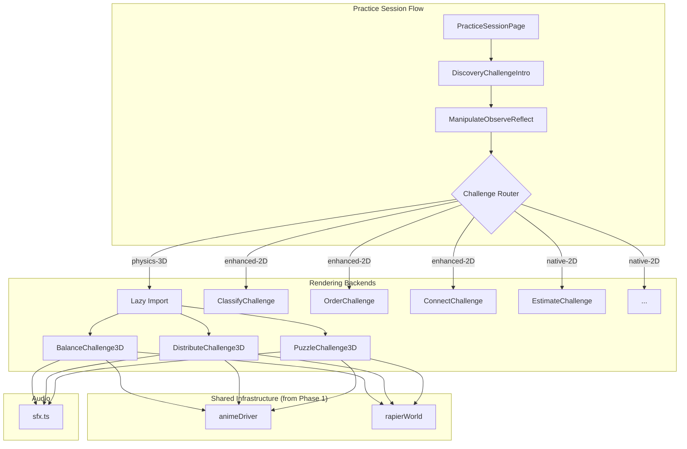
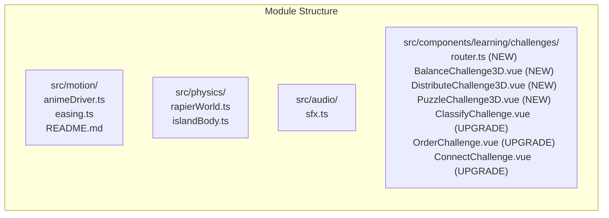

## Goal Capsule

- **Objective:** Transform the children's learning system from a 2D information-display tool into a spatial, physics-aware game world that children want to explore — achieving "learn through play, systematic growth" (寓教于乐、体系化成长).
- **Means:** Four-phase incremental 3D transformation: (1) 3D Knowledge Ocean with three.js + rapier + anime.js, (2) hybrid challenge engine combining physics-based and 2D challenges, (3) 3D Knowledge Castle, (4) unified world-view transitions.
- **Product authority:** This plan covers the overall vision and Phase 2 (hybrid challenge engine) requirements. Phase 1 is fully specified in [GitHub issue #243](https://github.com/vincentruan/numina/issues/243). Phases 3–4 are future brainstorms.
- **Open blockers:** Phase 2 depends on Phase 1's three.js/rapier infrastructure being in place and validated (T0 spike passed).
- **Execution profile:** Ships as 3 PRs — PR1 Foundation (U1–U3), PR2 Physics Challenges (U4–U6, waits on PR1 merge), PR3 Enhanced 2D + Polish (U7–U10, waits on PR1 merge). PR2 and PR3 can be built in parallel after PR1 merges.

---

## Product Contract

### Summary

A four-phase gamification transformation that turns the Numina children's learning system into a 3D explorable knowledge world. Phase 1 (3D Knowledge Ocean, specified in #243) establishes the three.js + rapier + anime.js infrastructure and converts the SVG map into a 3D floating-island scene. Phase 2 (this plan's focus) introduces a hybrid challenge engine: three challenge types (Balance, Distribute, Puzzle) get rapier physics for tactile interaction, three types (Classify, Order, Connect) get enhanced 2D drag interactions, and four types (Estimate, Pattern, SpotTheMistake, DrawGrid) remain as-is. Phases 3 and 4 extend the 3D framework to the Knowledge Castle and unify the visual language across all modules.

### Problem Frame

The Numina children's learning system has built a mature learning OS: a knowledge graph of ~1600 topics across 8 subjects, AI-powered Socratic tutoring, teach-back mode, 10 discovery challenge types, adaptive practice with BKT-based difficulty, and gamification elements (XP, levels, streaks, coins, castle). Yet every visualization is 2D — SVG islands, CSS towers, Cytoscape graph nodes.

The consequences show up in four pain points that children and parents experience together:

1. **Map lacks immersion.** The Knowledge Ocean looks like an information chart, not a world to explore. Children have no desire to "go inside" — it's a reference, not an adventure.
2. **Challenges lack tactile feel.** Discovery challenges are tap-and-select interactions. They feel like quizzes, not play. Children expect physical manipulation — dragging, dropping, balancing, bouncing — that the 2D interface cannot deliver.
3. **Growth feedback is not visceral.** The Knowledge Castle is a CSS strip of colored bars with brick icons. It conveys data but not achievement. There is no "wow moment" when a child sees their knowledge grow.
4. **No unified world-view.** Each learning module (map, castle, challenges, tutor) is an independent page. There is no sense of inhabiting a single world — just a sequence of screens.

These are not surface-level polish issues. They stem from a structural absence: the system has no spatial dimension and no physical dimension. Children perceive information but cannot *inhabit* knowledge. The transformation requires three.js for spatial rendering, rapier for physical interaction, and anime.js for motion continuity — not as technology for its own sake, but as the minimum infrastructure to make knowledge feel like a place.

### Requirements

**3D Infrastructure Foundation**

R1. A shared 3D infrastructure layer (three.js renderer, rapier physics world, anime.js motion driver) is established in Phase 1 and reused by every subsequent phase. No phase builds its own independent rendering or physics stack.

R2. The infrastructure follows a single-clock constraint: only the render loop calls `tick()` on the anime timeline. Components receive child timelines and never auto-play.

R3. Physics-driven objects (rapier bodies) and animation-driven objects (anime tweens) write to separate transform sources. A visual group layers on top of the physics mesh; they never fight over the same property.

R4. All 3D modules share the same SPA lifecycle protocol: pause on `onDeactivated` and `visibilitychange`, resume on `onActivated`, full teardown on `onBeforeUnmount` with verified memory release (JS Heap and WebGL context count do not grow over 20 mount/unmount cycles).

R5. Every 3D module has a graceful degradation path: WebGL unavailable, `webglcontextlost`, or `prefers-reduced-motion` triggers fallback to the existing 2D implementation with no white screen and no console errors.

**Hybrid Challenge Engine (Phase 2)**

R6. A challenge router dispatches each of the 10 challenge types to the appropriate rendering backend based on a classification: physics-3D, enhanced-2D, or native-2D. The classification is data-driven, not hardcoded in routing logic, so a challenge can be upgraded from native-2D to physics-3D without changing the router.

R7. Three challenge types use rapier physics for core interaction: Balance (real physical scale with weights), Distribute (physical object dragging and allocation), Puzzle (physical piece manipulation with collision). These inherit Phase 1's rapier world singleton and anime motion driver.

R8. Three challenge types use enhanced 2D interactions (Vant + CSS): Classify (drag-to-sort with snap feedback), Order (drag-to-reorder with position animation), Connect (draw connections with elastic line animation). No rapier dependency.

R9. Four challenge types remain as current 2D implementations: Estimate, Pattern, SpotTheMistake, DrawGrid. No visual or interaction changes.

R10. Physics challenges load three.js and rapier lazily via dynamic `import()`, only when a physics challenge is first activated. The challenge bundle is separate from the Knowledge Ocean bundle and does not block the ocean's first render.

R11. Physics challenges reuse Phase 1's `motion/` module (animeDriver, easing vocabulary) and `physics/` module (rapierWorld singleton). No duplicate physics world instances.

**Child Experience Baselines**

R12. All tappable elements — whether 3D raycaster targets or 2D DOM elements — have hit areas of at least 56x56 CSS pixels. For 3D raycaster picking, the hit test uses an expanded radius check (pixel distance <= 28px counts as a hit).

R13. Error feedback across all challenge types follows the warm protocol: gentle shake (2 oscillations, ~180ms) + guidance text + descending tone. No red X, no score deduction animation, no page jump.

R14. Physics interactions respect `prefers-reduced-motion`: when active, all physics-driven micro-animations (island bobbing, elastic bounce) are replaced with instant state transitions. The physics simulation itself may continue for gameplay correctness, but visual output skips the motion.

R15. Sound effects use Web Audio API procedural synthesis (Oscillator + envelope), no audio files. Audio context resumes only after first user gesture (iOS Safari requirement). A mute toggle is available, defaulting to system silent state.

**Backward Compatibility**

R16. The existing `ManipulateObserveReflect.vue` challenge dispatcher continues to work. The new challenge router wraps or replaces it transparently — existing practice session flows do not break.

R17. Challenge data types (`learning-challenge.ts`) remain rendering-backend-agnostic. A Balance challenge payload is the same whether it renders as a 3D physical scale or a 2D SVG balance.

### Key Decisions

**Hybrid rendering over full-3D.** Only three of ten challenge types get physics rendering; the rest stay 2D or get enhanced 2D. This maximizes return on investment — the three physics types (Balance, Distribute, Puzzle) are where physical interaction transforms the learning experience. The other seven either don't benefit from physics (SpotTheMistake, Estimate) or have adequate 2D interaction patterns (Classify, Order, Connect). Governs R6, R7, R8, R9.

**Independent challenge scenes, not embedded in the ocean.** Physics challenges render in their own three.js scene fragments, entered from the existing PracticeSessionPage flow. They share infrastructure with the ocean but are not spatially embedded in the ocean world. This keeps the Phase 2 scope bounded and avoids coupling challenge interactions to the ocean's camera/navigation system. Governs R10, R11.

**anime.js as sole tween engine (session-settled: user-approved — chosen over tween.js: avoids dual-clock fault source, anime.js v4 covers all 3D + 2D animation needs).** Inherited from #243; governs R2, R3.

**rapier3d-compat for physics (session-settled: user-approved — chosen over Ammo.js/Cannon-es: inline WASM zero-config, native CCD, complete TS types).** Inherited from #243; governs R3, R7, R11.

**Orbit camera for ocean navigation (session-settled: user-directed — chosen over third-person character controller and hybrid exploration: mobile-friendly, lower engineering cost, adequate for the map's role as navigation hub).** Inherited from dialogue; this is a Phase 1 (#243) decision with no Phase 2 requirement to govern.

### Key Flows

- F1. Challenge routing dispatch
  - **Trigger:** Child enters a practice session or discovery challenge for a topic.
  - **Steps:** The challenge router reads the challenge type from the payload, looks up the rendering classification (physics-3D / enhanced-2D / native-2D), and instantiates the corresponding renderer. For physics-3D, it dynamically imports the three.js + rapier modules, initializes the scene fragment using the shared rapierWorld singleton and animeDriver, and mounts the challenge. For enhanced-2D and native-2D, it delegates to the existing Vue components.
  - **Covered by:** R6, R7, R8, R9, R10

- F2. Physics challenge lifecycle
  - **Trigger:** A physics challenge (Balance / Distribute / Puzzle) is activated.
  - **Steps:** (1) Dynamic import loads the physics challenge bundle. (2) Scene fragment mounts: creates meshes, registers bodies with the shared rapierWorld, creates child anime timelines. (3) Render loop runs: rapier steps physics, anime ticks timelines, meshes sync. (4) On completion or navigation away: child timelines revert, scene fragment disposes geometry/materials, body references released. The shared rapierWorld and animeDriver persist for the next challenge.
  - **Covered by:** R2, R3, R4, R7, R11

- F3. Graceful degradation on physics challenge load failure
  - **Trigger:** Dynamic import of the physics challenge bundle fails (network error, WebGL context lost, or `prefers-reduced-motion` blocks 3D).
  - **Steps:** The challenge router catches the failure and falls back to the existing 2D implementation of that challenge type. The child sees a seamless experience with no error message — the challenge simply renders in 2D. A silent telemetry event records the fallback for monitoring.
  - **Covered by:** R5, R14, R16

<!-- ce-section: work-relationships -->
### How This Work Fits Together

This plan covers the overall vision and Phase 2 (hybrid challenge engine) requirements. The broader four-phase breakdown is the current understanding, not a committed roadmap — each phase after Phase 1 needs its own brainstorm to define requirements.

- **Phase 1: 3D Knowledge Ocean** — Fully specified in [GitHub issue #243](https://github.com/vincentruan/numina/issues/243). Establishes three.js + rapier + anime.js infrastructure, converts SVG ocean to 3D floating islands. This is the foundation everything else builds on.
- **Phase 2: Hybrid Challenge Engine** — This plan's focus. Introduces physics-based challenges reusing Phase 1's infrastructure. Depends on Phase 1.
- **Phase 3: 3D Knowledge Castle** — Converts the CSS tower strip into a walkable 3D building. Shares three.js framework with Phase 1. Can proceed independently of Phase 2 once Phase 1 is complete. Still needs its own brainstorm to define requirements.
- **Phase 4: Unified World-View** — Transitions between modules (ocean → castle → challenges) using 3D camera animations and a shared visual language. Depends on Phases 1–3 being in place. Furthest from realization; will be shaped by what Phases 1–3 teach.

### Scope Boundaries

**Deferred for later:**
- 3D Knowledge Castle (Phase 3) — needs separate brainstorm
- Unified world-view transitions (Phase 4) — needs separate brainstorm
- Smart Tutor and Teach-Back 3D enhancements — AI dialog interfaces; 3D value unclear
- Island skins / theme customization
- Background music (howler.js multi-track) — #243 explicitly deferred this
- Parent-facing 3D views
- Multi-language 3D label textures
- Multi-player shared world

**Outside this product's identity:**
- Replacing the existing 2D KnowledgeOcean.vue — it remains the degradation path per #243
- Adding new challenge types — the scope is upgrading existing types, not expanding the catalog
- Changes to AI tutoring logic or teach-back grading — those are separate product areas

### Dependencies / Assumptions

- **Phase 1 completion.** Phase 2 requires Phase 1's T0 spike to pass (lazy-load bundle size, frame rate, anime+three integration, degradation, memory stability). If T0 fails, Phase 2 is blocked until the infrastructure is validated.
- **#246 merged.** Per #243's dependency note, the 2D fixes (#246: badge layout, wide-screen stretching, TabBar overlap) should merge before Phase 1's T0 spike starts. Phase 2 is downstream of both.
- **Mid-range Android viability.** The 3D infrastructure must sustain 55+ fps on mid-range Android (or Chrome DevTools 6x CPU throttle). This assumption is validated in Phase 1's T0.2 spike.
- **Shared rapierWorld singleton works for challenge scenes.** The assumption is that one rapier World can serve both the ocean (island bobbing) and challenge scenes (physics interactions) without cross-contamination. If challenge scenes need isolated physics worlds (different gravity, different collision layers), the architecture may need a World-per-scene pattern instead of a singleton. This is a Phase 2 planning-time decision.
- **Existing challenge data is sufficient for 3D rendering.** The current `learning-challenge.ts` payloads (objects, zones, correct mappings) must contain enough spatial information for 3D scene construction. If Balance challenges lack weight values or Puzzle challenges lack piece dimensions, the data model needs extension — but not a redesign.

### Success Criteria

- SC1. Physics challenges feel meaningfully different from 2D challenges in user testing — children describe them as "fun" or "like a game" rather than "like a quiz."
- SC2. The hybrid routing is invisible to the child — transitions between 2D and 3D challenges happen within the same practice session flow with no jarring context switch.
- SC3. Frame rate remains 55+ fps when a physics challenge is active on mid-range Android, concurrent with the shared rapierWorld and animeDriver.
- SC4. The degradation path works: if 3D fails, the child continues learning in 2D with no data loss, no error message, and no broken flow.
- SC5. Memory stability: entering and exiting physics challenges 20 times does not grow JS Heap or WebGL context count.

### Acceptance Examples

- AE1. Physics challenge entry
  - **Covers R6, R7, R10.**
  - **Given:** A child is in a practice session for a topic whose discovery challenge is type "balance."
  - **When:** The challenge router dispatches to the physics-3D backend.
  - **Then:** The three.js + rapier modules load dynamically, a physical scale appears with two pans, and the child can drag weights onto the pans. The weights respond to gravity and collision. The anime driver handles the elastic bounce when a weight lands.

- AE2. Graceful fallback from 3D to 2D
  - **Covers R5, R16.**
  - **Given:** A child on an older device triggers a physics challenge, but WebGL context is lost during load.
  - **When:** The dynamic import catches the failure.
  - **Then:** The router falls back to the existing 2D Balance challenge implementation. The child sees a 2D balance interaction and can continue the practice session without interruption.

- AE3. prefers-reduced-motion with physics
  - **Covers R14.**
  - **Given:** A child with `prefers-reduced-motion: reduce` enabled enters a Distribute physics challenge.
  - **When:** Objects are dragged and released.
  - **Then:** Physics simulation runs (objects land correctly), but all bounce, wobble, and micro-animations are suppressed — objects snap to their final position instantly.

- AE4. Enhanced 2D challenge
  - **Covers R8.**
  - **Given:** A child enters a Classify challenge.
  - **When:** The router dispatches to the enhanced-2D backend.
  - **Then:** The child sees draggable items with snap-to-zone feedback, position animation on drop, and elastic highlight on correct classification. No three.js or rapier is loaded.

### Sources / Research

- [GitHub issue #243](https://github.com/vincentruan/numina/issues/243) — 3D Knowledge Ocean full specification (Phase 1 technical architecture, tech stack selection, lifecycle management, degradation strategy, acceptance criteria). This plan's Phase 2 inherits all infrastructure decisions from #243.
- `frontend/apps/child/src/types/learning-challenge.ts` — Current challenge type definitions (10 types, discriminated union, rendering-backend-agnostic payloads).
- `frontend/apps/child/src/components/learning/challenges/` — Existing 10 challenge Vue components (all 2D, all using ManipulateObserveReflect dispatch pattern).
- `frontend/apps/child/src/components/learning/KnowledgeOcean.vue` — Current SVG-based ocean (694 lines, three-level zoom, terrain themes).
- `frontend/apps/child/src/components/learning/KnowledgeCastle.vue` — Current CSS-based castle (515 lines, tower strip with floors and bricks).
- `frontend/apps/child/src/composables/useReducedMotion.ts` — Existing composable for motion preference detection, to be reused by 3D modules.
- `frontend/apps/child/src/composables/useHaptic.ts` — Existing haptic feedback composable for child-safe vibration.
- `frontend/apps/child/src/assets/clay.css` — Design token system (warm palette, no pure white/black) that 3D materials must match.
- `docs/solutions/best-practices/gamified-child-system-architecture-2026-04-17.md` — Existing gamification architecture patterns (batch endpoints, LEFT JOIN dedup, schema organization).
- `CONCEPTS.md` — 知识城堡 (Knowledge Castle) visual-growth metaphor definition, 素养徽章 (Literacy Badge) system, Learning OS vocabulary.

---

## Planning Contract

### Key Technical Decisions

KTD1. **Challenge router wraps existing registry, does not replace it.** The current `challenges/index.ts` `resolveChallengeComponent()` pattern stays for enhanced-2D and native-2D types. A new `challengeRouter.ts` adds a classification layer that intercepts physics-3D types and dynamically imports their lazy-loaded components. This preserves backward compatibility (R16) and lets existing practice session flows work unchanged. Governs R6, R16.

KTD2. **Challenge data types get optional spatial extensions, not a redesign.** `PuzzleChallenge` and `DistributeChallenge` gain optional `slotPositions?: Record<string, {x: number, y: number}>` and `zonePositions?: Record<string, {x: number, y: number, width: number, height: number}>` fields. The 2D renderers ignore these; the 3D renderers use them when present, falling back to computed layout when absent (R17). Governs R7, R17.

KTD3. **Physics challenges are self-contained Vue components with internal three.js lifecycle.** Each physics challenge component (`BalanceChallenge3D.vue`, etc.) owns its scene fragment, creates/disposes its own meshes and bodies, and shares the module-level `rapierWorld` singleton and `animeDriver`. The component follows the same `ChallengeShell` wrapper pattern as existing 2D challenges — same props interface, same `@complete` / `@request-tutor` emits (R16). Governs R3, R7, R11.

KTD4. **three.js and rapier chunks are isolated via Vite `manualChunks`.** The build produces separate chunks: `three-runtime` (three.js core), `rapier-runtime` (@dimforge/rapier3d-compat WASM), `motion-runtime` (anime.js + motion module). These are loaded only when a physics challenge is activated, never in the initial bundle (R10). Governs R10.

KTD5. **Single animeDriver with child timelines per challenge.** Each physics challenge creates a child timeline from the shared `animeDriver` root. On unmount, the child timeline is reverted. The root driver persists across challenge activations (R2). Governs R2, R11.

### High-Level Technical Design





### Output Structure

```text
frontend/apps/child/src/
├── motion/
│   ├── animeDriver.ts          # Single timeline root + tick()
│   ├── easing.ts               # Unified easing vocabulary
│   └── README.md               # Architecture contract
├── physics/
│   ├── rapierWorld.ts          # RAPIER.init() singleton + fixed timestep
│   └── islandBody.ts           # Body factory helpers
├── audio/
│   └── sfx.ts                  # Web Audio procedural synthesis
└── components/learning/challenges/
    ├── router.ts               # NEW — challenge classification + dispatch
    ├── BalanceChallenge3D.vue  # NEW — physics balance scale
    ├── DistributeChallenge3D.vue # NEW — physics distribution
    ├── PuzzleChallenge3D.vue   # NEW — physics puzzle pieces
    ├── index.ts                # EXTEND — adds 3D entries to registry
    ├── ClassifyChallenge.vue   # UPGRADE — drag-to-sort with snap
    ├── OrderChallenge.vue      # UPGRADE — drag-to-reorder with animation
    ├── ConnectChallenge.vue    # UPGRADE — elastic connection lines
    └── ChallengeShell.vue      # UNCHANGED — shared wrapper
```

### Assumptions

- **Shared rapierWorld with scoped-world escape hatch.** U1 exports both `getWorld()` (singleton) and `createScopedWorld(id)` (factory). If the singleton suffices for ocean + challenges, U4–U6 use `getWorld()`. If isolation is needed (different gravity, collision layers), they use `createScopedWorld('balance')` etc. No module rework required either way.
- **Existing challenge data is mostly sufficient for 3D.** Balance already has `objectValues` (weights). Puzzle and Distribute gain optional spatial fields (KTD2). When these fields are absent, the renderer uses a computed layout fallback (see below).
- **Mid-range Android sustains 55+ fps** with three.js + rapier + anime concurrent, validated in Phase 1's T0.2 spike.

### Computed Layout Strategy

When challenge payloads lack spatial coordinates, each 3D renderer applies a deterministic fallback:
- **Puzzle:** Grid layout — N columns derived from `Math.ceil(Math.sqrt(pieceCount))`, pieces evenly spaced on a virtual board centered in the scene.
- **Distribute:** Circular arrangement — zones positioned evenly around a circle (radius proportional to zone count), with a central tray for initial object placement.
- **Balance:** Fixed layout inherited from the 2D component's visual structure — left pan, fulcrum, right pan at predetermined world coordinates.

If data generators (`frontend/apps/child/src/data/learning-challenge/`) need updates to emit spatial coordinates for specific topics, those updates are scoped per U4–U6 as needed.

---

## Implementation Units

### PR1: Foundation

Waits on: Phase 1 (#243) T0 spike passed and merged.

### U1. Motion & Physics Infrastructure Modules

- **Goal:** Create the shared motion and physics modules that all 3D components (ocean + challenges) reuse.
- **Requirements:** R1, R2, R3, R4, R11
- **Dependencies:** None (first unit)
- **Files:**
  - `frontend/apps/child/src/motion/animeDriver.ts` (create)
  - `frontend/apps/child/src/motion/easing.ts` (create)
  - `frontend/apps/child/src/motion/materials.ts` (create)
  - `frontend/apps/child/src/motion/README.md` (create)
  - `frontend/apps/child/src/physics/rapierWorld.ts` (create)
  - `frontend/apps/child/src/physics/islandBody.ts` (create)
  - `frontend/apps/child/src/motion/animeDriver.test.ts` (create)
  - `frontend/apps/child/src/physics/rapierWorld.test.ts` (create)
- **Approach:**
  1. `animeDriver.ts`: Export a single `createTimeline({ autoplay: false })` root. Export `tickDriver(now)` called only from the render loop. Components call `createChildTimeline()` to get a scoped timeline. Enforce: no `import { animate } from 'animejs'` in component files (ESLint `no-restricted-imports` rule).
  2. `easing.ts`: Named exports for each easing function used across 3D modules (`easeOutElastic`, `easeOutQuad`, `easeInOutCubic`, etc.). Components import from here, never define their own.
  2b. `materials.ts`: Bridge utility from clay.css design tokens to three.js material colors. Reads CSS custom properties from the document root via `getComputedStyle()` and exports three.js `Color` instances keyed by token name (e.g., `clayColor('primary')`, `clayColor('canvas')`). U4–U6 reference clay tokens through this bridge instead of hardcoding hex values, ensuring 3D materials update automatically if brand colors change.
  3. `rapierWorld.ts`: `await RAPIER.init()` singleton. Fixed timestep accumulator (1/60, max 5 steps). Export `getWorld()` (default singleton), `createScopedWorld(id)` (factory for isolated worlds per challenge scene), `stepPhysics(dtFrame)`, `destroyWorld()`. The dual-API design lets challenge scenes opt into isolated physics (different gravity, collision layers) without rewriting the module. Interpolation: `syncMeshesFromBodies(alpha)` with lerp between prev/current transforms.
  4. `islandBody.ts`: Factory helpers for creating kinematic bodies (islands) and dynamic bodies (small objects). CCD enabled for dynamic. Export `createKinematicIsland()`, `createDynamicObject()`.
  5. `README.md`: Contract document — single clock rule, physics/animation separation, lifecycle protocol.
- **Patterns to follow:** #243's architecture section (single-clock, visualGroup separation, lifecycle three-way coverage). Existing `useReducedMotion.ts` composable integration.
- **Test scenarios:**
  - animeDriver: tick advances child timelines; auto-play is impossible from component context
  - animeDriver: `revertAll()` cancels all child timelines and releases references
  - rapierWorld: fixed timestep accumulator catches up correctly on 120Hz display (2 steps per frame)
  - rapierWorld: accumulator clamps on tab-return (no explosion of catch-up steps)
  - rapierWorld: `destroyWorld()` frees WASM memory; subsequent `getWorld()` throws clear error
  - rapierWorld: `createScopedWorld(id)` returns an independent world instance whose bodies do not appear in `getWorld()`
- **Verification:** Unit tests pass. README contract is reviewable. No component imports `animate` from animejs directly.

### U2. Challenge Router & Type Extensions

- **Goal:** Create the data-driven challenge router that dispatches to three rendering backends, and extend challenge types with optional spatial fields for 3D rendering.
- **Requirements:** R6, R7, R8, R9, R10, R16, R17
- **Dependencies:** U1 (runtime dependency — the router's dynamic import of 3D components loads U1 modules transitively, but no compile-time type dependency)
- **Files:**
  - `frontend/apps/child/src/components/learning/challenges/router.ts` (create)
  - `frontend/apps/child/src/components/learning/challenges/index.ts` (modify)
  - `frontend/apps/child/src/types/learning-challenge.ts` (modify)
  - `frontend/apps/child/src/components/learning/ManipulateObserveReflect.vue` (modify)
  - `frontend/apps/child/src/components/learning/challenges/router.test.ts` (create)
- **Approach:**
  1. `router.ts`: Define `ChallengeRenderingBackend = 'physics-3d' | 'enhanced-2d' | 'native-2d'`. Export `CHALLENGE_CLASSIFICATION: Record<ChallengeType, ChallengeRenderingBackend>`. Export `resolveChallengeBackend(type): ChallengeRenderingBackend`. Export `async loadChallengeComponent(type): Component` — for physics-3d, uses `import()` to lazy-load the 3D component; for others, delegates to existing `resolveChallengeComponent()`.
  2. `index.ts`: Add 3D component entries to `CHALLENGE_COMPONENTS` map (or route through the new router). Keep backward-compatible `resolveChallengeComponent()` for direct callers.
  3. `learning-challenge.ts`: Add optional spatial fields to `PuzzleChallenge` (`slotPositions?`) and `DistributeChallenge` (`zonePositions?`). Per KTD2, these are optional — 2D renderers ignore them, 3D renderers use them when present.
  4. `ManipulateObserveReflect.vue`: Update to use the new router for backend resolution. The component now handles async component loading for 3D backends with a loading state. **Loading UX contract:** when the router's dynamic import is pending for a physics-3D backend, render a `van-skeleton` placeholder matching the challenge layout (using clay.css warm tokens). Use Vue 3's `defineAsyncComponent` with a `loadingComponent` option, or `<Suspense>` with a fallback slot. The loading indicator must appear within one frame of the tap to prevent perceived blankness. If loading exceeds 5 seconds, fall back to the 2D implementation silently (same fallback path as F3).
- **Patterns to follow:** Existing `resolveChallengeComponent()` pattern in `challenges/index.ts`. Vue 3 `defineAsyncComponent` for lazy loading.
- **Test scenarios:**
  - Router: `resolveChallengeBackend('balance')` returns `'physics-3d'`
  - Router: `resolveChallengeBackend('classify')` returns `'enhanced-2d'`
  - Router: `resolveChallengeBackend('estimate')` returns `'native-2d'`
  - Router: `loadChallengeComponent('balance')` dynamically imports and returns the 3D component
  - Router: `loadChallengeComponent('classify')` returns the existing 2D component synchronously
  - Type extension: existing `BalanceChallenge` payloads without spatial fields still type-check
  - Type extension: `PuzzleChallenge` with `slotPositions` type-checks; without also type-checks (optional)
  - Integration: `ManipulateObserveReflect` renders a native-2D challenge without regression
- **Verification:** Router tests pass. Type-check passes. Existing challenge tests still green. `ManipulateObserveReflect` renders all 10 types without regression.

### U3. Audio & Shared Feedback System

- **Goal:** Create the procedural audio system and shared feedback helpers used by all challenge types (2D and 3D).
- **Requirements:** R13, R15
- **Dependencies:** U1 (for easing vocabulary used in audio envelopes)
- **Files:**
  - `frontend/apps/child/src/audio/sfx.ts` (create)
  - `frontend/apps/child/src/components/learning/challenges/feedback.ts` (create)
  - `frontend/apps/child/src/audio/sfx.test.ts` (create)
- **Approach:**
  1. `sfx.ts`: Web Audio API procedural synthesis. `AudioContext` created lazily on first user gesture (`AudioContext.resume()`). Export named sound functions: `playClickPop()`, `playSuccessChime()`, `playErrorDescend()`, `playDropThunk()`. Each uses `OscillatorNode` + `GainNode` envelope. Mute toggle reads from a module-level ref, defaulting to system silent state. No audio files.
  2. `feedback.ts`: Shared warm-feedback protocol. `triggerErrorFeedback(element)` applies the gentle shake CSS animation (2 oscillations, ~180ms, `easeOutQuad`). `triggerSuccessFeedback(element)` applies elastic bounce (`easeOutElastic`, ~300ms, scale 1.0→1.15→1.0), paired with `playSuccessChime()` from sfx.ts and `tryVibrate(15ms)` from `useHaptic`. Both integrate haptic feedback. A brief highlight tint uses `--color-primary` from clay.css via the materials bridge.
  3. Both modules respect `useReducedMotion()`: when active, audio plays but visual animations are skipped.
- **Patterns to follow:** Existing `useHaptic.ts` (tryVibrate pattern). Clay.css design tokens for feedback colors.
- **Test scenarios:**
  - sfx: `AudioContext` is not created until first explicit user-gesture call
  - sfx: mute toggle silences all subsequent plays
  - sfx: iOS Safari does not throw on `AudioContext.resume()` before user gesture
  - feedback: `triggerErrorFeedback` applies shake animation class and removes it after completion
  - feedback: `prefers-reduced-motion` skips visual animation but still triggers haptic
  - Covers AE3: reduced-motion physics challenge uses instant transitions for visual, audio still plays
- **Verification:** Audio tests pass. Feedback helpers work in isolation. No audio files in the bundle.

### PR2: Physics Challenges

Waits on: PR1 merge (merge order only — PR2 can be built before PR1 merges, but not merged before it).

### U4. Balance Challenge 3D

- **Goal:** Replace the 2D BalanceChallenge with a physics-based 3D balance scale using rapier for realistic weight interaction.
- **Requirements:** R3, R7, R11, R12, R13
- **Dependencies:** U1, U2, U3
- **Files:**
  - `frontend/apps/child/src/components/learning/challenges/BalanceChallenge3D.vue` (create)
  - `frontend/apps/child/src/components/learning/challenges/BalanceChallenge3D.test.ts` (create)
- **Approach:**
  1. Component mounts a three.js scene fragment: scale beam (kinematic body on fulcrum), two pans (dynamic bodies attached via constraints), weight objects (dynamic bodies with CCD).
  2. Uses shared `rapierWorld` from U1. Registers bodies on mount, removes on unmount.
  3. Child drags weights from a tray onto the right pan. Raycaster handles picking with 28px expanded radius (R12). On drop, weight becomes a dynamic body — gravity takes over, pan tilts realistically.
  4. Evaluation: compare left total vs right total using `objectValues` from challenge payload (same logic as existing 2D version). Verdict emits via `ChallengeShell` (correct/close/wrong).
  5. Visual: anime.js child timeline handles elastic bounce when weight lands on pan. Scale beam tilt uses rapier physics, not anime (R3).
  6. Wraps in existing `ChallengeShell` — same props interface (`config: BalanceChallenge`), same emits (`@complete`, `@request-tutor`).
  7. 56×56px minimum hit area for weight objects and pan slots (R12).
- **Patterns to follow:** Existing `BalanceChallenge.vue` evaluation logic. `ChallengeShell.vue` wrapper. #243's visualGroup pattern for animation/physics separation.
- **Test scenarios:**
  - Covers AE1: balance loads three.js + rapier dynamically, physical scale appears with pans and weights
  - Weight drag: raycaster hit test with expanded radius catches near-miss taps
  - Physics: weight placed on pan tilts the beam realistically; beam settles via physics damping
  - Evaluation: correct placement emits `correct` verdict; near-miss emits `close`
  - Lifecycle: unmount disposes all geometries, materials, textures; removes bodies from rapierWorld
  - Covers AE3: `prefers-reduced-motion` — beam still tilts (physics), but elastic bounce on weight landing is skipped
  - Error feedback: wrong placement triggers warm shake + descending tone (R13)
- **Verification:** 3D balance renders in browser. Physics interaction works. Evaluation matches 2D logic. Memory: mount/unmount 20 times, no leak.

### U5. Distribute Challenge 3D

- **Goal:** Replace the 2D DistributeChallenge with a physics-based 3D distribution scene where objects are dragged into zones.
- **Requirements:** R3, R7, R11, R12, R13
- **Dependencies:** U1, U2, U3
- **Files:**
  - `frontend/apps/child/src/components/learning/challenges/DistributeChallenge3D.vue` (create)
  - `frontend/apps/child/src/components/learning/challenges/DistributeChallenge3D.test.ts` (create)
- **Approach:**
  1. Scene: flat table surface, zone markers on the table, objects scattered in a tray area.
  2. Child drags objects from tray to zones. While dragging, object follows finger (kinematic). On release, object becomes dynamic with friction — slides and settles on the table.
  3. Zone detection: when object settles within a zone's bounds (from `zonePositions` if present, else computed layout), it snaps to the zone center with a soft magnetic attraction.
  4. Evaluation: check if each object ended up in the correct zone (equal distribution). Uses `useChallengeState` composable for persistence.
  5. Same `ChallengeShell` wrapper pattern. 56×56px minimum hit area for draggable objects and zone targets (R12).
- **Patterns to follow:** `DistributeChallenge.vue` evaluation logic. `useChallengeState` composable for sessionStorage persistence.
- **Test scenarios:**
  - Object drag: kinematic follow during touch, dynamic release on touch-end
  - Zone snap: object within zone bounds snaps to center; outside bounds stays put
  - Evaluation: equal distribution across zones = correct; one zone overloaded = wrong
  - Lifecycle: unmount cleans up all physics bodies and three.js resources
  - Integration: dragging works correctly on touch devices (touchstart/touchmove/touchend)
- **Verification:** 3D distribute renders and is playable. Physics feels natural. Evaluation correct. No memory leaks.

### U6. Puzzle Challenge 3D

- **Goal:** Replace the 2D PuzzleChallenge with a physics-based 3D puzzle where pieces are placed into slots with collision.
- **Requirements:** R3, R7, R11, R12, R13
- **Dependencies:** U1, U2, U3
- **Files:**
  - `frontend/apps/child/src/components/learning/challenges/PuzzleChallenge3D.vue` (create)
  - `frontend/apps/child/src/components/learning/challenges/PuzzleChallenge3D.test.ts` (create)
- **Approach:**
  1. Scene: puzzle board with slot outlines, pieces scattered in a tray.
  2. Child drags pieces from tray to board. While dragging, piece is kinematic. On release near a slot, piece snaps in with elastic animation. On release not near a slot, piece bounces back to tray (physics-driven).
  3. Slot detection: proximity check using `slotPositions` from payload. Within threshold = snap; outside = bounce back.
  4. Evaluation: all slots filled with correct pieces = correct; some correct = close; none = wrong.
  5. Same `ChallengeShell` wrapper pattern. 56×56px minimum hit area for puzzle pieces and board slots (R12).
- **Patterns to follow:** `PuzzleChallenge.vue` evaluation logic. `useChallengeState` composable.
- **Test scenarios:**
  - Snap: piece released near correct slot snaps into place with elastic animation
  - Bounce: piece released far from any slot rolls/slides back to tray
  - Evaluation: correct placement of all pieces = correct verdict
  - Collision: two pieces cannot occupy the same slot (physics collision)
  - Lifecycle: clean unmount with no residual bodies or geometries
- **Verification:** 3D puzzle renders and is playable. Pieces collide correctly. Snap/bounce feel natural. Evaluation correct.

### PR3: Enhanced 2D + Polish

Waits on: PR1 merge (merge order only — PR3 can be built before PR1 merges).

### U7. Classify Challenge Enhancement

- **Goal:** Upgrade ClassifyChallenge from tap-select to drag-to-sort with snap feedback.
- **Requirements:** R8, R12, R13
- **Dependencies:** U3 (for feedback helpers)
- **Files:**
  - `frontend/apps/child/src/components/learning/challenges/ClassifyChallenge.vue` (modify)
  - `frontend/apps/child/src/components/learning/challenges/ClassifyChallenge.test.ts` (modify)
- **Approach:**
  1. Replace tap-to-select interaction with drag-and-drop. Objects are draggable; zones highlight when an object is dragged over them.
  2. On drop: object snaps into the zone with elastic animation (anime.js child timeline or CSS transition). Correct zone = success chime + green highlight. Wrong zone = gentle shake + descending tone.
  3. Use `feedback.ts` from U3 for consistent warm error feedback.
  4. Maintain existing evaluation logic (`correctMapping` from payload). All drop targets have 56×56px minimum hit area (R12).
  5. All drop targets have 56×56px minimum hit area.
- **Patterns to follow:** Existing `ClassifyChallenge.vue` evaluation. Vant touch event patterns. `feedback.ts` shared helpers.
- **Test scenarios:**
  - Drag: object follows finger during drag; zone highlights on hover
  - Snap: object snaps to zone center on drop with elastic animation
  - Evaluation: correct classification = success; wrong = warm shake feedback
  - Covers AE4: draggable items with snap-to-zone feedback, no three.js/rapier loaded
  - Accessibility: 56×56px hit areas on all draggable objects and zone targets
- **Verification:** Drag interaction works on mobile. Snap animation feels good. Evaluation unchanged. No three.js loaded for this challenge.

### U8. Order Challenge Enhancement

- **Goal:** Upgrade OrderChallenge from tap-to-select ordering to drag-to-reorder with position animation.
- **Requirements:** R8, R12, R13
- **Dependencies:** U3
- **Files:**
  - `frontend/apps/child/src/components/learning/challenges/OrderChallenge.vue` (modify)
  - `frontend/apps/child/src/components/learning/challenges/OrderChallenge.test.ts` (modify)
- **Approach:**
  1. Replace tap-to-order with drag-to-reorder. Objects in a horizontal row are reorderable by dragging.
  2. During drag: the dragged object lifts (elevation shadow), other objects shift to make room (position animation).
  3. On drop: object settles into new position with elastic snap. Other objects animate to their new positions.
  4. Evaluation: compare final order to `correctOrder` from payload. All draggable objects have 56×56px minimum hit area (R12).
- **Patterns to follow:** Existing `OrderChallenge.vue` evaluation. CSS transition patterns for position animation.
- **Test scenarios:**
  - Drag: object lifts on drag start; neighbors shift to fill gap
  - Drop: object snaps into new position; neighbors animate to final positions
  - Evaluation: correct order = correct verdict; one position off = close
  - Touch: works correctly with touch events on mobile (no mouse dependency)
- **Verification:** Drag-to-reorder works smoothly. Position animations are fluid. Evaluation correct.

### U9. Connect Challenge Enhancement

- **Goal:** Upgrade ConnectChallenge to use elastic connection lines drawn between paired items.
- **Requirements:** R8, R12, R13
- **Dependencies:** U3
- **Files:**
  - `frontend/apps/child/src/components/learning/challenges/ConnectChallenge.vue` (modify)
  - `frontend/apps/child/src/components/learning/challenges/ConnectChallenge.test.ts` (modify)
- **Approach:**
  1. Replace tap-two-items-to-connect with drag-to-draw-line. Child drags from a left item to a right item, drawing an elastic SVG line.
  2. On release over a right item: line snaps with elastic bounce animation. Correct pair = success chime + colored line. Wrong pair = line dissolves + gentle shake.
  3. Use SVG for connection lines (no three.js needed).
  4. Evaluation: compare drawn pairs to `correctPairs` from payload. All tappable items and connection targets have 56×56px minimum hit area (R12).
- **Patterns to follow:** Existing `ConnectChallenge.vue` evaluation. SVG line animation with CSS transitions.
- **Test scenarios:**
  - Draw: line follows finger from left item during drag
  - Snap: line connects to right item on release with elastic bounce
  - Wrong pair: line dissolves, gentle shake feedback
  - Evaluation: all correct pairs drawn = correct; one wrong = close
- **Verification:** Elastic line drawing feels natural. Connection feedback is warm. Evaluation correct.

### U10. PWA Configuration & Integration Testing

- **Goal:** Configure Vite/PWA for lazy-loading 3D chunks, and run integration tests across the hybrid challenge system.
- **Requirements:** R5, R10, R14
- **Dependencies:** U4, U5, U6, U7, U8, U9
- **Files:**
  - `frontend/apps/child/vite.config.ts` (modify)
  - `frontend/apps/child/tests/integration/challenge-router.test.ts` (create)
  - `frontend/apps/child/tests/integration/challenge-memory.test.ts` (create)
- **Approach:**
  1. `vite.config.ts`: Add `manualChunks` for `three-runtime`, `rapier-runtime`, `motion-runtime`. Add these chunk patterns to PWA `globIgnores` so they are not precached. Verify first-install network transfer stays under 300KB increment.
  2. Integration test — challenge router: enter practice session with each challenge type; verify correct backend dispatch; verify 2D fallback when 3D import fails.
  3. Integration test — memory stability: mount/unmount physics challenge 20 times; assert JS Heap and WebGL context count do not grow monotonically.
  4. Integration test — reduced-motion: enable `prefers-reduced-motion`; verify physics challenges still function (physics runs) but visual micro-animations are skipped.
- **Patterns to follow:** Existing `vite.config.ts` PWA configuration. Existing Playwright test patterns.
- **Test scenarios:**
  - PWA: three.js + rapier chunks are not in precache manifest
  - PWA: first-install transfer size increment < 300KB
  - Router integration: physics challenge falls back to 2D on WebGL failure (Covers AE2)
  - Memory: 20 mount/unmount cycles show no monotonic Heap growth (Covers SC5)
  - Reduced-motion: physics runs, animations skipped (Covers AE3)
- **Verification:** `pnpm --filter frontend-child typecheck` passes. `pnpm --filter frontend-child lint` passes. `pnpm --filter frontend-child test:run` passes. PWA manifest verified. Memory test passes.

---

## Verification Contract

| Command | Scope | Applies to |
|---------|-------|------------|
| `pnpm --filter frontend-child typecheck` | Type safety | All units |
| `pnpm --filter frontend-child lint` | Code quality | All units |
| `pnpm --filter frontend-child test:run` | Unit + integration tests | All units |
| DevTools Memory tab (20 mount/unmount cycles) | Memory stability | U4, U5, U6, U10 |
| Chrome DevTools 6× CPU throttle on mid-range viewport | Frame rate ≥ 55fps | U4, U5, U6 |
| PWA Lighthouse audit | Precache exclusion | U10 |
| `prefers-reduced-motion` in DevTools sensors | Accessibility | U3, U4, U5, U6, U10 |

---

## Definition of Done

- All 10 implementation units pass their test scenarios
- `typecheck`, `lint`, `test:run` are green for the child app
- Physics challenges (Balance, Distribute, Puzzle) render in 3D with rapier physics and anime.js animations
- Enhanced 2D challenges (Classify, Order, Connect) have drag interactions with snap/elastic feedback
- Native 2D challenges (Estimate, Pattern, SpotTheMistake, DrawGrid) are unchanged
- Challenge router dispatches correctly to all three backends
- 3D chunks are lazy-loaded and excluded from PWA precache
- Memory stability verified: 20 mount/unmount cycles show no leak
- Graceful degradation: WebGL failure falls back to 2D with no error visible to child
- `prefers-reduced-motion` respected across all 3D modules
- Warm error feedback (shake + tone, no red X) consistent across all challenge types
- Product Contract preservation: all R-IDs, F-IDs, AE-IDs, Key Decisions from the brainstorm are preserved and cited by implementation units
